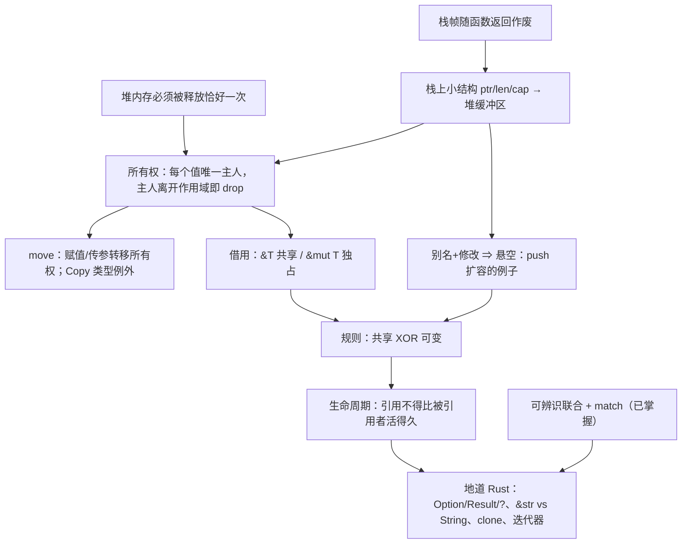

> [!quote] YOU

> [!note] SKILL loaded: teach

告诉我如何使用 rust 编程


> [!abstract] PI

先弄清楚你想用 Rust 做什么，再看你现有的基础，然后才开始讲。


> [!question] Question
> 你学 Rust 主要想做到什么？
>
> 1. 理解 Rust 的核心思想（所有权、借用、生命周期），能读懂和写出地道的 Rust 代码
> 2. 尽快上手做一个具体的东西（命令行工具、Web 后端等）
> 3. 系统编程或性能敏感的场景（替代 C/C++）
> 4. 先大致了解 Rust 是什么、好在哪里，判断值不值得学


> [!example] Answer
> 1. 理解 Rust 的核心思想（所有权、借用、生命周期），能读懂和写出地道的 Rust 代码


> [!question] Question
> 你目前最熟的编程语言是哪些？
>
> 1. Python / JavaScript / TypeScript
> 2. Java / C# / Go
> 3. C / C++
> 4. Haskell / OCaml / Scala 这类函数式语言
> 5. 基本没写过代码


> [!example] Answer
> 1. Python / JavaScript / TypeScript
> 2. Java / C# / Go


> [!abstract] PI

好，你写过带垃圾回收的语言。下面几道题帮我找到你的基础到哪里为止，不会也没关系。


> [!question] Quiz
> 在 Python 里执行 `a = [1, 2, 3]; b = a; b.append(4)` 之后，`a` 是什么？
>
> 1. [1, 2, 3, 4]
> 2. [1, 2, 3]
> 3. 报错，因为 a 已经被移交给 b


> [!success] Quiz — correct ✓
> Your answer: 1. [1, 2, 3, 4]
> Correct answer: 1
>
> `b = a` 不会复制列表，只是让 b 指向和 a 同一个堆上的对象。两个名字指向同一份数据，所以通过 b 改，a 也能看到。这种“多个名字同时指向、同时修改同一份数据”的情况叫别名（aliasing），后面讲 Rust 时它是核心问题。


> [!abstract] PI

Floor established. Jump up sharply.


> [!question] Quiz
> 在 Java / Go 这类有 GC 的语言里，一个堆上的对象什么时候可以被回收？
>
> 1. 当最后一个使用它的线程结束时
> 2. 当它的引用变量被重新赋值时
> 3. 当程序中不再有任何可达的引用指向它时
> 4. 当创建它的那个函数返回时


> [!success] Quiz — correct ✓
> Your answer: 3. 当程序中不再有任何可达的引用指向它时
> Correct answer: 3
>
> GC 判断的是可达性：从根（栈上的变量、全局变量等）出发顺着引用走，走不到的对象才算垃圾。函数返回不算，因为对象可能已经被返回出去或者存进了别处；变量被重新赋值也不一定算，因为可能还有其他引用指着它。这件事要等到运行时才能判断，所以 GC 必须在程序运行时去扫描。


> [!question] Quiz
> 在 C 这种没有 GC、需要手动 `free` 的语言里，下面哪个 bug 是“对同一块内存 free 两次”？
>
> 1. use-after-free
> 2. memory leak
> 3. double free
> 4. data race


> [!success] Quiz — correct ✓
> Your answer: 3. double free
> Correct answer: 3
>
> double free：同一块内存释放了两次。use-after-free：释放之后又去读写它。memory leak：一直没释放。data race：多个线程同时访问同一数据，且至少一个在写、又没有同步。前两个都是“谁负责释放、什么时候释放”没讲清楚导致的，Rust 的所有权就是为了解决这个问题。


> [!question] Quiz
> 在 C++ 里，`int* p = &v[0];` 拿到 vector 第一个元素的指针，然后执行 `v.push_back(42);`。这时 `p` 最可能怎么样？
>
> 1. 编译器会报错，禁止在持有指针时修改 v
> 2. p 会自动更新，指向元素在新内存里的位置
> 3. p 可能变成悬空指针，因为扩容时元素可能被搬到新的内存
> 4. p 仍然有效，因为 v 这个对象本身没有被释放


> [!failure] Quiz — incorrect ✗
> Your answer: 4. p 仍然有效，因为 v 这个对象本身没有被释放
> Correct answer: 3
>
> vector 的元素存放在堆上的一块连续缓冲区里。容量不够时，push_back 会申请一块更大的缓冲区，把元素复制过去，再释放旧的缓冲区。p 仍然指向旧地址，于是变成悬空指针，之后使用它就是 use-after-free。C++ 编译器不会拦你。这里同时发生了两件事：一个名字（p）在读，另一个名字（v）在改，这就是别名加修改。Rust 的借用规则恰好在编译期禁止这种组合。


> [!abstract] PI

找到一个边界了。再问一题，确认问题出在哪一层：


> [!question] Quiz
> 一个动态数组（C++ 的 `vector`、Go 的 slice、Rust 的 `Vec`）在内存里通常是什么样子？
>
> 1. 一个链表，每个元素各自分配在堆上、互相链接
> 2. 一个小结构（指针 + 长度 + 容量），指针指向堆上存元素的缓冲区
> 3. 所有元素直接存在变量所在的位置，扩容时就地变大


> [!failure] Quiz — incorrect ✗
> Your answer: 1. 一个链表，每个元素各自分配在堆上、互相链接
> Correct answer: 2
>
> 变量 v 本身只是一个固定大小的小结构，包含指向堆缓冲区的指针、长度和容量。元素放在堆上那块连续的缓冲区里。扩容时，v 的地址不变，但它内部的指针会改指一块新的缓冲区，旧缓冲区被释放。上一题的关键就在这里：v 还活着，不代表它的元素还在原来的地址。


> [!question] Quiz
> 函数里的局部变量（比如 `let x: i32 = 5`）一般存在哪里？函数返回后它会怎样？
>
> 1. 存在堆上，函数返回时由编译器插入 free 释放
> 2. 存在堆上，函数返回后等垃圾回收器来清理
> 3. 存在栈上，函数返回后仍然保留到程序结束
> 4. 存在栈上，函数返回时连同整个栈帧自动作废


> [!success] Quiz — correct ✓
> Your answer: 4. 存在栈上，函数返回时连同整个栈帧自动作废
> Correct answer: 4
>
> 每次调用函数，都会在栈上压入一个栈帧，局部变量就放在里面。函数返回时，整个栈帧直接作废，不需要任何回收逻辑，所以很快。代价是生命期固定：数据活不过创建它的那个函数调用。大小在运行时才确定、或者需要比函数活得更久的数据就放到堆上，堆上的数据得有人负责释放。


> [!abstract] PI

栈的概念你掌握了，没掌握的是“栈上的变量指向堆上的数据”这种结构。最后再探两条后面写地道 Rust 要用到的基础：


> [!question] Quiz
> TypeScript 里有 `type Shape = {kind: "circle", r: number} | {kind: "rect", w: number, h: number}`。对 `kind` 做 `switch` 时，在 `case "circle"` 分支里能访问 `shape.r`，原因是？
>
> 1. 编译器根据 kind 的值把类型收窄到了 circle 那个变体
> 2. 运行时会检查 r 是否存在，不存在就返回 undefined
> 3. 联合类型把所有变体的字段合并了，哪个分支都能访问 r


> [!success] Quiz — correct ✓
> Your answer: 1. 编译器根据 kind 的值把类型收窄到了 circle 那个变体
> Correct answer: 1
>
> 这叫可辨识联合（discriminated union）。编译器看到 `kind === "circle"`，就知道在这个分支里 shape 只可能是 circle 变体，所以允许访问 r。Rust 的 `enum` 加 `match` 是同一个思路，而且更严格：match 必须覆盖所有变体，漏掉一个就编译不过。Rust 用 `Option` 代替 null、用 `Result` 代替异常，靠的都是这个机制。


> [!abstract] PI

subagent 用不了（需要 tmux），只能我自己核对。下面用到的事实（Rust Book 第 4、8、10 章的所有权三规则、借用规则、`v.push` 报错 E0502、NLL）都是 Rust 最核心、最稳定的内容，我有把握。如果哪里需要逐字核对原文，你在 tmux 里启动 pi 后我再派 researcher 去查。

## 教学计划

**思路。** Rust 的所有规则都在回答同一个问题：**不用 GC，怎么在编译期就保证堆内存被释放且只被释放一次，并且释放之后没人再去用它？** 你熟悉 GC 的做法（运行时看可达性），所以我们从你缺的那一块开始：栈上的小结构指向堆上的缓冲区。再让你自己推出来：既然没有 GC，每块堆内存就得有唯一一个负责释放的主人（**所有权**）；主人可以交接（**move**）；想用但不想接手，就只能借（**借用**）；借的时候不能有人同时在改（**共享 XOR 可变**，正好防住你刚才错的那题）；编译器要能证明借来的东西没有活得比主人久（**生命周期**）。最后讲地道写法：`Option`/`Result` + `match` + `?`、`&str` 和 `String` 怎么选、什么时候用 `clone`、迭代器。这部分可以直接借用你已经懂的可辨识联合。

每一步尽量用提问的方式让你自己推出来。你给出推导之后，我再给对应的 Rust 代码和编译器报错来印证。



**根节点：**
- A 你已经确认过。
- B 是这节课的出发点：堆内存只释放 0 次是泄漏，释放 2 次是 double free，你也认得这些 bug。
- C 是你缺的那一块，所以第一课就从 C 讲起。

计划这样可以吗？想调整范围或顺序的话现在说，确认后我就从 C 开始讲。


> [!quote] YOU

好的从C开始


> [!abstract] PI

## 节点 C：栈上的小结构 → 堆上的缓冲区

**为什么需要它？** 后面的所有权、借用、生命周期，管的都是**堆上的那块内存**，以及**谁手里拿着指向它的指针**。这个画面不清楚，后面的规则看起来就会很随意。所以我们先把它推出来。

**你已经知道的：** 局部变量放在栈帧里，函数返回时整个栈帧一起作废。

现在考虑一个问题。你写：

```rust
let mut v = Vec::new();   // 空的动态数组
v.push(1);
v.push(2);
// ……可能 push 3 个，也可能 300 万个，取决于运行时的输入
```

最直接的想法是把元素就放在 `v` 所在的栈帧里。先想一下这样做有什么问题：


> [!question] Quiz
> 为什么动态数组的元素不能直接放在栈帧里？
>
> 1. 栈上的内存只能读不能写，元素却需要被修改
> 2. 栈上的数据只有当前线程能看到，元素却需要共享
> 3. 栈帧大小在编译期就固定了，元素个数却到运行时才知道
> 4. 栈上只能存整数和指针，元素却可能是任意类型


> [!success] Quiz — correct ✓
> Your answer: 3. 栈帧大小在编译期就固定了，元素个数却到运行时才知道
> Correct answer: 3
>
> 编译器生成函数代码时，就已经算好了栈帧多大、每个局部变量在帧里的哪个偏移位置。v 在帧里只能占一块固定大小的格子，而元素数量要到运行时才知道，可能是 3 个，也可能是 300 万个。所以元素只能放到一个大小可以在运行时决定的地方，也就是堆。栈本身是可读写的，什么类型都能放，所以另外两个理由不对；线程共享那条和这个问题无关。


> [!question] Quiz
> 要支持上面三个操作，v 那个固定大小的格子里至少需要存哪些字段？（多选）
>
> 1. 每个元素各自的堆地址列表
> 2. 当前缓冲区最多能容纳的元素个数
> 3. 指向上一块旧缓冲区的指针
> 4. 当前已存放的元素个数
> 5. 指向堆上缓冲区起始位置的指针


> [!success] Quiz — correct ✓
> Your answer: 2. 当前缓冲区最多能容纳的元素个数, 4. 当前已存放的元素个数, 5. 指向堆上缓冲区起始位置的指针
> Correct answer: 2, 4, 5
>
> ptr：元素在一块连续缓冲区里，所以第 i 个元素的地址是 ptr + i × 元素大小，有起始地址就够了，不用为每个元素单独存地址（单独存地址的那种结构其实就是你上次选的链表）。len：告诉你现在有几个元素、哪些下标合法、push 应该写到哪个位置。cap：告诉你缓冲区什么时候满了、需要换更大的。这三个字段都是固定大小，在 64 位机器上各占 8 字节，一共 24 字节，无论元素有多少个。旧缓冲区的指针不用留：扩容时把元素复制到新缓冲区，旧的立刻释放掉。


> [!question] Quiz
> v 当前 len = 2、cap = 2。有人保存了 p = &v[1]，然后执行 v.push(9)。下面哪个说法正确？
>
> 1. v 的栈地址不变，v.ptr 改指新缓冲区，p 被自动更新到新位置
> 2. v 的栈地址不变，v.ptr 也不变，缓冲区就地变大，p 仍有效
> 3. v 整个被搬到新的栈地址，v.ptr 不变，p 指向的元素仍有效
> 4. v 的栈地址不变，v.ptr 改指新缓冲区，p 指向已释放的内存
