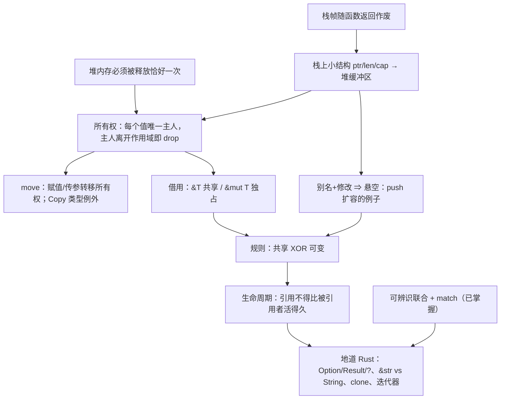
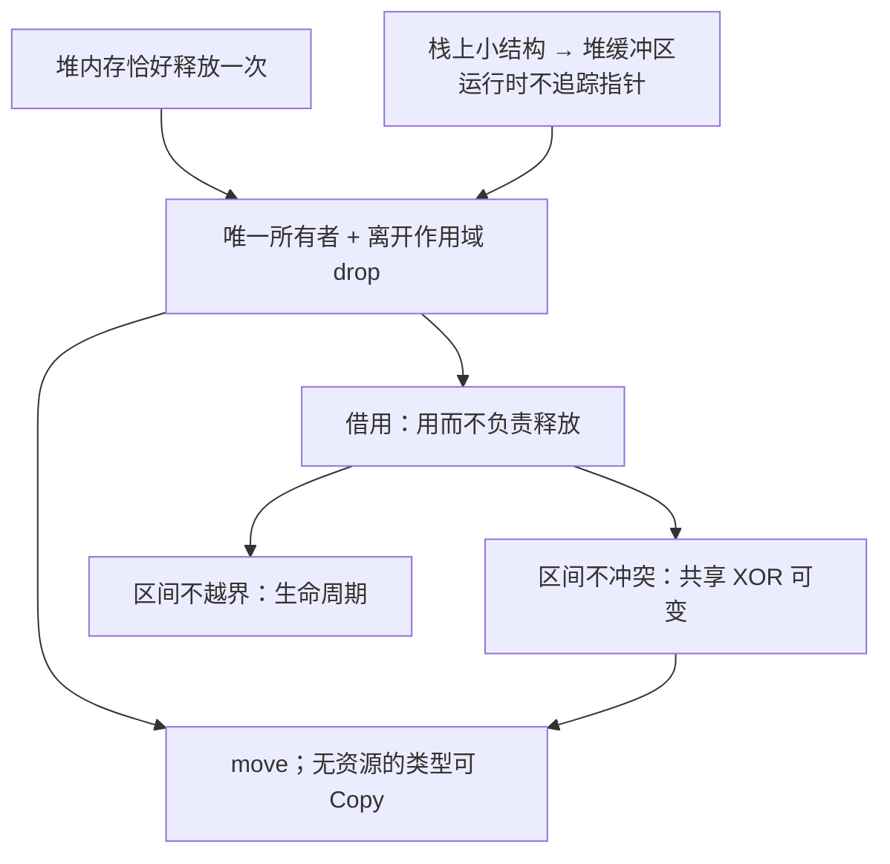
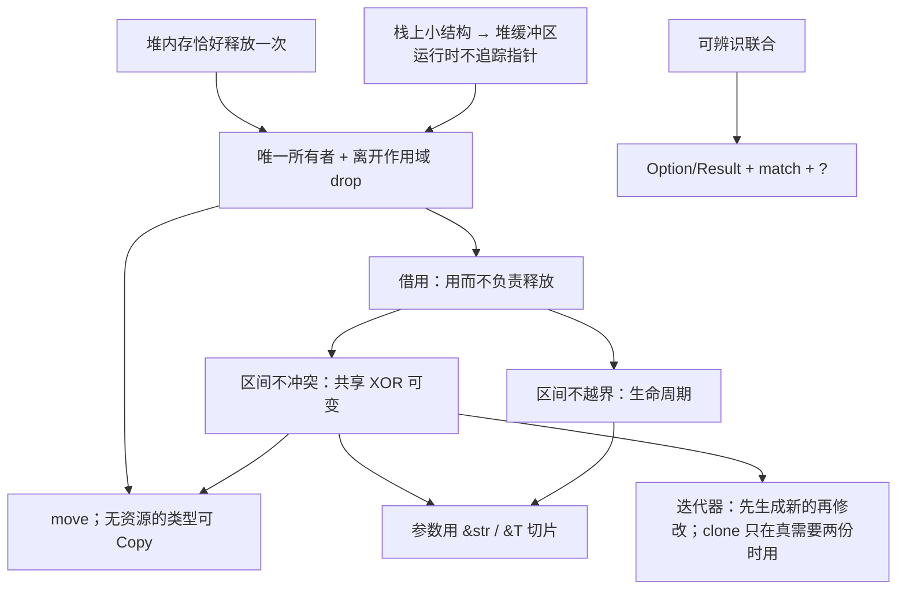

> [!quote] YOU

> [!note] SKILL loaded: teach

告诉我如何使用 rust 编程


> [!abstract] PI

先弄清楚你想用 Rust 做什么，再看你现有的基础，然后才开始讲。


> [!question] Question
> 你学 Rust 主要想做到什么？
>
> 1. 理解 Rust 的核心思想（所有权、借用、生命周期），能读懂和写出地道的 Rust 代码
> 2. 尽快上手做一个具体的东西（命令行工具、Web 后端等）
> 3. 系统编程或性能敏感的场景（替代 C/C++）
> 4. 先大致了解 Rust 是什么、好在哪里，判断值不值得学


> [!example] Answer
> 1. 理解 Rust 的核心思想（所有权、借用、生命周期），能读懂和写出地道的 Rust 代码


> [!question] Question
> 你目前最熟的编程语言是哪些？
>
> 1. Python / JavaScript / TypeScript
> 2. Java / C# / Go
> 3. C / C++
> 4. Haskell / OCaml / Scala 这类函数式语言
> 5. 基本没写过代码


> [!example] Answer
> 1. Python / JavaScript / TypeScript
> 2. Java / C# / Go


> [!abstract] PI

好，你写过带垃圾回收的语言。下面几道题帮我找到你的基础到哪里为止，不会也没关系。


> [!question] Quiz
> 在 Python 里执行 `a = [1, 2, 3]; b = a; b.append(4)` 之后，`a` 是什么？
>
> 1. [1, 2, 3, 4]
> 2. [1, 2, 3]
> 3. 报错，因为 a 已经被移交给 b


> [!success] Quiz — correct ✓
> Your answer: 1. [1, 2, 3, 4]
> Correct answer: 1
>
> `b = a` 不会复制列表，只是让 b 指向和 a 同一个堆上的对象。两个名字指向同一份数据，所以通过 b 改，a 也能看到。这种“多个名字同时指向、同时修改同一份数据”的情况叫别名（aliasing），后面讲 Rust 时它是核心问题。


> [!abstract] PI

Floor established. Jump up sharply.


> [!question] Quiz
> 在 Java / Go 这类有 GC 的语言里，一个堆上的对象什么时候可以被回收？
>
> 1. 当最后一个使用它的线程结束时
> 2. 当它的引用变量被重新赋值时
> 3. 当程序中不再有任何可达的引用指向它时
> 4. 当创建它的那个函数返回时


> [!success] Quiz — correct ✓
> Your answer: 3. 当程序中不再有任何可达的引用指向它时
> Correct answer: 3
>
> GC 判断的是可达性：从根（栈上的变量、全局变量等）出发顺着引用走，走不到的对象才算垃圾。函数返回不算，因为对象可能已经被返回出去或者存进了别处；变量被重新赋值也不一定算，因为可能还有其他引用指着它。这件事要等到运行时才能判断，所以 GC 必须在程序运行时去扫描。


> [!question] Quiz
> 在 C 这种没有 GC、需要手动 `free` 的语言里，下面哪个 bug 是“对同一块内存 free 两次”？
>
> 1. use-after-free
> 2. memory leak
> 3. double free
> 4. data race


> [!success] Quiz — correct ✓
> Your answer: 3. double free
> Correct answer: 3
>
> double free：同一块内存释放了两次。use-after-free：释放之后又去读写它。memory leak：一直没释放。data race：多个线程同时访问同一数据，且至少一个在写、又没有同步。前两个都是“谁负责释放、什么时候释放”没讲清楚导致的，Rust 的所有权就是为了解决这个问题。


> [!question] Quiz
> 在 C++ 里，`int* p = &v[0];` 拿到 vector 第一个元素的指针，然后执行 `v.push_back(42);`。这时 `p` 最可能怎么样？
>
> 1. 编译器会报错，禁止在持有指针时修改 v
> 2. p 会自动更新，指向元素在新内存里的位置
> 3. p 可能变成悬空指针，因为扩容时元素可能被搬到新的内存
> 4. p 仍然有效，因为 v 这个对象本身没有被释放


> [!failure] Quiz — incorrect ✗
> Your answer: 4. p 仍然有效，因为 v 这个对象本身没有被释放
> Correct answer: 3
>
> vector 的元素存放在堆上的一块连续缓冲区里。容量不够时，push_back 会申请一块更大的缓冲区，把元素复制过去，再释放旧的缓冲区。p 仍然指向旧地址，于是变成悬空指针，之后使用它就是 use-after-free。C++ 编译器不会拦你。这里同时发生了两件事：一个名字（p）在读，另一个名字（v）在改，这就是别名加修改。Rust 的借用规则恰好在编译期禁止这种组合。


> [!abstract] PI

找到一个边界了。再问一题，确认问题出在哪一层：


> [!question] Quiz
> 一个动态数组（C++ 的 `vector`、Go 的 slice、Rust 的 `Vec`）在内存里通常是什么样子？
>
> 1. 一个链表，每个元素各自分配在堆上、互相链接
> 2. 一个小结构（指针 + 长度 + 容量），指针指向堆上存元素的缓冲区
> 3. 所有元素直接存在变量所在的位置，扩容时就地变大


> [!failure] Quiz — incorrect ✗
> Your answer: 1. 一个链表，每个元素各自分配在堆上、互相链接
> Correct answer: 2
>
> 变量 v 本身只是一个固定大小的小结构，包含指向堆缓冲区的指针、长度和容量。元素放在堆上那块连续的缓冲区里。扩容时，v 的地址不变，但它内部的指针会改指一块新的缓冲区，旧缓冲区被释放。上一题的关键就在这里：v 还活着，不代表它的元素还在原来的地址。


> [!question] Quiz
> 函数里的局部变量（比如 `let x: i32 = 5`）一般存在哪里？函数返回后它会怎样？
>
> 1. 存在堆上，函数返回时由编译器插入 free 释放
> 2. 存在堆上，函数返回后等垃圾回收器来清理
> 3. 存在栈上，函数返回后仍然保留到程序结束
> 4. 存在栈上，函数返回时连同整个栈帧自动作废


> [!success] Quiz — correct ✓
> Your answer: 4. 存在栈上，函数返回时连同整个栈帧自动作废
> Correct answer: 4
>
> 每次调用函数，都会在栈上压入一个栈帧，局部变量就放在里面。函数返回时，整个栈帧直接作废，不需要任何回收逻辑，所以很快。代价是生命期固定：数据活不过创建它的那个函数调用。大小在运行时才确定、或者需要比函数活得更久的数据就放到堆上，堆上的数据得有人负责释放。


> [!abstract] PI

栈的概念你掌握了，没掌握的是“栈上的变量指向堆上的数据”这种结构。最后再探两条后面写地道 Rust 要用到的基础：


> [!question] Quiz
> TypeScript 里有 `type Shape = {kind: "circle", r: number} | {kind: "rect", w: number, h: number}`。对 `kind` 做 `switch` 时，在 `case "circle"` 分支里能访问 `shape.r`，原因是？
>
> 1. 编译器根据 kind 的值把类型收窄到了 circle 那个变体
> 2. 运行时会检查 r 是否存在，不存在就返回 undefined
> 3. 联合类型把所有变体的字段合并了，哪个分支都能访问 r


> [!success] Quiz — correct ✓
> Your answer: 1. 编译器根据 kind 的值把类型收窄到了 circle 那个变体
> Correct answer: 1
>
> 这叫可辨识联合（discriminated union）。编译器看到 `kind === "circle"`，就知道在这个分支里 shape 只可能是 circle 变体，所以允许访问 r。Rust 的 `enum` 加 `match` 是同一个思路，而且更严格：match 必须覆盖所有变体，漏掉一个就编译不过。Rust 用 `Option` 代替 null、用 `Result` 代替异常，靠的都是这个机制。


> [!abstract] PI

subagent 用不了（需要 tmux），只能我自己核对。下面用到的事实（Rust Book 第 4、8、10 章的所有权三规则、借用规则、`v.push` 报错 E0502、NLL）都是 Rust 最核心、最稳定的内容，我有把握。如果哪里需要逐字核对原文，你在 tmux 里启动 pi 后我再派 researcher 去查。

## 教学计划

**思路。** Rust 的所有规则都在回答同一个问题：**不用 GC，怎么在编译期就保证堆内存被释放且只被释放一次，并且释放之后没人再去用它？** 你熟悉 GC 的做法（运行时看可达性），所以我们从你缺的那一块开始：栈上的小结构指向堆上的缓冲区。再让你自己推出来：既然没有 GC，每块堆内存就得有唯一一个负责释放的主人（**所有权**）；主人可以交接（**move**）；想用但不想接手，就只能借（**借用**）；借的时候不能有人同时在改（**共享 XOR 可变**，正好防住你刚才错的那题）；编译器要能证明借来的东西没有活得比主人久（**生命周期**）。最后讲地道写法：`Option`/`Result` + `match` + `?`、`&str` 和 `String` 怎么选、什么时候用 `clone`、迭代器。这部分可以直接借用你已经懂的可辨识联合。

每一步尽量用提问的方式让你自己推出来。你给出推导之后，我再给对应的 Rust 代码和编译器报错来印证。



**根节点：**
- A 你已经确认过。
- B 是这节课的出发点：堆内存只释放 0 次是泄漏，释放 2 次是 double free，你也认得这些 bug。
- C 是你缺的那一块，所以第一课就从 C 讲起。

计划这样可以吗？想调整范围或顺序的话现在说，确认后我就从 C 开始讲。


> [!quote] YOU

好的从C开始


> [!abstract] PI

## 节点 C：栈上的小结构 → 堆上的缓冲区

**为什么需要它？** 后面的所有权、借用、生命周期，管的都是**堆上的那块内存**，以及**谁手里拿着指向它的指针**。这个画面不清楚，后面的规则看起来就会很随意。所以我们先把它推出来。

**你已经知道的：** 局部变量放在栈帧里，函数返回时整个栈帧一起作废。

现在考虑一个问题。你写：

```rust
let mut v = Vec::new();   // 空的动态数组
v.push(1);
v.push(2);
// ……可能 push 3 个，也可能 300 万个，取决于运行时的输入
```

最直接的想法是把元素就放在 `v` 所在的栈帧里。先想一下这样做有什么问题：


> [!question] Quiz
> 为什么动态数组的元素不能直接放在栈帧里？
>
> 1. 栈上的内存只能读不能写，元素却需要被修改
> 2. 栈上的数据只有当前线程能看到，元素却需要共享
> 3. 栈帧大小在编译期就固定了，元素个数却到运行时才知道
> 4. 栈上只能存整数和指针，元素却可能是任意类型


> [!success] Quiz — correct ✓
> Your answer: 3. 栈帧大小在编译期就固定了，元素个数却到运行时才知道
> Correct answer: 3
>
> 编译器生成函数代码时，就已经算好了栈帧多大、每个局部变量在帧里的哪个偏移位置。v 在帧里只能占一块固定大小的格子，而元素数量要到运行时才知道，可能是 3 个，也可能是 300 万个。所以元素只能放到一个大小可以在运行时决定的地方，也就是堆。栈本身是可读写的，什么类型都能放，所以另外两个理由不对；线程共享那条和这个问题无关。


> [!question] Quiz
> 要支持上面三个操作，v 那个固定大小的格子里至少需要存哪些字段？（多选）
>
> 1. 每个元素各自的堆地址列表
> 2. 当前缓冲区最多能容纳的元素个数
> 3. 指向上一块旧缓冲区的指针
> 4. 当前已存放的元素个数
> 5. 指向堆上缓冲区起始位置的指针


> [!success] Quiz — correct ✓
> Your answer: 2. 当前缓冲区最多能容纳的元素个数, 4. 当前已存放的元素个数, 5. 指向堆上缓冲区起始位置的指针
> Correct answer: 2, 4, 5
>
> ptr：元素在一块连续缓冲区里，所以第 i 个元素的地址是 ptr + i × 元素大小，有起始地址就够了，不用为每个元素单独存地址（单独存地址的那种结构其实就是你上次选的链表）。len：告诉你现在有几个元素、哪些下标合法、push 应该写到哪个位置。cap：告诉你缓冲区什么时候满了、需要换更大的。这三个字段都是固定大小，在 64 位机器上各占 8 字节，一共 24 字节，无论元素有多少个。旧缓冲区的指针不用留：扩容时把元素复制到新缓冲区，旧的立刻释放掉。


> [!question] Quiz
> v 当前 len = 2、cap = 2。有人保存了 p = &v[1]，然后执行 v.push(9)。下面哪个说法正确？
>
> 1. v 的栈地址不变，v.ptr 改指新缓冲区，p 被自动更新到新位置
> 2. v 的栈地址不变，v.ptr 也不变，缓冲区就地变大，p 仍有效
> 3. v 整个被搬到新的栈地址，v.ptr 不变，p 指向的元素仍有效
> 4. v 的栈地址不变，v.ptr 改指新缓冲区，p 指向已释放的内存


> [!failure] Quiz — incorrect ✗
> Your answer: 1. v 的栈地址不变，v.ptr 改指新缓冲区，p 被自动更新到新位置
> Correct answer: 4
>
> len == cap，所以这次 push 会扩容：申请新缓冲区、复制元素、释放旧缓冲区、更新 v.ptr 和 cap。v 在栈帧里的格子位置是编译期定好的，不会移动。p 只是一个裸地址，没有任何东西会去通知它或更新它，所以它现在指向已经释放的内存。（就地变大在某些分配器里确实可能发生，但不能依赖，一般默认会搬走。）这正是 Rust 要在编译期禁止的情况：手里有 p 的时候，不允许通过 v 修改。


> [!question] Quiz
> 在没有 GC 的程序里，`v.push` 扩容后为什么不能把旧指针 p 更新到新地址？
>
> 1. 新缓冲区里元素的排列顺序和旧缓冲区不同
> 2. 运行时没有任何东西记录哪些指针指向了这块缓冲区
> 3. 堆内存一旦分配就不允许再写入新的地址值
> 4. 指针是只读变量，创建之后就不能再修改


> [!success] Quiz — correct ✓
> Your answer: 2. 运行时没有任何东西记录哪些指针指向了这块缓冲区
> Correct answer: 2
>
> 要更新 p，得先知道 p 在哪儿。没有 GC 时，运行时不会记录“谁指向了这块内存”，push 的代码只看得到 v 自己的字段。Java 的 GC 能更新引用，正是因为它追踪了所有引用，这是它的运行时成本。Rust 不想付这个成本，所以改成在编译期禁止“有人借着 v 的元素时修改 v”。元素顺序在扩容时不变，指针变量本身也可以修改，所以另外两个理由都不对。


> [!abstract] PI

节点 C 讲完了。用两句话概括：

1. **`Vec`/`String` = 栈上固定 24 字节（ptr, len, cap）+ 堆上的缓冲区。** 两者的地址各变各的。
2. **没有 GC，就没人追踪指针。** 缓冲区一换，旧指针就悬空了，也没人会去修正它。

两个根节点现在都有了：
- **B**：堆内存必须恰好释放一次
- **C**：栈上的那个小结构是通往堆内存的唯一入口

下一个节点 **D：所有权**，就是从这两点推出来的。我会先问你一个问题：*函数返回、`v` 那 24 字节随栈帧作废的时候，堆上的缓冲区该由谁来释放？如果 `let w = v;` 复制出了第二份 ptr，又会出什么问题？*

现在继续讲 D 吗？


> [!quote] YOU

继续讲 D


> [!abstract] PI

## 节点 D：所有权

**为什么需要它？** 根节点 B 要求堆缓冲区恰好释放一次，0 次是泄漏，2 次是 double free。Rust 没有 GC，所以必须**有一段确定的代码，在一个确定的时刻**去释放它。我们来找这个时刻。

```rust
fn f() {
    let v = vec![1, 2, 3];   // 栈上 24 字节 + 堆上缓冲区
    // ……用 v ……
}   // ← 函数返回，栈帧作废
```

函数返回时，栈上那 24 字节会自动作废，但堆上的缓冲区**不会**。栈帧作废只是“这块栈空间不要了”，没有任何代码会顺着 ptr 去释放堆。


> [!question] Quiz
> 在没有 GC 的前提下，释放 v 的堆缓冲区最自然、开销最小的时机是什么？
>
> 1. 当 v 离开作用域、它的栈格子即将作废时，顺着 ptr 释放
> 2. 程序结束时，由操作系统一次性回收所有堆内存
> 3. 当 v 最后一次被修改之后，立刻顺着 ptr 释放
> 4. 定期扫描堆，释放那些已经没有变量指向的缓冲区


> [!success] Quiz — correct ✓
> Your answer: 1. 当 v 离开作用域、它的栈格子即将作废时，顺着 ptr 释放
> Correct answer: 1
>
> v 的栈格子是通往缓冲区的唯一入口。格子作废以后，就再也没人知道缓冲区在哪儿了，所以必须在格子作废之前释放，也就是离开作用域的时候。这个时刻编译器在编译期就知道（在 `}` 处），所以它可以直接在那里插入一行释放代码，运行时零额外开销。Rust 把这一步叫 drop。“等到程序结束”就是内存泄漏；“定期扫描”就是 GC；“最后一次修改之后”是错的，因为修改完以后可能还要读。


> [!question] Quiz
> 按“离开作用域就顺着 ptr 释放”这条规则，函数在 } 处会发生什么？
>
> 1. w 释放缓冲区，v 发现已被释放于是跳过，一切正常
> 2. w 释放缓冲区，v 再释放同一块缓冲区，造成 double free
> 3. 只有先声明的 v 释放缓冲区，w 作为副本什么都不做
> 4. 两个变量都不释放，因为缓冲区还被对方引用着，造成泄漏


> [!failure] Quiz — incorrect ✗
> Your answer: 3. 只有先声明的 v 释放缓冲区，w 作为副本什么都不做
> Correct answer: 2
>
> 规则很机械：每个变量离开作用域时都顺着自己的 ptr 去释放。v 和 w 的 ptr 是同一个地址，所以同一块缓冲区会被释放两次，这就是 double free。“发现已被释放于是跳过”需要运行时记录状态；“还被对方引用所以不释放”需要知道有几个引用指着它，其实就是引用计数。这两种都要额外的运行时机制。“副本什么都不做”的问题在于，两份 24 字节完全一样，凭什么区分哪个是副本？必须有一条规则来区分。


> [!question] Quiz
> 如果规定“先声明的 v 负责释放，w 只是不负责的副本”，main 里使用 x 时会怎样？
>
> 1. x 指向的缓冲区会被释放两次，分别由 v 和 x 释放
> 2. x 指向的缓冲区已在 make 返回时被 v 释放，x 悬空
> 3. x 指向的缓冲区仍然有效，因为 w 已经把它返回出去了


> [!success] Quiz — correct ✓
> Your answer: 2. x 指向的缓冲区已在 make 返回时被 v 释放，x 悬空
> Correct answer: 2
>
> v 是负责人，它在 make 的 } 处离开作用域，于是释放缓冲区。w 和 x 只是副本，不负责释放，但它们的 ptr 仍指着那块已经被释放的内存。所以 main 里的 x 是悬空的，再使用就是 use-after-free。问题在于：数据流向了 w，负责人却还是 v，责任没有跟着数据走。


> [!question] Quiz
> 责任转交给 w 之后，要在不增加任何运行时开销的前提下杜绝上面的 bug，对 v 最合理的处理是？
>
> 1. 赋值时把堆缓冲区也复制一份，让 v 和 w 各自拥有独立的缓冲区
> 2. 给缓冲区加一个计数器，记录有几个变量指向它，归零时才释放
> 3. 编译器把 v 标记为已失效，之后任何对 v 的使用都报编译错误
> 4. 运行时把 v 的 ptr 置为 null，之后使用 v 时先检查是否为 null


> [!success] Quiz — correct ✓
> Your answer: 3. 编译器把 v 标记为已失效，之后任何对 v 的使用都报编译错误
> Correct answer: 3
>
> 编译器在编译期就知道 `let w = v` 这一行在哪儿，所以它可以禁止这之后对 v 的任何使用，同时也不在 v 离开作用域时插入释放代码。这一切都在编译期完成，运行时零开销。这就是 move（移动）。另外三个方案都要付运行时代价：置 null 加检查，每次访问都要多一次判断；深拷贝要复制整个堆缓冲区；引用计数要维护计数器。Rust 里其实这三种都能用，分别对应 Option、.clone()、Rc，但都必须你显式写出来，默认行为是零开销的 move。


> [!question] Quiz
> 这段代码的结果是什么？
>
> 1. 正常打印 3 和 3：传参时自动深拷贝了一份缓冲区给 s
> 2. 正常打印 3 和 3：传参只是临时借给函数，返回后 v 仍可用
> 3. 编译错误：v 在传给 consume 时已被 move，之后不能再用
> 4. 运行时崩溃：consume 返回时 s 释放了缓冲区，v 悬空


> [!warning] Quiz — cancelled
> (user skipped)


> [!abstract] PI

这道题先放下。节点 D 的核心已经推出来了：

- **所有权三规则**：每个值有一个所有者；同一时刻只能有一个；所有者离开作用域就 drop。
- **move**：赋值、传参、返回都会转移所有权。转移之后旧变量失效，编译期就会拦截，运行时零开销。

刚才那道题考的是：`consume(v)` 之后再用 `v` 会编译报错（E0382），因为传参和 `let s = v` 一样会发生 move。想“临时借给函数”，要写 `consume(&v)`，这就是下一个节点 **F：借用**。

你想现在继续讲 E/F，还是先停在这里？


> [!quote] YOU

完整的代码是什么


> [!abstract] PI

下面两段代码我都用本机的 `rustc` 实际编译、运行过。

## 1. 刚才那道题的代码（编译不过）

`bad.rs`：
```rust
fn consume(s: Vec<i32>) {
    println!("{}", s.len());
}

fn main() {
    let v = vec![1, 2, 3];
    consume(v);              // 所有权从 v 移到了 s
    println!("{}", v.len()); // ← v 已失效
}
```

`rustc bad.rs` 的真实输出：
```
error[E0382]: borrow of moved value: `v`
 --> bad.rs:8:20
  |
6 |     let v = vec![1, 2, 3];
  |         - move occurs because `v` has type `Vec<i32>`, which does not implement the `Copy` trait
7 |     consume(v);
  |             - value moved here
8 |     println!("{}", v.len());
  |                    ^ value borrowed here after move
  |
note: consider changing this parameter type in function `consume` to borrow instead if owning the value isn't necessary
 --> bad.rs:1:15
  |
1 | fn consume(s: Vec<i32>) {
  |    -------    ^^^^^^^^ this parameter takes ownership of the value
help: consider cloning the value if the performance cost is acceptable
  |
7 |     consume(v.clone());
```

编译器给了两种修法：**借用**，或者 **clone**。它们就对应节点 D 那道题里被排除掉的几种方案。

## 2. 能编译的几种写法

`good.rs`：
```rust
// 写法 1：借用（不转移所有权）
fn inspect(s: &Vec<i32>) {
    println!("inspect: {}", s.len());
}

// 写法 2：拿走所有权，用完再还回来
fn take_and_give_back(s: Vec<i32>) -> Vec<i32> {
    println!("take: {}", s.len());
    s
}

// 原来的函数：拿走所有权，函数结束时 drop
fn consume(s: Vec<i32>) {
    println!("consume: {}", s.len());
}

fn main() {
    let v = vec![1, 2, 3];

    inspect(&v);                     // 借出去，v 仍是所有者
    println!("after inspect: {}", v.len());

    let v = take_and_give_back(v);   // 所有权出去又回来
    println!("after give back: {}", v.len());

    consume(v.clone());              // 深拷贝一份交出去，v 不受影响
    println!("after clone: {}", v.len());

    consume(v);                      // 真正交出所有权
    // println!("{}", v.len());      // 取消注释 → error[E0382]
}
```

运行输出：
```
inspect: 3
after inspect: 3
take: 3
after give back: 3
consume: 3
after clone: 3
consume: 3
```

要自己跑的话，把代码存成 `good.rs`，然后执行 `rustc good.rs && ./good`。

**三种写法对比：**
- **写法 2**（拿走再还回来）能用，但每个函数都得把值传回来，很啰嗦。
- **clone** 要复制整个堆缓冲区，有开销。
- **`&v` 借用**最常用，但它也有自己的规则：借出去的时候，别人能不能同时修改 `v`？这就回到了节点 C 里 `push` 让指针悬空的那个问题。这是下一个节点 **F**。

要继续讲 F 吗？


> [!quote] YOU

继续 F


> [!abstract] PI

## 节点 F：借用

**为什么需要它？** 上一段代码说明了：只想“用一下” `v`，却不得不交出所有权，要么还回来、要么 clone，都很笨。我们需要一种方式，**能访问值，但不承担释放责任**。

**`&v` 是什么？** 它是一个**指向 `v` 那 24 字节栈格子的指针**，叫作**引用**。注意它指向的是 `v` 本身，不是堆缓冲区。

```
  inspect 的栈帧            main 的栈帧                 堆
  ┌────────────┐          ┌──────────────┐          ┌───┬───┬───┐
  │ s ─────────┼────────▶ │ v: ptr ──────┼────────▶ │ 1 │ 2 │ 3 │
  └────────────┘          │    len=3     │          └───┴───┴───┘
                          │    cap=3     │
                          └──────────────┘
```

`s.len()` 的执行过程是：顺着 `s` 找到 `v`，读出 `v` 的 len。


> [!question] Quiz
> inspect(&v) 返回时，形参 s 离开作用域。按所有权规则，会发生什么？
>
> 1. 释放 v 的栈格子：s 离开作用域，把它指向的 24 字节作废
> 2. 什么都不释放：s 不是所有者，缓冲区仍由 v 负责
> 3. 把 v 标记为失效：借用结束后所有权归还给了 inspect
> 4. 释放堆缓冲区：s 离开作用域，顺着指针把数据 drop 掉


> [!success] Quiz — correct ✓
> Your answer: 2. 什么都不释放：s 不是所有者，缓冲区仍由 v 负责
> Correct answer: 2
>
> 规则 3 说的是“所有者离开作用域时 drop 值”。s 是引用，不是所有者，它离开作用域时只是自己那 8 字节的指针作废，不会去释放它指向的东西。缓冲区仍由 v 负责，在 main 结束时 drop。这就是引用的定义：能访问，不负责释放。v 的栈格子属于 main 的栈帧，只有 main 返回时才会作废，别人释放不了它。


> [!question] Quiz
> 如果 Rust 允许这段代码运行，println 那一行会遇到什么问题？
>
> 1. first 指向 v 的栈格子，而栈格子地址不变，所以读到的仍是 1
> 2. first 会被 push 自动更新到新缓冲区，所以读到的仍是 1
> 3. first 和 v 都是所有者，函数结束时会发生 double free
> 4. first 指向旧缓冲区，push 扩容时旧缓冲区已被释放，first 悬空


> [!warning] Quiz — cancelled
> (user skipped)


> [!question] Question
> 你连续跳过了两道题。接下来想怎么上课？
>
> 1. 少出题，每个节点最后只来一道确认题
> 2. 不要题，直接讲，多给可运行的代码和真实报错
> 3. 保持现在的节奏，刚才只是临时跳过
> 4. 改成让我自己写/改代码来练习


> [!example] Answer
> 1. 少出题，每个节点最后只来一道确认题


> [!quote] YOU

你的问题里面的这段代码要明确


> [!abstract] PI

明白了：之前的题目只写了“这段代码”，代码本身却在聊天正文里，答题界面上看不到。以后每道题都会把**完整代码**直接放进题目里。

## 节点 H：共享 XOR 可变

**为什么需要它？** 刚才看到的悬空问题有个固定的模式：**有人拿着引用在读，同时有人在改。** 改动（比如 `push` 扩容）可能让别人手里的引用失效。运行时又没人追踪引用，所以只能在编译期禁止这种组合。

从这一点出发，规则可以一条条推出来：

1. **多个人同时读，安全吗？** 安全。读不会改动任何东西，谁的引用都不会失效。所以 `&T` 可以有任意多个。
2. **有人在改的时候，别人能读吗？** 不能。改动可能让读的人手里的引用悬空（`first` 和 `push` 的例子）。
3. **两个人同时改呢？** 也不能。一方的改动同样可能让另一方的引用失效，比如一方触发扩容，另一方还拿着旧缓冲区的地址。

合起来就是：**任一时刻，要么有任意多个 `&T`，要么有恰好一个 `&mut T`。**

本机实测，两个 `&mut` 同时存在会报错：

```rust
fn main() {
    let mut v = vec![1, 2, 3];
    let m1 = &mut v;
    let m2 = &mut v;
    m1.push(4);
    m2.push(5);
}
```
```
error[E0499]: cannot borrow `v` as mutable more than once at a time
3 |     let m1 = &mut v;
  |              ------ first mutable borrow occurs here
4 |     let m2 = &mut v;
  |              ^^^^^^ second mutable borrow occurs here
5 |     m1.push(4);
  |     -- first borrow later used here
```

**还有一个关键细节：借用到“最后一次使用”就结束了，不是到 `}` 才结束**（这叫 NLL，非词法生命周期）。所以下面这段可以编译，本机实测输出 `3 1` 和 `1 [1, 2, 3, 4]`：

```rust
fn main() {
    let mut v = vec![1, 2, 3];

    let a = &v;
    let b = &v;
    println!("{} {}", a.len(), b[0]);   // a、b 最后一次使用，共享借用到此结束

    let first = v[0];                   // i32 是 Copy：复制出一个值，不是引用
    v.push(4);                          // 此时没有任何活着的借用，可以可变借用
    println!("{} {:?}", first, v);
}
```

注意两个报错信息里都有一句 **"later used here"**。编译器判断冲突的依据是：**在可变借用发生之后，那个旧的借用还会不会被用到。**

确认题：


> [!question] Quiz
> 下面这段代码能通过编译吗？
>
> ```rust
> fn main() {
>     let mut v = vec![1, 2, 3];
>     let first = &v[0];
>     println!("{}", first);
>     v.push(4);
>     println!("{:?}", v);
> }
> ```
>
> 1. 不能：只要创建过 &v[0]，v 就再也不能被修改
> 2. 不能：first 的借用持续到 main 的 } 为止，和 push 冲突
> 3. 能：push 扩容时会自动把 first 更新到新缓冲区
> 4. 能：first 最后一次使用在 push 之前，借用已经结束


> [!failure] Quiz — incorrect ✗
> Your answer: 1. 不能：只要创建过 &v[0]，v 就再也不能被修改
> Correct answer: 4
>
> 借用从创建开始，到最后一次使用为止（NLL）。first 最后一次使用是第一个 println，push 发生在那之后，此时已经没有活着的共享借用，所以和 &mut 不冲突，可以编译。规则要防的是“改动之后还有人拿着旧引用去用”，这里没有这种情况：push 之后 first 再也没被用过，就算它悬空了也无所谓，反正没人会去读它。first 也不会被自动更新，只是不再被使用而已。


> [!question] Quiz
> 下面这段代码的编译结果是什么？
>
> ```rust
> fn main() {
>     let mut v = vec![1, 2, 3];
>     let a = &v;
>     let b = &v;
>     println!("{}", a.len());
>     v.push(4);
>     println!("{}", b.len());
> }
> ```
>
> 1. 报错：a 和 b 两个共享借用同时存在，彼此冲突
> 2. 报错：a 的借用区间一直延伸到最后一行，覆盖了 push
> 3. 报错：b 的借用区间一直延伸到最后一行，覆盖了 push
> 4. 通过：a 在 push 之前已最后一次使用，借用均已结束


> [!success] Quiz — correct ✓
> Your answer: 3. 报错：b 的借用区间一直延伸到最后一行，覆盖了 push
> Correct answer: 3
>
> 每个借用各算各的区间。a 从第 3 行到第 5 行，在 push 之前就结束了，没有问题。b 从第 4 行一直到第 7 行，push 正好落在它的区间里，所以冲突。本机实测报错 E0502，编译器指向的正是 b：第 4 行“immutable borrow occurs here”，第 7 行“immutable borrow later used here”。a 和 b 同时存在没有问题，因为共享引用可以有任意多个。


> [!abstract] PI

答对了，节点 H 讲完。

**F + H 小结：**
- **引用**：`&T` 只读，`&mut T` 可读可写。两种引用都不是所有者，离开作用域时不释放任何东西。
- **共享 XOR 可变**：任一时刻，一个值要么有任意多个 `&T`，要么只有一个 `&mut T`。
- **借用是一段区间**：从创建到最后一次使用为止。编译器只检查这些区间有没有冲突地重叠。

**依赖图进度：** A ✅ B ✅ C ✅ D ✅ F ✅ G ✅ H ✅

还剩下：
- **E（Copy）**：上面 `let first = v[0]` 为什么不是 move？这一节很短。
- **I（生命周期）**：H 管的是“借用期间别人不能乱改”。I 管的是另一件事：**引用不能比它指向的东西活得更久**，比如函数返回一个指向自己局部变量的引用。区间这个概念会在那里直接用上。
- **J（地道写法）**

下一步先快速讲完 E，再讲 I，可以吗？


> [!quote] YOU

继续


> [!abstract] PI

## 节点 E：Copy

**为什么需要它？** 上一节有这么一行：`let first = v[0];`，之后 `v` 和 `first` 都还能用。按节点 D 的规则，赋值应该是 move，那这里为什么不是？

**回到 move 存在的原因。** 我们规定 move，是因为复制 `Vec` 的 24 字节会让**两份 ptr 指向同一块堆内存**，结果是 double free。问题的根源在于这 24 字节**管理着一份外部资源**。

再看 `i32`。它就是 4 个字节，本身就是全部数据，不指向任何东西，也没有什么需要释放。把这 4 字节复制一份，得到的是一个**完全独立**的值，以后谁也不会去释放谁。

所以：**如果按位复制一份不会引发任何问题，就没必要 move，直接复制就行。** Rust 把这样的类型标记为 `Copy`。

由此可以判断哪些类型是 Copy：
- **是 Copy**：整数、浮点数、`bool`、`char`，以及全部由 Copy 类型组成的元组和数组，比如 `(i32, bool)`、`[u8; 4]`。
- **不是 Copy**：`String`、`Vec` 这类拥有堆资源的类型。实现了 `Drop` 的类型一律不能是 Copy：既然有东西要释放，按位复制就会释放两次。要复制它们，得显式写 `.clone()`，深拷贝一份堆数据。

**引用的情况能和节点 H 对上**（本机实测）：

```rust
fn main() {
    let v = vec![1, 2, 3];
    let r1 = &v;
    let r2 = r1;               // &T 是 Copy，r1 仍可用
    println!("{} {}", r1.len(), r2.len());   // 输出：3 3
}
```

```rust
fn main() {
    let mut v = vec![1, 2, 3];
    let m1 = &mut v;
    let m2 = m1;               // &mut T 不是 Copy → move
    m2.push(4);
    m1.push(5);
}
```
```
error[E0382]: borrow of moved value: `m1`
  |     let m1 = &mut v;
  |         -- move occurs because `m1` has type `&mut Vec<i32>`, which does not implement the `Copy` trait
```

`&T` 可以随便复制，因为共享引用本来就允许有任意多个。`&mut T` 如果能复制，就会同时出现两个可变引用，违反“只能有一个 `&mut`”。所以它只能 move。**Copy 与否，直接取决于 H 的规则。**

确认题：


> [!question] Quiz
> 下面哪些类型是 Copy？（多选）
>
> ```rust
> i32
> (i32, bool)
> String
> &String
> &mut String
> ```
>
> 1. String
> 2. &String
> 3. &mut String
> 4. i32
> 5. (i32, bool)


> [!failure] Quiz — incorrect ✗
> Your answer: 4. i32, 5. (i32, bool)
> Correct answer: 2, 4, 5
>
> i32：纯数据，不管理任何资源，是 Copy。(i32, bool)：每个成员都是 Copy，整体也是。String：管理着堆缓冲区，复制 ptr 会导致 double free，所以不是。&String：共享引用，允许有任意多个，复制一份不违反任何规则，是 Copy（被复制的是引用本身，不是它指向的 String）。&mut String：复制会产生两个可变引用，违反共享 XOR 可变，所以不是。


> [!question] Quiz
> 下面这段代码能编译吗？
>
> ```rust
> fn show(s: &String) {
>     println!("{}", s);
> }
>
> fn main() {
>     let s = String::from("hi");
>     let r = &s;
>     show(r);
>     show(r);
> }
> ```
>
> 1. 不能：s 已经被 r 借走，show 不能再借第二次
> 2. 不能：第一次 show(r) 把 r move 走了，第二次使用报 E0382
> 3. 能：传参时复制的是引用 r，r 是 Copy，之后仍可用
> 4. 能：传参时自动 clone 了一份 String，每次传的是新副本


> [!success] Quiz — correct ✓
> Your answer: 3. 能：传参时复制的是引用 r，r 是 Copy，之后仍可用
> Correct answer: 3
>
> show(r) 相当于 `let s_param = r;`，而 r 的类型是 &String，是 Copy，所以这里复制的是 8 字节的地址，r 不会失效。String 没有被复制，也没有被 clone，自始至终只有 s 这一个所有者、一个堆缓冲区。共享借用可以有任意多个，所以也不存在借用冲突。如果把参数类型换成 String、传 s 进去，那就是 move，第二次调用会报 E0382。


> [!abstract] PI

答对了，节点 E 讲完。

**E 小结：** Copy 不是一条额外的规则，它可以从前面的规则推出来。把值本身的字节复制一份，只要不违反“唯一所有者”和“共享 XOR 可变”，这个类型就可以是 Copy。所以 `i32` 和 `&T` 是 Copy；`String`、`Vec`、`&mut T` 不是，它们在赋值和传参时会 move，想复制得显式 `.clone()`。

**进度：** A B C D E F G H ✅，还剩 **I（生命周期）** 和 **J（地道写法）**。

下一个讲 I，它从这个问题开始：

```rust
fn make_ref() -> &String {
    let s = String::from("hi");
    &s
}
```

这个函数想把局部变量的引用返回出去，它会出什么问题，编译器又是怎么发现的？准备好了说“继续”。


> [!quote] YOU

继续


> [!abstract] PI

## 节点 I：生命周期（上半部分）

**为什么需要它？** H 防的是“借用期间所有者被改”。还有另一种情况 H 管不到：**借用期间所有者直接没了**。

```rust
fn make_ref() -> &String {
    let s = String::from("hi");
    &s
}
```

跟着规则走一遍：`s` 是所有者，在 `}` 处离开作用域，堆缓冲区被 drop，`s` 所在的栈帧也作废了。可是返回出去的 `&s` 指向的正是这个已经作废的栈格子。调用者拿到的从一开始就是悬空引用。

这里没有任何修改，所以 H 拦不住。我们需要第二条约束。把节点 H 里“借用是一段区间”的说法再用一次：

- **借用区间**：引用从创建到最后一次使用
- **所有者存活区间**：所有者从创建到被 drop（或被 move 走）

> **借用区间必须完整地落在所有者存活区间之内。** 引用不能比它指向的东西活得更久。

一个引用的有效区间就叫它的**生命周期**（lifetime）。编译器的“借用检查器”做的就是这两件事：区间不能冲突地重叠（H），区间不能超出所有者（I）。

**函数内部的例子**（本机实测）：

```rust
fn main() {
    let r;
    {
        let s = String::from("hi");
        r = &s;
    }                       // s 在这里被 drop
    println!("{}", r);      // r 还在用
}
```
```
error[E0597]: `s` does not live long enough
5 |         r = &s;
  |             ^^ borrowed value does not live long enough
6 |     }
  |     - `s` dropped here while still borrowed
7 |     println!("{}", r);
  |                    - borrow later used here
```

报错信息就是那条规则的原话：**`s` 已经被 drop，借用却还在用。**

**回到 `make_ref`。** 本机编译会先报 E0106 `missing lifetime specifier`，并附一句 *"there is no value for it to be borrowed from"*：返回的是引用，但参数里什么都没有，那它借的是谁？下半部分会讲这一点。编译器给出的修法是：

```rust
fn make_ref() -> String {        // 不返回引用，直接把所有权 move 出去
    let s = String::from("hi");
    s
}
```

所有权跟着返回值交给调用者，不会悬空。这就是节点 D 里“责任跟着数据走”。

确认题：


> [!question] Quiz
> 下面这段代码能编译吗？
>
> ```rust
> fn main() {
>     let s = String::from("hi");
>     let r;
>     {
>         let t = &s;
>         r = t;
>     }
>     println!("{}", r);
> }
> ```
>
> 1. 能：r 借的是 s，s 活到 main 结束，覆盖了 r 的使用
> 2. 不能：r = t 把 t move 走了，之后 t 离开作用域时会出错
> 3. 不能：t 在内层 } 处失效，从 t 复制来的 r 也跟着悬空
> 4. 不能：s 同时被 t 和 r 两个引用借用，发生冲突


> [!success] Quiz — correct ✓
> Your answer: 1. 能：r 借的是 s，s 活到 main 结束，覆盖了 r 的使用
> Correct answer: 1
>
> 关键要看引用指向的是谁。t 和 r 都指向 s，不指向 t。t 是 &String，是 Copy，所以 r = t 复制的是地址。t 在内层 } 处失效，只是 t 这个变量没了，r 手里的地址仍然指着 s。s 一直活到 main 结束，r 的借用区间完整地落在 s 的存活区间里，所以合法。两个共享引用同时存在也没有问题。与 E0597 那个例子对比：那里是被借的 s 在内层作用域里，这里在内层作用域里的只是 t 这个引用。


> [!abstract] PI

## 节点 I：生命周期（下半部分）——函数签名上的 `'a`

**为什么需要它？** 刚才的例子都在一个函数里，编译器能看到所有代码。但 Rust **单独检查每个函数**：检查调用方时，它**只看被调函数的签名，不看函数体**。这样编译快，改函数体也不会牵连调用方。

于是有个问题。看这个签名（本机实测会报错）：

```rust
fn longer(a: &String, b: &String) -> &String {
    if a.len() >= b.len() { a } else { b }
}
```
```
error[E0106]: missing lifetime specifier
  = help: this function's return type contains a borrowed value,
          but the signature does not say whether it is borrowed from `a` or `b`
```

调用方拿到返回的引用后，要检查“借用区间不超出所有者”。可**所有者是谁**？是 `a` 指向的那个，还是 `b` 指向的那个？光看签名回答不了。

**所以签名里需要一个标注，把输出和输入连起来：**

```rust
fn longer<'a>(a: &'a String, b: &'a String) -> &'a String {
    if a.len() >= b.len() { a } else { b }
}
```

`'a` 是一个**生命周期参数**，用法和泛型 `<T>` 一样。它的意思是：**返回的引用最多只能活到 `a` 和 `b` 指向的东西都还活着的时候。** 它不会改变任何东西的实际寿命，只是一个约定，让调用方能检查。

调用方按签名检查（本机实测）：

```rust
fn main() {
    let x = String::from("hello");
    let r;
    {
        let y = String::from("hi");
        r = longer(&x, &y);
    }                       // y 被 drop
    println!("{}", r);
}
```
```
error[E0597]: `y` does not live long enough
 9 |         r = longer(&x, &y);
   |                        ^^ borrowed value does not live long enough
10 |     }
   |     - `y` dropped here while still borrowed
11 |     println!("{}", r);
```

注意：运行时 `x` 更长，`r` 实际会指向 `x`，本来是安全的。但编译器**只看签名**，签名说 `r` 可能借自 `y`，所以拒绝。这就是“只看签名”的代价：宁可多拦，也不漏过。

**为什么平时很少写 `'a`？** 大部分情况编译器能按**省略规则**自己补上。最常见的一条是：**只有一个输入引用时，输出引用就借自它。**

```rust
fn first(v: &Vec<i32>) -> &i32 {   // 自动推断成 fn first<'a>(v: &'a Vec<i32>) -> &'a i32
    &v[0]
}
```

只有像 `longer` 这样有多个输入引用、编译器猜不出来的时候，才需要你自己写。（另外，带 `&self` 的方法默认输出借自 `self`。）

确认题：


> [!question] Quiz
> 下面这段代码能编译吗？
>
> ```rust
> fn pick<'a, 'b>(a: &'a String, b: &'b String) -> &'a String {
>     println!("{}", b);
>     a
> }
>
> fn main() {
>     let x = String::from("hello");
>     let r;
>     {
>         let y = String::from("hi");
>         r = pick(&x, &y);
>     }
>     println!("{}", r);
> }
> ```
>
> 1. 能：签名说返回值只借自 a（x），x 活得够久
> 2. 不能：y 也被传进了 pick，在内层 } 处 drop 后 r 可能悬空
> 3. 不能：'a 和 'b 不同，两个参数必须用同一个生命周期
> 4. 能：编译器看了函数体，发现实际返回的是 a


> [!success] Quiz — correct ✓
> Your answer: 1. 能：签名说返回值只借自 a（x），x 活得够久
> Correct answer: 1
>
> 签名写的是返回值 &'a String，只和 a 的生命周期绑定，和 'b 无关。所以调用方只要求 x 活得比 r 久，y 被 drop 不影响 r。本机实测能编译，输出 hi、hello。编译器不是靠看函数体得出这个结论的，它只看签名：如果签名写成 &'b String，或者像 longer 那样两个参数共用 'a，同样的 main 就会报 E0597。函数体内部则会被单独检查：如果函数体里返回 b，就和签名里的 'a 对不上，pick 自己会编译失败。


> [!abstract] PI

答对了，节点 I 讲完。

**I 小结：**
- **生命周期** = 引用有效的那段区间。规则只有一条：**它必须落在所有者的存活区间之内**，否则报 E0597 或 E0515。
- 编译器**分函数检查、只看签名**，所以返回引用的函数要在签名里说明返回值借自哪个参数（`'a`）。只有一个输入引用这类常见情况，可以按省略规则自动推断。

**到目前为止，整个所有权体系都从两个根节点推出来：**



还剩最后一个节点 **J：地道写法**，内容包括：
- `&str` 和 `String`（以及 `&[T]` 和 `Vec<T>`）：函数参数为什么通常写 `&str`
- `Option`/`Result` + `match` + `?`：可以直接套用你熟悉的可辨识联合
- 什么时候 `clone` 是合理的，迭代器为什么能绕开很多借用冲突

要继续讲 J 吗？


> [!quote] YOU

继续


> [!abstract] PI

J 的内容比较多，分三段讲，每段一道题。

## J1：`&str` 和 `&[T]`：参数为什么通常写切片

**为什么需要它？** 前面的函数参数一直写的是 `&String`。这样写会出问题（本机实测）：

```rust
fn shout(s: &String) -> String { s.to_uppercase() }
fn main() { shout("literal"); }
```
```
error[E0308]: mismatched types
  |             ^^^^^^^^^ expected `&String`, found `&str`
```

字符串字面量 `"literal"` 不是 `String`。它是编译进程序里的一段只读字节，没有放在堆上，也没有 cap。另外，如果只想传 `"hello world"` 的前 5 个字符，用 `&String` 也做不到，因为 `&String` 只能指向一整个 `String`。

**推一下：** 一个**只读**字符串的函数，到底需要知道什么？
- `ptr`：从哪里开始读，需要。
- `len`：读多少个字节，需要。
- `cap`：不需要。只读的话不能 push，容量和它无关。

所以只需要 **(ptr, len)**。这就是**切片**：`&str` 是字符串切片，`&[T]` 是数组切片。它们直接指向某块数据中的**一段**，不管这段数据住在哪里：

```
  owned: [ptr, len=11, cap=11] ──▶ 堆: h e l l o ␣ w o r l d
                                      ▲
  &owned[0..5]: [ptr, len=5] ─────────┘           （指向同一缓冲区的前 5 字节）

  "literal":   [ptr, len=7] ──▶ 程序只读数据区: l i t e r a l
```

本机测量的大小：`&String` 8 字节（一个地址），`&str` 16 字节（ptr + len），`String` 24 字节（ptr + len + cap）。

所以函数参数写 `&str`，**哪种来源都能接收**（本机实测）：

```rust
fn shout(s: &str) -> String { s.to_uppercase() }
fn sum(xs: &[i32]) -> i32 { let mut t = 0; for x in xs { t += x; } t }

fn main() {
    let owned = String::from("hello world");
    shout(&owned);        // &String 自动转成 &str  → "HELLO WORLD"
    shout("literal");     // 字面量本身就是 &str    → "LITERAL"
    shout(&owned[0..5]);  // 子串                   → "HELLO"

    let v = vec![1, 2, 3, 4];
    sum(&v);              // &Vec<i32> 自动转成 &[i32] → 10
    sum(&v[1..3]);        // 子切片                    → 5
    sum(&[10, 20]);       // 数组                      → 30
}
```

**地道写法的规则：**
- **只读参数用 `&str` / `&[T]`。**
- **需要拥有或修改时用 `String` / `Vec<T>`**，比如存进结构体、要 push、要从函数里返回新数据。

切片也是借用，所以 H 和 I 的规则照样适用：


> [!question] Quiz
> 下面这段代码能编译吗？
>
> ```rust
> fn first_word(s: &str) -> &str {
>     match s.find(' ') {
>         Some(i) => &s[..i],
>         None => s,
>     }
> }
>
> fn main() {
>     let mut s = String::from("hello world");
>     let w = first_word(&s);
>     s.clear();
>     println!("{}", w);
> }
> ```
>
> 1. 能：clear 只把 len 设为 0，不释放缓冲区，w 仍然有效
> 2. 不能：w 借自 s，它的借用区间覆盖了需要 &mut s 的 clear
> 3. 能：w 是一个独立的 &str，和 s 的缓冲区没有关系
> 4. 不能：first_word 有输入输出引用却没写 'a，签名缺少生命周期


> [!success] Quiz — correct ✓
> Your answer: 2. 不能：w 借自 s，它的借用区间覆盖了需要 &mut s 的 clear
> Correct answer: 2
>
> first_word 只有一个输入引用，按省略规则，返回值借自 s，签名不用写 'a。所以 w 是指向 s 缓冲区前 5 字节的切片，它的借用区间从第 10 行持续到第 12 行的 println。clear 的签名是 &mut self，需要可变借用，而且正好落在 w 的区间里，违反共享 XOR 可变，本机实测报 E0502。至于 clear 实际会不会释放缓冲区，编译器不关心：它只看签名里有没有 &mut，不看实现细节。这和 I 里“只看签名”是同一个原则。


> [!abstract] PI

## J2：`Option` / `Result` + `match` + `?`

**为什么需要它？** 你熟悉的两种做法各有一个坑：
- **null**（Java/Go/JS）：任何引用都可能是 null。类型系统不区分“可能没有”和“一定有”，所以忘了检查要到运行时才炸。
- **异常**（Java/Python）：函数签名里看不出它会不会失败，错误会隐形地往上抛。

Rust 的做法是用你已经掌握的**可辨识联合**，把“可能没有”和“可能失败”**写进类型里**：

```rust
enum Option<T> { Some(T), None }        // 可能没有值
enum Result<T, E> { Ok(T), Err(E) }     // 可能失败，失败时带着错误 E
```

这里没有新机制。它们就是标准库里定义的两个普通 `enum`，相当于 TypeScript 的 `{kind:"some", value:T} | {kind:"none"}`。

**拿到 `Option<i32>`，就不能直接当 `i32` 用**（本机实测）：

```rust
let x = find_even(&[1, 4]);   // x: Option<i32>
println!("{}", x + 1);
```
```
error[E0369]: cannot add `{integer}` to `Option<i32>`
```

必须先用 `match` 拆开，而且 **`match` 必须覆盖所有变体**（本机实测）：

```rust
fn f(o: Option<i32>) -> i32 {
    match o {
        Some(x) => x,
    }
}
```
```
error[E0004]: non-exhaustive patterns: `None` not covered
```

这正是 null 那个坑的反面：**“忘了处理没有值的情况”在编译期就会被拦下来。**

**`?`：把错误往上传，但写在明处。** 处理 `Result` 时，最常见的需求是“这一步失败了，就把错误原样交给调用者”。每次都写 `match` 很啰嗦，`?` 就是它的简写：

```rust
let n = s.parse::<i32>()?;
// 等价于：
let n = match s.parse::<i32>() {
    Ok(v) => v,
    Err(e) => return Err(e.into()),   // 提前返回
};
```

它像异常一样会往上传，但有两点不同：**每个可能失败的地方都标着 `?`，函数签名里也必须写明 `Result`。**

完整例子（本机实测）：

```rust
use std::num::ParseIntError;

fn find_even(xs: &[i32]) -> Option<i32> {
    for &x in xs {
        if x % 2 == 0 { return Some(x); }
    }
    None
}

fn parse_and_double(s: &str) -> Result<i32, ParseIntError> {
    let n = s.parse::<i32>()?;
    Ok(n * 2)
}

fn main() {
    match find_even(&[1, 3, 4, 5]) {
        Some(x) => println!("found {}", x),   // → found 4
        None => println!("none"),
    }
    println!("{:?}", parse_and_double("21"));  // → Ok(42)
    println!("{:?}", parse_and_double("abc")); // → Err(ParseIntError { kind: InvalidDigit })
}
```

确认题：


> [!question] Quiz
> 下面这段程序输出什么？
>
> ```rust
> use std::num::ParseIntError;
>
> fn total(a: &str, b: &str) -> Result<i32, ParseIntError> {
>     let x = a.parse::<i32>()?;
>     let y = b.parse::<i32>()?;
>     println!("parsed both");
>     Ok(x + y)
> }
>
> fn main() {
>     println!("{:?}", total("1", "x"));
> }
> ```
>
> 1. 先输出 parsed both，再输出 Err(ParseIntError { kind: InvalidDigit })
> 2. 程序 panic 崩溃，打印解析错误信息后退出
> 3. 只输出 Err(ParseIntError { kind: InvalidDigit })
> 4. 输出 Ok(1)，解析失败的 b 被当作 0


> [!failure] Quiz — incorrect ✗
> Your answer: 1. 先输出 parsed both，再输出 Err(ParseIntError { kind: InvalidDigit })
> Correct answer: 3
>
> "1" 解析成功，x = 1。"x" 解析失败，第二个 ? 拿到 Err，立即 return Err(...)，后面的 println 和 Ok(x + y) 都不会执行。main 收到 Err 并打印出来。本机实测只输出这一行。? 不会 panic，也不会把错误吞掉换成默认值，它只做提前返回，把错误交给调用者处理。


> [!question] Quiz
> 下面这段程序输出什么？
>
> ```rust
> fn get(xs: &[i32], i: usize) -> Option<i32> {
>     let v = xs.get(i)?;          // 越界时 get 返回 None
>     println!("got {}", v);
>     Some(v * 10)
> }
>
> fn main() {
>     println!("{:?}", get(&[1, 2], 0));
>     println!("{:?}", get(&[1, 2], 5));
> }
> ```
>
> 1. got 1 / Some(10)，然后程序因为越界 panic
> 2. got 1 / Some(10) / None
> 3. got 1 / Some(10) / got 0 / None
> 4. got 1 / Some(10) / got None / None


> [!failure] Quiz — incorrect ✗
> Your answer: 4. got 1 / Some(10) / got None / None
> Correct answer: 2
>
> 第一次调用：get(0) 返回 Some(&1)，? 取出值，继续执行，打印 got 1，返回 Some(10)。第二次调用：get(5) 越界，返回 None，? 立即 return None，println 执行不到。所以输出是三行：got 1、Some(10)、None。? 用在 Option 上和用在 Result 上一样，都是“失败就提前返回”。xs.get(i) 不会 panic，用 xs[i] 越界才会 panic，这也是地道写法更常用 get 的原因。


> [!question] Quiz
> 下面代码中 a 和 b 的类型分别是什么？
>
> ```rust
> fn demo(xs: &[i32]) -> Option<i32> {
>     let a = xs.get(0);
>     let b = xs.get(0)?;
>     Some(*b)
> }
> ```
>
> 1. a: Option<&i32>，b: &i32
> 2. a: Option<&i32>，b: Option<&i32>
> 3. a: &i32，b: Option<&i32>
> 4. a: Option<&i32>，b: Option<i32>


> [!success] Quiz — correct ✓
> Your answer: 1. a: Option<&i32>，b: &i32
> Correct answer: 1
>
> a 没有加 ?，所以就是 get 原样返回的 Option<&i32>，可能是 Some 也可能是 None，用之前必须 match。b 加了 ?：None 的情况在这里直接 return None 离开函数，能走到下一行的只有 Some 的情况，所以 b 被剥掉一层，类型是 &i32。这就是 ? 和 JS 的 ?. 的根本区别：?. 之后的值仍可能是 undefined，? 之后的值一定存在。


> [!abstract] PI

这次对了。**J2 小结：**
- `Option` 和 `Result` 就是普通的可辨识联合，“可能没有”和“可能失败”都写在类型里，`match` 必须覆盖所有变体。
- **`?` 剥掉一层 `Option`/`Result`：成功时取出值，失败时立刻 `return`。** 它像 `throw`，不像 JS 的 `?.`。所以 `?` 之后拿到的值一定存在。

最后一段是 **J3：迭代器与 `clone`**。我们会用 `for x in &v`、`iter().map().filter()` 改写一些常见的“边遍历边修改”写法，这类写法在 Rust 里会撞上 H 的规则。还会讲清楚什么时候 `clone` 是合理选择、什么时候只是在掩盖设计问题。要继续吗？


> [!quote] YOU

继续


> [!abstract] PI

## J3：迭代器与 `clone`

**为什么需要它？** 在 GC 语言里，“边遍历边往列表里加东西”很常见（虽然 Java 会抛 `ConcurrentModificationException`）。在 Rust 里这样写，**正面撞上 H 的规则**（本机实测）：

```rust
fn main() {
    let mut v = vec![1, 2, 3];
    for x in &v {
        if *x % 2 == 1 {
            v.push(*x * 10);
        }
    }
}
```
```
error[E0502]: cannot borrow `v` as mutable because it is also borrowed as immutable
3 |       for x in &v {
  |                -- immutable borrow occurs here
5 |             v.push(*x * 10);
  |             ^^^^^^^^^^^^^^^ mutable borrow occurs here
```

这其实就是节点 C/G 的那个 bug：遍历器手里拿着指向**旧缓冲区**的指针，`push` 扩容就会让它悬空。整个循环期间 `&v` 都活着，所以循环里不能出现 `&mut v`。

**地道的解法：分两步，先读完旧的、生成新的，再修改。**

### 三种遍历方式：对应三种所有权关系

| 写法 | `x` 的类型 | 含义 |
|---|---|---|
| `for x in &v` | `&T` | 共享借用：只读 |
| `for x in &mut v` | `&mut T` | 可变借用：原地修改元素 |
| `for x in v` | `T` | **move**：消耗 `v`，之后 `v` 不能再用 |

### 迭代器链：读旧的 → 生成新的

完整代码（本机实测）：

```rust
fn main() {
    let mut v = vec![1, 2, 3];
    for x in &v { print!("{} ", x); }    // 1 2 3
    println!();
    for x in &mut v { *x *= 10; }        // 原地修改
    println!("{:?}", v);                 // [10, 20, 30]

    let extra: Vec<i32> = v.iter()       // 共享借用 v
        .filter(|x| **x > 10)
        .map(|x| x + 1)
        .collect();                      // 生成一个新的 Vec；借用到此结束
    println!("{:?}", extra);             // [21, 31]

    v.extend(extra);                     // 现在没有活着的借用，可以修改
    println!("{:?}", v);                 // [10, 20, 30, 21, 31]
}
```

`collect()` 生成一个**新的、独立拥有的** `Vec`。`v.iter()` 的借用到这一行就结束了，所以下一行 `extend` 不会冲突。这就是用 H 的区间规则来安排代码顺序。

### 什么时候用 `clone`

`clone` 会深拷贝堆数据，得到一个独立的新所有者。

- **合理的情况：确实需要两个独立的所有者。** 比如一个 `String` 既要存进结构体，原来的变量之后还要继续用：
  ```rust
  let u = User { name: name.clone() };   // name 之后还要用
  ```
  如果之后**不再用** `name`，直接 move 进去就行：`User { name }`。
- **代码异味：只是为了让编译器闭嘴。** 比如循环里每次都 `v.clone()`，只为绕过“边遍历边修改”。这通常说明代码顺序没安排好，应该改成上面那种“先生成新的、再修改”的写法。

**判断标准：clone 之后，你是真的需要两份独立的数据，还是其实只需要“借一下”或者“交出去”？** 只需要借一下就用 `&`，交出去就用 move，只有真的需要两份时才用 `clone`。

确认题：


> [!question] Quiz
> 下面这段代码在哪一行报编译错误？
>
> ```rust
> fn main() {
>     let mut v = vec![1, 2, 3];               // 第 2 行
>     for x in &mut v { *x += 1; }             // 第 3 行
>     for x in &v { println!("{}", x); }       // 第 4 行
>     for x in v { println!("{}", x); }        // 第 5 行
>     println!("{}", v.len());                 // 第 6 行
> }
> ```
>
> 1. 第 3 行：*x += 1 修改元素需要 clone 一份 v
> 2. 第 6 行：v 已在第 5 行被 for 循环 move 走
> 3. 第 4 行：第 3 行的 &mut v 借用还没结束，不能再共享借用
> 4. 第 5 行：第 4 行的 &v 借用还没结束，不能 move v


> [!success] Quiz — correct ✓
> Your answer: 2. 第 6 行：v 已在第 5 行被 for 循环 move 走
> Correct answer: 2
>
> 第 3 行的 &mut v 借用在循环结束时就结束了，因为之后不再使用。第 4 行的 &v 也一样，在循环结束时结束。所以第 4、5 行都没有冲突。第 5 行 `for x in v` 会调用 into_iter()，拿走 v 的所有权，v 在这里被 move，之后失效。第 6 行再用 v，本机实测报 E0382：“`v` moved due to this implicit call to `.into_iter()`”。如果之后还要用 v，第 5 行应该写成 `for x in &v`。


> [!abstract] PI

答对了。整个计划到这里全部讲完。

## 总结：一张图串起来



**这一路纠正过的几个错误模型：**
1. 指针会被自动更新。这是 GC 语言的经验，Rust 在运行时没人追踪指针。
2. 借过一次就永远不能改。实际上借用只是一段区间，到最后一次使用就结束。
3. `&String` 是 Copy 意味着复制了 String。实际复制的只是 8 字节地址。
4. `?` 失败后继续执行。它其实是 `return`，跟 JS 的 `?.` 是两回事。

**接下来可以学的方向**（都建立在今天这张图上）：
- **结构体、`impl`、trait**：Rust 的“类”和“接口”。方法签名里的 `self` / `&self` / `&mut self` 正好对应 move、共享借用、可变借用。
- **`Rc` / `RefCell`**：确实需要多个所有者时用它们，相当于把引用计数和借用检查挪到运行时。
- **多线程（`Send` / `Sync`）**：共享 XOR 可变怎么顺带消灭了数据竞争。
- **动手练习**：[Rustlings](https://github.com/rust-lang/rustlings) 的 move_semantics、options、error_handling 几组题，正好对应今天的内容。

下一步想学哪一块，还是先找段代码动手写写？


> [!quote] YOU

先找段代码动手写下


> [!abstract] PI

我建好了一个练习项目，一共 4 道题，每道题对应今天讲过的一个节点。我先在一份临时副本里写了参考答案，确认 6 个测试都能通过。答案没有放进你的项目里。

**项目位置：** `/Users/hongling/learn/rust-practice/src/lib.rs`

| 题 | 内容 | 练的节点 |
|---|---|---|
| 练习 4（**先做这道**） | 给 `total_len` 选对参数类型 | F 借用 / D 所有权 / J1 切片 |
| 练习 1 | `longest_word(s: &str) -> Option<&str>` | J1 切片、I 生命周期省略、J2 Option |
| 练习 2 | `parse_scores`：解析 `"90, 85,100"` | J2 Result + `?` |
| 练习 3 | 把每个奇数 ×10 追加到 Vec 末尾 | H 共享 XOR 可变、J3 迭代器 |

**为什么先做练习 4？** 它的签名现在故意写错了，导致测试代码整体编译不过，其他题也就跑不了。`cargo test` 会把所有测试一起编译。

**怎么做：**
1. 打开 `src/lib.rs`，把 `todo!()` 换成你的实现。除了练习 4，不要改函数签名，也不要改测试。
2. 在终端里运行：
   ```bash
   cd /Users/hongling/learn/rust-practice
   cargo test            # 跑全部测试
   cargo test ex1        # 只跑练习 1
   ```
3. 先读编译器的报错，它通常已经指向答案了。
4. 练习 3 建议先写最直接的错误写法（`for x in &v { v.push(..) }`），亲眼看一次 E0502，再改对。

**卡住了，或者做完一题，就把报错或代码贴给我，或者直接说“看看练习 N”，我去读你的文件。** 我会先看你的思路哪里对、哪里偏，然后再给提示，不会直接给答案。


> [!quote] YOU

帮我填上练习 1


> [!abstract] PI

文件好像被你改过了，我先读一下当前内容：


> [!abstract] PI

练习 1 已经填好，两个 `ex1` 测试都通过了：

```rust
pub fn longest_word(s: &str) -> Option<&str> {
    let mut best: Option<&str> = None; // 还没见过任何单词

    for w in s.split_whitespace() {
        // w: &str，指向 s 缓冲区里的一段（没有复制任何字符）
        let is_longer = match best {
            None => true,                 // 第一个单词，直接收
            Some(b) => w.len() > b.len(), // 严格更长才替换 → 平局保留先出现的
        };
        if is_longer {
            best = Some(w);
        }
    }

    best
}
```

**每一行用到的知识：**
- **`Option<&str>` 作为“目前最好的”（J2）**：一开始没有单词，所以初始值是 `None`。`match` 强制你处理“还没有”这种情况，不会出现 null 那样的坑。
- **`w` 是切片（J1）**：`split_whitespace()` 不复制任何字符，每个 `w` 都是 `(ptr, len)`，直接指向 `s` 的缓冲区。`best` 里存的也只是这样一个切片。
- **为什么不用写 `'a`（I）**：只有一个输入引用 `s`，按省略规则，返回值借自 `s`。返回的那个切片确实指向 `s` 的缓冲区，所以签名说的是实话。这就是测试 `ex1_result_borrows_from_input` 能通过的原因：`owned` 活着，`w` 就有效。
- **`>` 而不是 `>=`**：长度相同时不替换，保留先出现的那个，这是题目的要求。

**一个陷阱（本机验证过）：** 你可能会想用更短的写法 `s.split_whitespace().max_by_key(|w| w.len())`，它也返回 `Option<&str>`。但遇到多个一样长的单词时，`max_by_key` 返回的是**最后一个**：`"a bb cc"` 会得到 `Some("cc")`，测试会失败。所以这里自己写了循环。

**顺带看了一下你的练习 4：** 你把签名改成了 `&Vec<String>`，测试能编译了，这一步是对的。但它现在失败了（`left: 2, right: 5`），因为 `words.len()` 返回的是**单词个数**，题目要的是**所有单词的字节长度之和**。另外，`&Vec<String>` 和 `&[String]` 哪个更地道，可以回想一下 J1。

练习 2、3 还是 `todo!()`，所以会 panic，这是预期中的。下一步你想自己修练习 4，还是先做练习 2？


> [!quote] YOU

有修改本地文件嘛


> [!abstract] PI

有改。下面是我做过的全部本地修改：

**`/Users/hongling/learn/rust-practice/`（练习项目）**
1. **创建项目**：运行了 `cargo new --lib rust-practice`，生成 `Cargo.toml`、`src/lib.rs`、`.gitignore`，并初始化了一个 git 仓库（还没有任何提交）。`Cargo.lock` 是之后跑 `cargo test` 时自动生成的。
2. **写入 `src/lib.rs`**：4 道练习题、`todo!()` 占位和测试代码。
3. **在文件头加了一段提示**：“⚠️ 先做练习 4……”。
4. **刚才填了练习 1**：只改了 `longest_word` 的函数体。把你那边的 `{}` 换成了上一条消息里那段实现。

**没动的：** 你自己改的练习 4（`&Vec<String>` 签名和 `words.len()`）我没碰，练习 2、3 也没碰。

**`/tmp/` 下的临时文件**（和你的项目无关）：讲课时用来实测编译器报错的小 `.rs` 文件放在 `/tmp/rs/`；验证参考答案用的项目副本放在 `/tmp/rp`、`/tmp/rp1`。`/tmp/rp` 里有全部 4 题的参考答案。

`/Users/hongling/learn` 下的其他目录我都没动过。

如果想撤回练习 1 的填写、自己重新做，我可以把它恢复成 `todo!()`。另外，项目还没有任何 git 提交，所以要看改动只能看当前文件内容，没法用 `git diff`。
