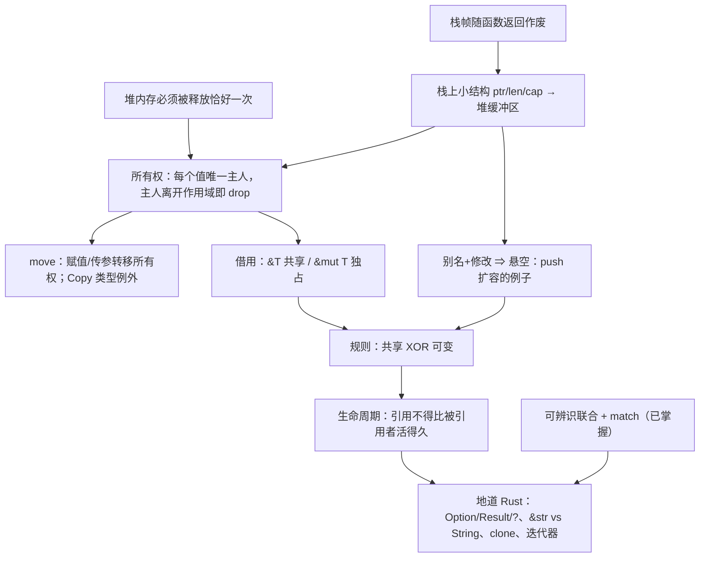
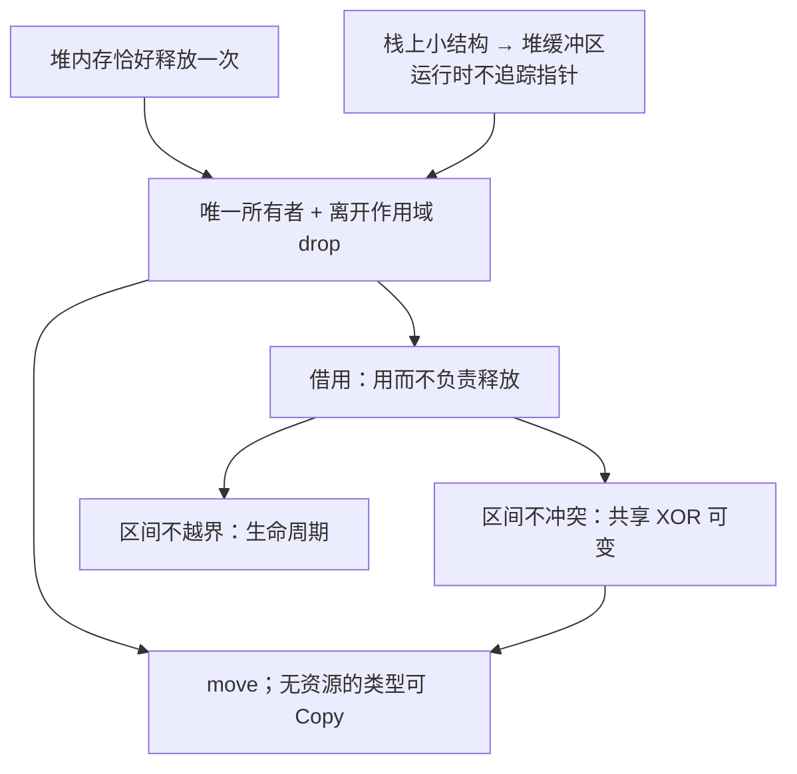
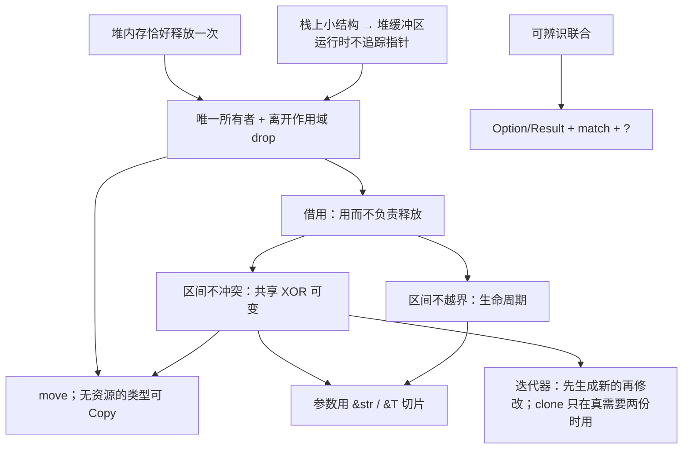
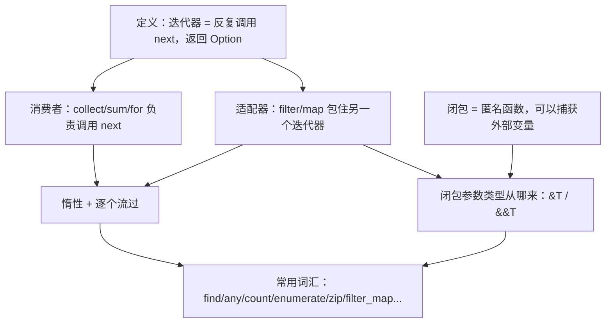
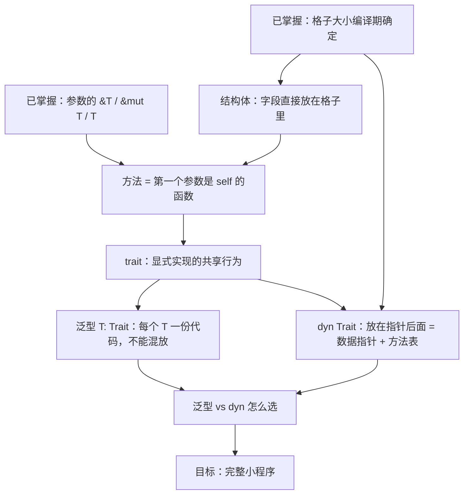
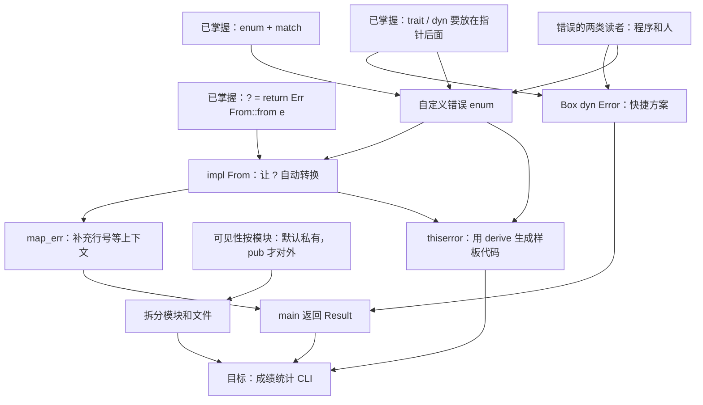

> [!quote] YOU

> [!note] SKILL loaded: teach

告诉我如何使用 rust 编程


> [!abstract] PI

先弄清楚你想用 Rust 做什么，再看你现有的基础，然后才开始讲。


> [!question] Question
> 你学 Rust 主要想做到什么？
>
> 1. 理解 Rust 的核心思想（所有权、借用、生命周期），能读懂和写出地道的 Rust 代码
> 2. 尽快上手做一个具体的东西（命令行工具、Web 后端等）
> 3. 系统编程或性能敏感的场景（替代 C/C++）
> 4. 先大致了解 Rust 是什么、好在哪里，判断值不值得学


> [!example] Answer
> 1. 理解 Rust 的核心思想（所有权、借用、生命周期），能读懂和写出地道的 Rust 代码


> [!question] Question
> 你目前最熟的编程语言是哪些？
>
> 1. Python / JavaScript / TypeScript
> 2. Java / C# / Go
> 3. C / C++
> 4. Haskell / OCaml / Scala 这类函数式语言
> 5. 基本没写过代码


> [!example] Answer
> 1. Python / JavaScript / TypeScript
> 2. Java / C# / Go


> [!abstract] PI

好，你写过带垃圾回收的语言。下面几道题帮我找到你的基础到哪里为止，不会也没关系。


> [!question] Quiz
> 在 Python 里执行 `a = [1, 2, 3]; b = a; b.append(4)` 之后，`a` 是什么？
>
> 1. [1, 2, 3, 4]
> 2. [1, 2, 3]
> 3. 报错，因为 a 已经被移交给 b


> [!success] Quiz — correct ✓
> Your answer: 1. [1, 2, 3, 4]
> Correct answer: 1
>
> `b = a` 不会复制列表，只是让 b 指向和 a 同一个堆上的对象。两个名字指向同一份数据，所以通过 b 改，a 也能看到。这种“多个名字同时指向、同时修改同一份数据”的情况叫别名（aliasing），后面讲 Rust 时它是核心问题。


> [!abstract] PI

Floor established. Jump up sharply.


> [!question] Quiz
> 在 Java / Go 这类有 GC 的语言里，一个堆上的对象什么时候可以被回收？
>
> 1. 当最后一个使用它的线程结束时
> 2. 当它的引用变量被重新赋值时
> 3. 当程序中不再有任何可达的引用指向它时
> 4. 当创建它的那个函数返回时


> [!success] Quiz — correct ✓
> Your answer: 3. 当程序中不再有任何可达的引用指向它时
> Correct answer: 3
>
> GC 判断的是可达性：从根（栈上的变量、全局变量等）出发顺着引用走，走不到的对象才算垃圾。函数返回不算，因为对象可能已经被返回出去或者存进了别处；变量被重新赋值也不一定算，因为可能还有其他引用指着它。这件事要等到运行时才能判断，所以 GC 必须在程序运行时去扫描。


> [!question] Quiz
> 在 C 这种没有 GC、需要手动 `free` 的语言里，下面哪个 bug 是“对同一块内存 free 两次”？
>
> 1. use-after-free
> 2. memory leak
> 3. double free
> 4. data race


> [!success] Quiz — correct ✓
> Your answer: 3. double free
> Correct answer: 3
>
> double free：同一块内存释放了两次。use-after-free：释放之后又去读写它。memory leak：一直没释放。data race：多个线程同时访问同一数据，且至少一个在写、又没有同步。前两个都是“谁负责释放、什么时候释放”没讲清楚导致的，Rust 的所有权就是为了解决这个问题。


> [!question] Quiz
> 在 C++ 里，`int* p = &v[0];` 拿到 vector 第一个元素的指针，然后执行 `v.push_back(42);`。这时 `p` 最可能怎么样？
>
> 1. 编译器会报错，禁止在持有指针时修改 v
> 2. p 会自动更新，指向元素在新内存里的位置
> 3. p 可能变成悬空指针，因为扩容时元素可能被搬到新的内存
> 4. p 仍然有效，因为 v 这个对象本身没有被释放


> [!failure] Quiz — incorrect ✗
> Your answer: 4. p 仍然有效，因为 v 这个对象本身没有被释放
> Correct answer: 3
>
> vector 的元素存放在堆上的一块连续缓冲区里。容量不够时，push_back 会申请一块更大的缓冲区，把元素复制过去，再释放旧的缓冲区。p 仍然指向旧地址，于是变成悬空指针，之后使用它就是 use-after-free。C++ 编译器不会拦你。这里同时发生了两件事：一个名字（p）在读，另一个名字（v）在改，这就是别名加修改。Rust 的借用规则恰好在编译期禁止这种组合。


> [!abstract] PI

找到一个边界了。再问一题，确认问题出在哪一层：


> [!question] Quiz
> 一个动态数组（C++ 的 `vector`、Go 的 slice、Rust 的 `Vec`）在内存里通常是什么样子？
>
> 1. 一个链表，每个元素各自分配在堆上、互相链接
> 2. 一个小结构（指针 + 长度 + 容量），指针指向堆上存元素的缓冲区
> 3. 所有元素直接存在变量所在的位置，扩容时就地变大


> [!failure] Quiz — incorrect ✗
> Your answer: 1. 一个链表，每个元素各自分配在堆上、互相链接
> Correct answer: 2
>
> 变量 v 本身只是一个固定大小的小结构，包含指向堆缓冲区的指针、长度和容量。元素放在堆上那块连续的缓冲区里。扩容时，v 的地址不变，但它内部的指针会改指一块新的缓冲区，旧缓冲区被释放。上一题的关键就在这里：v 还活着，不代表它的元素还在原来的地址。


> [!question] Quiz
> 函数里的局部变量（比如 `let x: i32 = 5`）一般存在哪里？函数返回后它会怎样？
>
> 1. 存在堆上，函数返回时由编译器插入 free 释放
> 2. 存在堆上，函数返回后等垃圾回收器来清理
> 3. 存在栈上，函数返回后仍然保留到程序结束
> 4. 存在栈上，函数返回时连同整个栈帧自动作废


> [!success] Quiz — correct ✓
> Your answer: 4. 存在栈上，函数返回时连同整个栈帧自动作废
> Correct answer: 4
>
> 每次调用函数，都会在栈上压入一个栈帧，局部变量就放在里面。函数返回时，整个栈帧直接作废，不需要任何回收逻辑，所以很快。代价是生命期固定：数据活不过创建它的那个函数调用。大小在运行时才确定、或者需要比函数活得更久的数据就放到堆上，堆上的数据得有人负责释放。


> [!abstract] PI

栈的概念你掌握了，没掌握的是“栈上的变量指向堆上的数据”这种结构。最后再探两条后面写地道 Rust 要用到的基础：


> [!question] Quiz
> TypeScript 里有 `type Shape = {kind: "circle", r: number} | {kind: "rect", w: number, h: number}`。对 `kind` 做 `switch` 时，在 `case "circle"` 分支里能访问 `shape.r`，原因是？
>
> 1. 编译器根据 kind 的值把类型收窄到了 circle 那个变体
> 2. 运行时会检查 r 是否存在，不存在就返回 undefined
> 3. 联合类型把所有变体的字段合并了，哪个分支都能访问 r


> [!success] Quiz — correct ✓
> Your answer: 1. 编译器根据 kind 的值把类型收窄到了 circle 那个变体
> Correct answer: 1
>
> 这叫可辨识联合（discriminated union）。编译器看到 `kind === "circle"`，就知道在这个分支里 shape 只可能是 circle 变体，所以允许访问 r。Rust 的 `enum` 加 `match` 是同一个思路，而且更严格：match 必须覆盖所有变体，漏掉一个就编译不过。Rust 用 `Option` 代替 null、用 `Result` 代替异常，靠的都是这个机制。


> [!abstract] PI

subagent 用不了（需要 tmux），只能我自己核对。下面用到的事实（Rust Book 第 4、8、10 章的所有权三规则、借用规则、`v.push` 报错 E0502、NLL）都是 Rust 最核心、最稳定的内容，我有把握。如果哪里需要逐字核对原文，你在 tmux 里启动 pi 后我再派 researcher 去查。

## 教学计划

**思路。** Rust 的所有规则都在回答同一个问题：**不用 GC，怎么在编译期就保证堆内存被释放且只被释放一次，并且释放之后没人再去用它？** 你熟悉 GC 的做法（运行时看可达性），所以我们从你缺的那一块开始：栈上的小结构指向堆上的缓冲区。再让你自己推出来：既然没有 GC，每块堆内存就得有唯一一个负责释放的主人（**所有权**）；主人可以交接（**move**）；想用但不想接手，就只能借（**借用**）；借的时候不能有人同时在改（**共享 XOR 可变**，正好防住你刚才错的那题）；编译器要能证明借来的东西没有活得比主人久（**生命周期**）。最后讲地道写法：`Option`/`Result` + `match` + `?`、`&str` 和 `String` 怎么选、什么时候用 `clone`、迭代器。这部分可以直接借用你已经懂的可辨识联合。

每一步尽量用提问的方式让你自己推出来。你给出推导之后，我再给对应的 Rust 代码和编译器报错来印证。



**根节点：**
- A 你已经确认过。
- B 是这节课的出发点：堆内存只释放 0 次是泄漏，释放 2 次是 double free，你也认得这些 bug。
- C 是你缺的那一块，所以第一课就从 C 讲起。

计划这样可以吗？想调整范围或顺序的话现在说，确认后我就从 C 开始讲。


> [!quote] YOU

好的从C开始


> [!abstract] PI

## 节点 C：栈上的小结构 → 堆上的缓冲区

**为什么需要它？** 后面的所有权、借用、生命周期，管的都是**堆上的那块内存**，以及**谁手里拿着指向它的指针**。这个画面不清楚，后面的规则看起来就会很随意。所以我们先把它推出来。

**你已经知道的：** 局部变量放在栈帧里，函数返回时整个栈帧一起作废。

现在考虑一个问题。你写：

```rust
let mut v = Vec::new();   // 空的动态数组
v.push(1);
v.push(2);
// ……可能 push 3 个，也可能 300 万个，取决于运行时的输入
```

最直接的想法是把元素就放在 `v` 所在的栈帧里。先想一下这样做有什么问题：


> [!question] Quiz
> 为什么动态数组的元素不能直接放在栈帧里？
>
> 1. 栈上的内存只能读不能写，元素却需要被修改
> 2. 栈上的数据只有当前线程能看到，元素却需要共享
> 3. 栈帧大小在编译期就固定了，元素个数却到运行时才知道
> 4. 栈上只能存整数和指针，元素却可能是任意类型


> [!success] Quiz — correct ✓
> Your answer: 3. 栈帧大小在编译期就固定了，元素个数却到运行时才知道
> Correct answer: 3
>
> 编译器生成函数代码时，就已经算好了栈帧多大、每个局部变量在帧里的哪个偏移位置。v 在帧里只能占一块固定大小的格子，而元素数量要到运行时才知道，可能是 3 个，也可能是 300 万个。所以元素只能放到一个大小可以在运行时决定的地方，也就是堆。栈本身是可读写的，什么类型都能放，所以另外两个理由不对；线程共享那条和这个问题无关。


> [!question] Quiz
> 要支持上面三个操作，v 那个固定大小的格子里至少需要存哪些字段？（多选）
>
> 1. 每个元素各自的堆地址列表
> 2. 当前缓冲区最多能容纳的元素个数
> 3. 指向上一块旧缓冲区的指针
> 4. 当前已存放的元素个数
> 5. 指向堆上缓冲区起始位置的指针


> [!success] Quiz — correct ✓
> Your answer: 2. 当前缓冲区最多能容纳的元素个数, 4. 当前已存放的元素个数, 5. 指向堆上缓冲区起始位置的指针
> Correct answer: 2, 4, 5
>
> ptr：元素在一块连续缓冲区里，所以第 i 个元素的地址是 ptr + i × 元素大小，有起始地址就够了，不用为每个元素单独存地址（单独存地址的那种结构其实就是你上次选的链表）。len：告诉你现在有几个元素、哪些下标合法、push 应该写到哪个位置。cap：告诉你缓冲区什么时候满了、需要换更大的。这三个字段都是固定大小，在 64 位机器上各占 8 字节，一共 24 字节，无论元素有多少个。旧缓冲区的指针不用留：扩容时把元素复制到新缓冲区，旧的立刻释放掉。


> [!question] Quiz
> v 当前 len = 2、cap = 2。有人保存了 p = &v[1]，然后执行 v.push(9)。下面哪个说法正确？
>
> 1. v 的栈地址不变，v.ptr 改指新缓冲区，p 被自动更新到新位置
> 2. v 的栈地址不变，v.ptr 也不变，缓冲区就地变大，p 仍有效
> 3. v 整个被搬到新的栈地址，v.ptr 不变，p 指向的元素仍有效
> 4. v 的栈地址不变，v.ptr 改指新缓冲区，p 指向已释放的内存


> [!failure] Quiz — incorrect ✗
> Your answer: 1. v 的栈地址不变，v.ptr 改指新缓冲区，p 被自动更新到新位置
> Correct answer: 4
>
> len == cap，所以这次 push 会扩容：申请新缓冲区、复制元素、释放旧缓冲区、更新 v.ptr 和 cap。v 在栈帧里的格子位置是编译期定好的，不会移动。p 只是一个裸地址，没有任何东西会去通知它或更新它，所以它现在指向已经释放的内存。（就地变大在某些分配器里确实可能发生，但不能依赖，一般默认会搬走。）这正是 Rust 要在编译期禁止的情况：手里有 p 的时候，不允许通过 v 修改。


> [!question] Quiz
> 在没有 GC 的程序里，`v.push` 扩容后为什么不能把旧指针 p 更新到新地址？
>
> 1. 新缓冲区里元素的排列顺序和旧缓冲区不同
> 2. 运行时没有任何东西记录哪些指针指向了这块缓冲区
> 3. 堆内存一旦分配就不允许再写入新的地址值
> 4. 指针是只读变量，创建之后就不能再修改


> [!success] Quiz — correct ✓
> Your answer: 2. 运行时没有任何东西记录哪些指针指向了这块缓冲区
> Correct answer: 2
>
> 要更新 p，得先知道 p 在哪儿。没有 GC 时，运行时不会记录“谁指向了这块内存”，push 的代码只看得到 v 自己的字段。Java 的 GC 能更新引用，正是因为它追踪了所有引用，这是它的运行时成本。Rust 不想付这个成本，所以改成在编译期禁止“有人借着 v 的元素时修改 v”。元素顺序在扩容时不变，指针变量本身也可以修改，所以另外两个理由都不对。


> [!abstract] PI

节点 C 讲完了。用两句话概括：

1. **`Vec`/`String` = 栈上固定 24 字节（ptr, len, cap）+ 堆上的缓冲区。** 两者的地址各变各的。
2. **没有 GC，就没人追踪指针。** 缓冲区一换，旧指针就悬空了，也没人会去修正它。

两个根节点现在都有了：
- **B**：堆内存必须恰好释放一次
- **C**：栈上的那个小结构是通往堆内存的唯一入口

下一个节点 **D：所有权**，就是从这两点推出来的。我会先问你一个问题：*函数返回、`v` 那 24 字节随栈帧作废的时候，堆上的缓冲区该由谁来释放？如果 `let w = v;` 复制出了第二份 ptr，又会出什么问题？*

现在继续讲 D 吗？


> [!quote] YOU

继续讲 D


> [!abstract] PI

## 节点 D：所有权

**为什么需要它？** 根节点 B 要求堆缓冲区恰好释放一次，0 次是泄漏，2 次是 double free。Rust 没有 GC，所以必须**有一段确定的代码，在一个确定的时刻**去释放它。我们来找这个时刻。

```rust
fn f() {
    let v = vec![1, 2, 3];   // 栈上 24 字节 + 堆上缓冲区
    // ……用 v ……
}   // ← 函数返回，栈帧作废
```

函数返回时，栈上那 24 字节会自动作废，但堆上的缓冲区**不会**。栈帧作废只是“这块栈空间不要了”，没有任何代码会顺着 ptr 去释放堆。


> [!question] Quiz
> 在没有 GC 的前提下，释放 v 的堆缓冲区最自然、开销最小的时机是什么？
>
> 1. 当 v 离开作用域、它的栈格子即将作废时，顺着 ptr 释放
> 2. 程序结束时，由操作系统一次性回收所有堆内存
> 3. 当 v 最后一次被修改之后，立刻顺着 ptr 释放
> 4. 定期扫描堆，释放那些已经没有变量指向的缓冲区


> [!success] Quiz — correct ✓
> Your answer: 1. 当 v 离开作用域、它的栈格子即将作废时，顺着 ptr 释放
> Correct answer: 1
>
> v 的栈格子是通往缓冲区的唯一入口。格子作废以后，就再也没人知道缓冲区在哪儿了，所以必须在格子作废之前释放，也就是离开作用域的时候。这个时刻编译器在编译期就知道（在 `}` 处），所以它可以直接在那里插入一行释放代码，运行时零额外开销。Rust 把这一步叫 drop。“等到程序结束”就是内存泄漏；“定期扫描”就是 GC；“最后一次修改之后”是错的，因为修改完以后可能还要读。


> [!question] Quiz
> 按“离开作用域就顺着 ptr 释放”这条规则，函数在 } 处会发生什么？
>
> 1. w 释放缓冲区，v 发现已被释放于是跳过，一切正常
> 2. w 释放缓冲区，v 再释放同一块缓冲区，造成 double free
> 3. 只有先声明的 v 释放缓冲区，w 作为副本什么都不做
> 4. 两个变量都不释放，因为缓冲区还被对方引用着，造成泄漏


> [!failure] Quiz — incorrect ✗
> Your answer: 3. 只有先声明的 v 释放缓冲区，w 作为副本什么都不做
> Correct answer: 2
>
> 规则很机械：每个变量离开作用域时都顺着自己的 ptr 去释放。v 和 w 的 ptr 是同一个地址，所以同一块缓冲区会被释放两次，这就是 double free。“发现已被释放于是跳过”需要运行时记录状态；“还被对方引用所以不释放”需要知道有几个引用指着它，其实就是引用计数。这两种都要额外的运行时机制。“副本什么都不做”的问题在于，两份 24 字节完全一样，凭什么区分哪个是副本？必须有一条规则来区分。


> [!question] Quiz
> 如果规定“先声明的 v 负责释放，w 只是不负责的副本”，main 里使用 x 时会怎样？
>
> 1. x 指向的缓冲区会被释放两次，分别由 v 和 x 释放
> 2. x 指向的缓冲区已在 make 返回时被 v 释放，x 悬空
> 3. x 指向的缓冲区仍然有效，因为 w 已经把它返回出去了


> [!success] Quiz — correct ✓
> Your answer: 2. x 指向的缓冲区已在 make 返回时被 v 释放，x 悬空
> Correct answer: 2
>
> v 是负责人，它在 make 的 } 处离开作用域，于是释放缓冲区。w 和 x 只是副本，不负责释放，但它们的 ptr 仍指着那块已经被释放的内存。所以 main 里的 x 是悬空的，再使用就是 use-after-free。问题在于：数据流向了 w，负责人却还是 v，责任没有跟着数据走。


> [!question] Quiz
> 责任转交给 w 之后，要在不增加任何运行时开销的前提下杜绝上面的 bug，对 v 最合理的处理是？
>
> 1. 赋值时把堆缓冲区也复制一份，让 v 和 w 各自拥有独立的缓冲区
> 2. 给缓冲区加一个计数器，记录有几个变量指向它，归零时才释放
> 3. 编译器把 v 标记为已失效，之后任何对 v 的使用都报编译错误
> 4. 运行时把 v 的 ptr 置为 null，之后使用 v 时先检查是否为 null


> [!success] Quiz — correct ✓
> Your answer: 3. 编译器把 v 标记为已失效，之后任何对 v 的使用都报编译错误
> Correct answer: 3
>
> 编译器在编译期就知道 `let w = v` 这一行在哪儿，所以它可以禁止这之后对 v 的任何使用，同时也不在 v 离开作用域时插入释放代码。这一切都在编译期完成，运行时零开销。这就是 move（移动）。另外三个方案都要付运行时代价：置 null 加检查，每次访问都要多一次判断；深拷贝要复制整个堆缓冲区；引用计数要维护计数器。Rust 里其实这三种都能用，分别对应 Option、.clone()、Rc，但都必须你显式写出来，默认行为是零开销的 move。


> [!question] Quiz
> 这段代码的结果是什么？
>
> 1. 正常打印 3 和 3：传参时自动深拷贝了一份缓冲区给 s
> 2. 正常打印 3 和 3：传参只是临时借给函数，返回后 v 仍可用
> 3. 编译错误：v 在传给 consume 时已被 move，之后不能再用
> 4. 运行时崩溃：consume 返回时 s 释放了缓冲区，v 悬空


> [!warning] Quiz — cancelled
> (user skipped)


> [!abstract] PI

这道题先放下。节点 D 的核心已经推出来了：

- **所有权三规则**：每个值有一个所有者；同一时刻只能有一个；所有者离开作用域就 drop。
- **move**：赋值、传参、返回都会转移所有权。转移之后旧变量失效，编译期就会拦截，运行时零开销。

刚才那道题考的是：`consume(v)` 之后再用 `v` 会编译报错（E0382），因为传参和 `let s = v` 一样会发生 move。想“临时借给函数”，要写 `consume(&v)`，这就是下一个节点 **F：借用**。

你想现在继续讲 E/F，还是先停在这里？


> [!quote] YOU

完整的代码是什么


> [!abstract] PI

下面两段代码我都用本机的 `rustc` 实际编译、运行过。

## 1. 刚才那道题的代码（编译不过）

`bad.rs`：
```rust
fn consume(s: Vec<i32>) {
    println!("{}", s.len());
}

fn main() {
    let v = vec![1, 2, 3];
    consume(v);              // 所有权从 v 移到了 s
    println!("{}", v.len()); // ← v 已失效
}
```

`rustc bad.rs` 的真实输出：
```
error[E0382]: borrow of moved value: `v`
 --> bad.rs:8:20
  |
6 |     let v = vec![1, 2, 3];
  |         - move occurs because `v` has type `Vec<i32>`, which does not implement the `Copy` trait
7 |     consume(v);
  |             - value moved here
8 |     println!("{}", v.len());
  |                    ^ value borrowed here after move
  |
note: consider changing this parameter type in function `consume` to borrow instead if owning the value isn't necessary
 --> bad.rs:1:15
  |
1 | fn consume(s: Vec<i32>) {
  |    -------    ^^^^^^^^ this parameter takes ownership of the value
help: consider cloning the value if the performance cost is acceptable
  |
7 |     consume(v.clone());
```

编译器给了两种修法：**借用**，或者 **clone**。它们就对应节点 D 那道题里被排除掉的几种方案。

## 2. 能编译的几种写法

`good.rs`：
```rust
// 写法 1：借用（不转移所有权）
fn inspect(s: &Vec<i32>) {
    println!("inspect: {}", s.len());
}

// 写法 2：拿走所有权，用完再还回来
fn take_and_give_back(s: Vec<i32>) -> Vec<i32> {
    println!("take: {}", s.len());
    s
}

// 原来的函数：拿走所有权，函数结束时 drop
fn consume(s: Vec<i32>) {
    println!("consume: {}", s.len());
}

fn main() {
    let v = vec![1, 2, 3];

    inspect(&v);                     // 借出去，v 仍是所有者
    println!("after inspect: {}", v.len());

    let v = take_and_give_back(v);   // 所有权出去又回来
    println!("after give back: {}", v.len());

    consume(v.clone());              // 深拷贝一份交出去，v 不受影响
    println!("after clone: {}", v.len());

    consume(v);                      // 真正交出所有权
    // println!("{}", v.len());      // 取消注释 → error[E0382]
}
```

运行输出：
```
inspect: 3
after inspect: 3
take: 3
after give back: 3
consume: 3
after clone: 3
consume: 3
```

要自己跑的话，把代码存成 `good.rs`，然后执行 `rustc good.rs && ./good`。

**三种写法对比：**
- **写法 2**（拿走再还回来）能用，但每个函数都得把值传回来，很啰嗦。
- **clone** 要复制整个堆缓冲区，有开销。
- **`&v` 借用**最常用，但它也有自己的规则：借出去的时候，别人能不能同时修改 `v`？这就回到了节点 C 里 `push` 让指针悬空的那个问题。这是下一个节点 **F**。

要继续讲 F 吗？


> [!quote] YOU

继续 F


> [!abstract] PI

## 节点 F：借用

**为什么需要它？** 上一段代码说明了：只想“用一下” `v`，却不得不交出所有权，要么还回来、要么 clone，都很笨。我们需要一种方式，**能访问值，但不承担释放责任**。

**`&v` 是什么？** 它是一个**指向 `v` 那 24 字节栈格子的指针**，叫作**引用**。注意它指向的是 `v` 本身，不是堆缓冲区。

```
  inspect 的栈帧            main 的栈帧                 堆
  ┌────────────┐          ┌──────────────┐          ┌───┬───┬───┐
  │ s ─────────┼────────▶ │ v: ptr ──────┼────────▶ │ 1 │ 2 │ 3 │
  └────────────┘          │    len=3     │          └───┴───┴───┘
                          │    cap=3     │
                          └──────────────┘
```

`s.len()` 的执行过程是：顺着 `s` 找到 `v`，读出 `v` 的 len。


> [!question] Quiz
> inspect(&v) 返回时，形参 s 离开作用域。按所有权规则，会发生什么？
>
> 1. 释放 v 的栈格子：s 离开作用域，把它指向的 24 字节作废
> 2. 什么都不释放：s 不是所有者，缓冲区仍由 v 负责
> 3. 把 v 标记为失效：借用结束后所有权归还给了 inspect
> 4. 释放堆缓冲区：s 离开作用域，顺着指针把数据 drop 掉


> [!success] Quiz — correct ✓
> Your answer: 2. 什么都不释放：s 不是所有者，缓冲区仍由 v 负责
> Correct answer: 2
>
> 规则 3 说的是“所有者离开作用域时 drop 值”。s 是引用，不是所有者，它离开作用域时只是自己那 8 字节的指针作废，不会去释放它指向的东西。缓冲区仍由 v 负责，在 main 结束时 drop。这就是引用的定义：能访问，不负责释放。v 的栈格子属于 main 的栈帧，只有 main 返回时才会作废，别人释放不了它。


> [!question] Quiz
> 如果 Rust 允许这段代码运行，println 那一行会遇到什么问题？
>
> 1. first 指向 v 的栈格子，而栈格子地址不变，所以读到的仍是 1
> 2. first 会被 push 自动更新到新缓冲区，所以读到的仍是 1
> 3. first 和 v 都是所有者，函数结束时会发生 double free
> 4. first 指向旧缓冲区，push 扩容时旧缓冲区已被释放，first 悬空


> [!warning] Quiz — cancelled
> (user skipped)


> [!question] Question
> 你连续跳过了两道题。接下来想怎么上课？
>
> 1. 少出题，每个节点最后只来一道确认题
> 2. 不要题，直接讲，多给可运行的代码和真实报错
> 3. 保持现在的节奏，刚才只是临时跳过
> 4. 改成让我自己写/改代码来练习


> [!example] Answer
> 1. 少出题，每个节点最后只来一道确认题


> [!quote] YOU

你的问题里面的这段代码要明确


> [!abstract] PI

明白了：之前的题目只写了“这段代码”，代码本身却在聊天正文里，答题界面上看不到。以后每道题都会把**完整代码**直接放进题目里。

## 节点 H：共享 XOR 可变

**为什么需要它？** 刚才看到的悬空问题有个固定的模式：**有人拿着引用在读，同时有人在改。** 改动（比如 `push` 扩容）可能让别人手里的引用失效。运行时又没人追踪引用，所以只能在编译期禁止这种组合。

从这一点出发，规则可以一条条推出来：

1. **多个人同时读，安全吗？** 安全。读不会改动任何东西，谁的引用都不会失效。所以 `&T` 可以有任意多个。
2. **有人在改的时候，别人能读吗？** 不能。改动可能让读的人手里的引用悬空（`first` 和 `push` 的例子）。
3. **两个人同时改呢？** 也不能。一方的改动同样可能让另一方的引用失效，比如一方触发扩容，另一方还拿着旧缓冲区的地址。

合起来就是：**任一时刻，要么有任意多个 `&T`，要么有恰好一个 `&mut T`。**

本机实测，两个 `&mut` 同时存在会报错：

```rust
fn main() {
    let mut v = vec![1, 2, 3];
    let m1 = &mut v;
    let m2 = &mut v;
    m1.push(4);
    m2.push(5);
}
```
```
error[E0499]: cannot borrow `v` as mutable more than once at a time
3 |     let m1 = &mut v;
  |              ------ first mutable borrow occurs here
4 |     let m2 = &mut v;
  |              ^^^^^^ second mutable borrow occurs here
5 |     m1.push(4);
  |     -- first borrow later used here
```

**还有一个关键细节：借用到“最后一次使用”就结束了，不是到 `}` 才结束**（这叫 NLL，非词法生命周期）。所以下面这段可以编译，本机实测输出 `3 1` 和 `1 [1, 2, 3, 4]`：

```rust
fn main() {
    let mut v = vec![1, 2, 3];

    let a = &v;
    let b = &v;
    println!("{} {}", a.len(), b[0]);   // a、b 最后一次使用，共享借用到此结束

    let first = v[0];                   // i32 是 Copy：复制出一个值，不是引用
    v.push(4);                          // 此时没有任何活着的借用，可以可变借用
    println!("{} {:?}", first, v);
}
```

注意两个报错信息里都有一句 **"later used here"**。编译器判断冲突的依据是：**在可变借用发生之后，那个旧的借用还会不会被用到。**

确认题：


> [!question] Quiz
> 下面这段代码能通过编译吗？
>
> ```rust
> fn main() {
>     let mut v = vec![1, 2, 3];
>     let first = &v[0];
>     println!("{}", first);
>     v.push(4);
>     println!("{:?}", v);
> }
> ```
>
> 1. 不能：只要创建过 &v[0]，v 就再也不能被修改
> 2. 不能：first 的借用持续到 main 的 } 为止，和 push 冲突
> 3. 能：push 扩容时会自动把 first 更新到新缓冲区
> 4. 能：first 最后一次使用在 push 之前，借用已经结束


> [!failure] Quiz — incorrect ✗
> Your answer: 1. 不能：只要创建过 &v[0]，v 就再也不能被修改
> Correct answer: 4
>
> 借用从创建开始，到最后一次使用为止（NLL）。first 最后一次使用是第一个 println，push 发生在那之后，此时已经没有活着的共享借用，所以和 &mut 不冲突，可以编译。规则要防的是“改动之后还有人拿着旧引用去用”，这里没有这种情况：push 之后 first 再也没被用过，就算它悬空了也无所谓，反正没人会去读它。first 也不会被自动更新，只是不再被使用而已。


> [!question] Quiz
> 下面这段代码的编译结果是什么？
>
> ```rust
> fn main() {
>     let mut v = vec![1, 2, 3];
>     let a = &v;
>     let b = &v;
>     println!("{}", a.len());
>     v.push(4);
>     println!("{}", b.len());
> }
> ```
>
> 1. 报错：a 和 b 两个共享借用同时存在，彼此冲突
> 2. 报错：a 的借用区间一直延伸到最后一行，覆盖了 push
> 3. 报错：b 的借用区间一直延伸到最后一行，覆盖了 push
> 4. 通过：a 在 push 之前已最后一次使用，借用均已结束


> [!success] Quiz — correct ✓
> Your answer: 3. 报错：b 的借用区间一直延伸到最后一行，覆盖了 push
> Correct answer: 3
>
> 每个借用各算各的区间。a 从第 3 行到第 5 行，在 push 之前就结束了，没有问题。b 从第 4 行一直到第 7 行，push 正好落在它的区间里，所以冲突。本机实测报错 E0502，编译器指向的正是 b：第 4 行“immutable borrow occurs here”，第 7 行“immutable borrow later used here”。a 和 b 同时存在没有问题，因为共享引用可以有任意多个。


> [!abstract] PI

答对了，节点 H 讲完。

**F + H 小结：**
- **引用**：`&T` 只读，`&mut T` 可读可写。两种引用都不是所有者，离开作用域时不释放任何东西。
- **共享 XOR 可变**：任一时刻，一个值要么有任意多个 `&T`，要么只有一个 `&mut T`。
- **借用是一段区间**：从创建到最后一次使用为止。编译器只检查这些区间有没有冲突地重叠。

**依赖图进度：** A ✅ B ✅ C ✅ D ✅ F ✅ G ✅ H ✅

还剩下：
- **E（Copy）**：上面 `let first = v[0]` 为什么不是 move？这一节很短。
- **I（生命周期）**：H 管的是“借用期间别人不能乱改”。I 管的是另一件事：**引用不能比它指向的东西活得更久**，比如函数返回一个指向自己局部变量的引用。区间这个概念会在那里直接用上。
- **J（地道写法）**

下一步先快速讲完 E，再讲 I，可以吗？


> [!quote] YOU

继续


> [!abstract] PI

## 节点 E：Copy

**为什么需要它？** 上一节有这么一行：`let first = v[0];`，之后 `v` 和 `first` 都还能用。按节点 D 的规则，赋值应该是 move，那这里为什么不是？

**回到 move 存在的原因。** 我们规定 move，是因为复制 `Vec` 的 24 字节会让**两份 ptr 指向同一块堆内存**，结果是 double free。问题的根源在于这 24 字节**管理着一份外部资源**。

再看 `i32`。它就是 4 个字节，本身就是全部数据，不指向任何东西，也没有什么需要释放。把这 4 字节复制一份，得到的是一个**完全独立**的值，以后谁也不会去释放谁。

所以：**如果按位复制一份不会引发任何问题，就没必要 move，直接复制就行。** Rust 把这样的类型标记为 `Copy`。

由此可以判断哪些类型是 Copy：
- **是 Copy**：整数、浮点数、`bool`、`char`，以及全部由 Copy 类型组成的元组和数组，比如 `(i32, bool)`、`[u8; 4]`。
- **不是 Copy**：`String`、`Vec` 这类拥有堆资源的类型。实现了 `Drop` 的类型一律不能是 Copy：既然有东西要释放，按位复制就会释放两次。要复制它们，得显式写 `.clone()`，深拷贝一份堆数据。

**引用的情况能和节点 H 对上**（本机实测）：

```rust
fn main() {
    let v = vec![1, 2, 3];
    let r1 = &v;
    let r2 = r1;               // &T 是 Copy，r1 仍可用
    println!("{} {}", r1.len(), r2.len());   // 输出：3 3
}
```

```rust
fn main() {
    let mut v = vec![1, 2, 3];
    let m1 = &mut v;
    let m2 = m1;               // &mut T 不是 Copy → move
    m2.push(4);
    m1.push(5);
}
```
```
error[E0382]: borrow of moved value: `m1`
  |     let m1 = &mut v;
  |         -- move occurs because `m1` has type `&mut Vec<i32>`, which does not implement the `Copy` trait
```

`&T` 可以随便复制，因为共享引用本来就允许有任意多个。`&mut T` 如果能复制，就会同时出现两个可变引用，违反“只能有一个 `&mut`”。所以它只能 move。**Copy 与否，直接取决于 H 的规则。**

确认题：


> [!question] Quiz
> 下面哪些类型是 Copy？（多选）
>
> ```rust
> i32
> (i32, bool)
> String
> &String
> &mut String
> ```
>
> 1. String
> 2. &String
> 3. &mut String
> 4. i32
> 5. (i32, bool)


> [!failure] Quiz — incorrect ✗
> Your answer: 4. i32, 5. (i32, bool)
> Correct answer: 2, 4, 5
>
> i32：纯数据，不管理任何资源，是 Copy。(i32, bool)：每个成员都是 Copy，整体也是。String：管理着堆缓冲区，复制 ptr 会导致 double free，所以不是。&String：共享引用，允许有任意多个，复制一份不违反任何规则，是 Copy（被复制的是引用本身，不是它指向的 String）。&mut String：复制会产生两个可变引用，违反共享 XOR 可变，所以不是。


> [!question] Quiz
> 下面这段代码能编译吗？
>
> ```rust
> fn show(s: &String) {
>     println!("{}", s);
> }
>
> fn main() {
>     let s = String::from("hi");
>     let r = &s;
>     show(r);
>     show(r);
> }
> ```
>
> 1. 不能：s 已经被 r 借走，show 不能再借第二次
> 2. 不能：第一次 show(r) 把 r move 走了，第二次使用报 E0382
> 3. 能：传参时复制的是引用 r，r 是 Copy，之后仍可用
> 4. 能：传参时自动 clone 了一份 String，每次传的是新副本


> [!success] Quiz — correct ✓
> Your answer: 3. 能：传参时复制的是引用 r，r 是 Copy，之后仍可用
> Correct answer: 3
>
> show(r) 相当于 `let s_param = r;`，而 r 的类型是 &String，是 Copy，所以这里复制的是 8 字节的地址，r 不会失效。String 没有被复制，也没有被 clone，自始至终只有 s 这一个所有者、一个堆缓冲区。共享借用可以有任意多个，所以也不存在借用冲突。如果把参数类型换成 String、传 s 进去，那就是 move，第二次调用会报 E0382。


> [!abstract] PI

答对了，节点 E 讲完。

**E 小结：** Copy 不是一条额外的规则，它可以从前面的规则推出来。把值本身的字节复制一份，只要不违反“唯一所有者”和“共享 XOR 可变”，这个类型就可以是 Copy。所以 `i32` 和 `&T` 是 Copy；`String`、`Vec`、`&mut T` 不是，它们在赋值和传参时会 move，想复制得显式 `.clone()`。

**进度：** A B C D E F G H ✅，还剩 **I（生命周期）** 和 **J（地道写法）**。

下一个讲 I，它从这个问题开始：

```rust
fn make_ref() -> &String {
    let s = String::from("hi");
    &s
}
```

这个函数想把局部变量的引用返回出去，它会出什么问题，编译器又是怎么发现的？准备好了说“继续”。


> [!quote] YOU

继续


> [!abstract] PI

## 节点 I：生命周期（上半部分）

**为什么需要它？** H 防的是“借用期间所有者被改”。还有另一种情况 H 管不到：**借用期间所有者直接没了**。

```rust
fn make_ref() -> &String {
    let s = String::from("hi");
    &s
}
```

跟着规则走一遍：`s` 是所有者，在 `}` 处离开作用域，堆缓冲区被 drop，`s` 所在的栈帧也作废了。可是返回出去的 `&s` 指向的正是这个已经作废的栈格子。调用者拿到的从一开始就是悬空引用。

这里没有任何修改，所以 H 拦不住。我们需要第二条约束。把节点 H 里“借用是一段区间”的说法再用一次：

- **借用区间**：引用从创建到最后一次使用
- **所有者存活区间**：所有者从创建到被 drop（或被 move 走）

> **借用区间必须完整地落在所有者存活区间之内。** 引用不能比它指向的东西活得更久。

一个引用的有效区间就叫它的**生命周期**（lifetime）。编译器的“借用检查器”做的就是这两件事：区间不能冲突地重叠（H），区间不能超出所有者（I）。

**函数内部的例子**（本机实测）：

```rust
fn main() {
    let r;
    {
        let s = String::from("hi");
        r = &s;
    }                       // s 在这里被 drop
    println!("{}", r);      // r 还在用
}
```
```
error[E0597]: `s` does not live long enough
5 |         r = &s;
  |             ^^ borrowed value does not live long enough
6 |     }
  |     - `s` dropped here while still borrowed
7 |     println!("{}", r);
  |                    - borrow later used here
```

报错信息就是那条规则的原话：**`s` 已经被 drop，借用却还在用。**

**回到 `make_ref`。** 本机编译会先报 E0106 `missing lifetime specifier`，并附一句 *"there is no value for it to be borrowed from"*：返回的是引用，但参数里什么都没有，那它借的是谁？下半部分会讲这一点。编译器给出的修法是：

```rust
fn make_ref() -> String {        // 不返回引用，直接把所有权 move 出去
    let s = String::from("hi");
    s
}
```

所有权跟着返回值交给调用者，不会悬空。这就是节点 D 里“责任跟着数据走”。

确认题：


> [!question] Quiz
> 下面这段代码能编译吗？
>
> ```rust
> fn main() {
>     let s = String::from("hi");
>     let r;
>     {
>         let t = &s;
>         r = t;
>     }
>     println!("{}", r);
> }
> ```
>
> 1. 能：r 借的是 s，s 活到 main 结束，覆盖了 r 的使用
> 2. 不能：r = t 把 t move 走了，之后 t 离开作用域时会出错
> 3. 不能：t 在内层 } 处失效，从 t 复制来的 r 也跟着悬空
> 4. 不能：s 同时被 t 和 r 两个引用借用，发生冲突


> [!success] Quiz — correct ✓
> Your answer: 1. 能：r 借的是 s，s 活到 main 结束，覆盖了 r 的使用
> Correct answer: 1
>
> 关键要看引用指向的是谁。t 和 r 都指向 s，不指向 t。t 是 &String，是 Copy，所以 r = t 复制的是地址。t 在内层 } 处失效，只是 t 这个变量没了，r 手里的地址仍然指着 s。s 一直活到 main 结束，r 的借用区间完整地落在 s 的存活区间里，所以合法。两个共享引用同时存在也没有问题。与 E0597 那个例子对比：那里是被借的 s 在内层作用域里，这里在内层作用域里的只是 t 这个引用。


> [!abstract] PI

## 节点 I：生命周期（下半部分）——函数签名上的 `'a`

**为什么需要它？** 刚才的例子都在一个函数里，编译器能看到所有代码。但 Rust **单独检查每个函数**：检查调用方时，它**只看被调函数的签名，不看函数体**。这样编译快，改函数体也不会牵连调用方。

于是有个问题。看这个签名（本机实测会报错）：

```rust
fn longer(a: &String, b: &String) -> &String {
    if a.len() >= b.len() { a } else { b }
}
```
```
error[E0106]: missing lifetime specifier
  = help: this function's return type contains a borrowed value,
          but the signature does not say whether it is borrowed from `a` or `b`
```

调用方拿到返回的引用后，要检查“借用区间不超出所有者”。可**所有者是谁**？是 `a` 指向的那个，还是 `b` 指向的那个？光看签名回答不了。

**所以签名里需要一个标注，把输出和输入连起来：**

```rust
fn longer<'a>(a: &'a String, b: &'a String) -> &'a String {
    if a.len() >= b.len() { a } else { b }
}
```

`'a` 是一个**生命周期参数**，用法和泛型 `<T>` 一样。它的意思是：**返回的引用最多只能活到 `a` 和 `b` 指向的东西都还活着的时候。** 它不会改变任何东西的实际寿命，只是一个约定，让调用方能检查。

调用方按签名检查（本机实测）：

```rust
fn main() {
    let x = String::from("hello");
    let r;
    {
        let y = String::from("hi");
        r = longer(&x, &y);
    }                       // y 被 drop
    println!("{}", r);
}
```
```
error[E0597]: `y` does not live long enough
 9 |         r = longer(&x, &y);
   |                        ^^ borrowed value does not live long enough
10 |     }
   |     - `y` dropped here while still borrowed
11 |     println!("{}", r);
```

注意：运行时 `x` 更长，`r` 实际会指向 `x`，本来是安全的。但编译器**只看签名**，签名说 `r` 可能借自 `y`，所以拒绝。这就是“只看签名”的代价：宁可多拦，也不漏过。

**为什么平时很少写 `'a`？** 大部分情况编译器能按**省略规则**自己补上。最常见的一条是：**只有一个输入引用时，输出引用就借自它。**

```rust
fn first(v: &Vec<i32>) -> &i32 {   // 自动推断成 fn first<'a>(v: &'a Vec<i32>) -> &'a i32
    &v[0]
}
```

只有像 `longer` 这样有多个输入引用、编译器猜不出来的时候，才需要你自己写。（另外，带 `&self` 的方法默认输出借自 `self`。）

确认题：


> [!question] Quiz
> 下面这段代码能编译吗？
>
> ```rust
> fn pick<'a, 'b>(a: &'a String, b: &'b String) -> &'a String {
>     println!("{}", b);
>     a
> }
>
> fn main() {
>     let x = String::from("hello");
>     let r;
>     {
>         let y = String::from("hi");
>         r = pick(&x, &y);
>     }
>     println!("{}", r);
> }
> ```
>
> 1. 能：签名说返回值只借自 a（x），x 活得够久
> 2. 不能：y 也被传进了 pick，在内层 } 处 drop 后 r 可能悬空
> 3. 不能：'a 和 'b 不同，两个参数必须用同一个生命周期
> 4. 能：编译器看了函数体，发现实际返回的是 a


> [!success] Quiz — correct ✓
> Your answer: 1. 能：签名说返回值只借自 a（x），x 活得够久
> Correct answer: 1
>
> 签名写的是返回值 &'a String，只和 a 的生命周期绑定，和 'b 无关。所以调用方只要求 x 活得比 r 久，y 被 drop 不影响 r。本机实测能编译，输出 hi、hello。编译器不是靠看函数体得出这个结论的，它只看签名：如果签名写成 &'b String，或者像 longer 那样两个参数共用 'a，同样的 main 就会报 E0597。函数体内部则会被单独检查：如果函数体里返回 b，就和签名里的 'a 对不上，pick 自己会编译失败。


> [!abstract] PI

答对了，节点 I 讲完。

**I 小结：**
- **生命周期** = 引用有效的那段区间。规则只有一条：**它必须落在所有者的存活区间之内**，否则报 E0597 或 E0515。
- 编译器**分函数检查、只看签名**，所以返回引用的函数要在签名里说明返回值借自哪个参数（`'a`）。只有一个输入引用这类常见情况，可以按省略规则自动推断。

**到目前为止，整个所有权体系都从两个根节点推出来：**



还剩最后一个节点 **J：地道写法**，内容包括：
- `&str` 和 `String`（以及 `&[T]` 和 `Vec<T>`）：函数参数为什么通常写 `&str`
- `Option`/`Result` + `match` + `?`：可以直接套用你熟悉的可辨识联合
- 什么时候 `clone` 是合理的，迭代器为什么能绕开很多借用冲突

要继续讲 J 吗？


> [!quote] YOU

继续


> [!abstract] PI

J 的内容比较多，分三段讲，每段一道题。

## J1：`&str` 和 `&[T]`：参数为什么通常写切片

**为什么需要它？** 前面的函数参数一直写的是 `&String`。这样写会出问题（本机实测）：

```rust
fn shout(s: &String) -> String { s.to_uppercase() }
fn main() { shout("literal"); }
```
```
error[E0308]: mismatched types
  |             ^^^^^^^^^ expected `&String`, found `&str`
```

字符串字面量 `"literal"` 不是 `String`。它是编译进程序里的一段只读字节，没有放在堆上，也没有 cap。另外，如果只想传 `"hello world"` 的前 5 个字符，用 `&String` 也做不到，因为 `&String` 只能指向一整个 `String`。

**推一下：** 一个**只读**字符串的函数，到底需要知道什么？
- `ptr`：从哪里开始读，需要。
- `len`：读多少个字节，需要。
- `cap`：不需要。只读的话不能 push，容量和它无关。

所以只需要 **(ptr, len)**。这就是**切片**：`&str` 是字符串切片，`&[T]` 是数组切片。它们直接指向某块数据中的**一段**，不管这段数据住在哪里：

```
  owned: [ptr, len=11, cap=11] ──▶ 堆: h e l l o ␣ w o r l d
                                      ▲
  &owned[0..5]: [ptr, len=5] ─────────┘           （指向同一缓冲区的前 5 字节）

  "literal":   [ptr, len=7] ──▶ 程序只读数据区: l i t e r a l
```

本机测量的大小：`&String` 8 字节（一个地址），`&str` 16 字节（ptr + len），`String` 24 字节（ptr + len + cap）。

所以函数参数写 `&str`，**哪种来源都能接收**（本机实测）：

```rust
fn shout(s: &str) -> String { s.to_uppercase() }
fn sum(xs: &[i32]) -> i32 { let mut t = 0; for x in xs { t += x; } t }

fn main() {
    let owned = String::from("hello world");
    shout(&owned);        // &String 自动转成 &str  → "HELLO WORLD"
    shout("literal");     // 字面量本身就是 &str    → "LITERAL"
    shout(&owned[0..5]);  // 子串                   → "HELLO"

    let v = vec![1, 2, 3, 4];
    sum(&v);              // &Vec<i32> 自动转成 &[i32] → 10
    sum(&v[1..3]);        // 子切片                    → 5
    sum(&[10, 20]);       // 数组                      → 30
}
```

**地道写法的规则：**
- **只读参数用 `&str` / `&[T]`。**
- **需要拥有或修改时用 `String` / `Vec<T>`**，比如存进结构体、要 push、要从函数里返回新数据。

切片也是借用，所以 H 和 I 的规则照样适用：


> [!question] Quiz
> 下面这段代码能编译吗？
>
> ```rust
> fn first_word(s: &str) -> &str {
>     match s.find(' ') {
>         Some(i) => &s[..i],
>         None => s,
>     }
> }
>
> fn main() {
>     let mut s = String::from("hello world");
>     let w = first_word(&s);
>     s.clear();
>     println!("{}", w);
> }
> ```
>
> 1. 能：clear 只把 len 设为 0，不释放缓冲区，w 仍然有效
> 2. 不能：w 借自 s，它的借用区间覆盖了需要 &mut s 的 clear
> 3. 能：w 是一个独立的 &str，和 s 的缓冲区没有关系
> 4. 不能：first_word 有输入输出引用却没写 'a，签名缺少生命周期


> [!success] Quiz — correct ✓
> Your answer: 2. 不能：w 借自 s，它的借用区间覆盖了需要 &mut s 的 clear
> Correct answer: 2
>
> first_word 只有一个输入引用，按省略规则，返回值借自 s，签名不用写 'a。所以 w 是指向 s 缓冲区前 5 字节的切片，它的借用区间从第 10 行持续到第 12 行的 println。clear 的签名是 &mut self，需要可变借用，而且正好落在 w 的区间里，违反共享 XOR 可变，本机实测报 E0502。至于 clear 实际会不会释放缓冲区，编译器不关心：它只看签名里有没有 &mut，不看实现细节。这和 I 里“只看签名”是同一个原则。


> [!abstract] PI

## J2：`Option` / `Result` + `match` + `?`

**为什么需要它？** 你熟悉的两种做法各有一个坑：
- **null**（Java/Go/JS）：任何引用都可能是 null。类型系统不区分“可能没有”和“一定有”，所以忘了检查要到运行时才炸。
- **异常**（Java/Python）：函数签名里看不出它会不会失败，错误会隐形地往上抛。

Rust 的做法是用你已经掌握的**可辨识联合**，把“可能没有”和“可能失败”**写进类型里**：

```rust
enum Option<T> { Some(T), None }        // 可能没有值
enum Result<T, E> { Ok(T), Err(E) }     // 可能失败，失败时带着错误 E
```

这里没有新机制。它们就是标准库里定义的两个普通 `enum`，相当于 TypeScript 的 `{kind:"some", value:T} | {kind:"none"}`。

**拿到 `Option<i32>`，就不能直接当 `i32` 用**（本机实测）：

```rust
let x = find_even(&[1, 4]);   // x: Option<i32>
println!("{}", x + 1);
```
```
error[E0369]: cannot add `{integer}` to `Option<i32>`
```

必须先用 `match` 拆开，而且 **`match` 必须覆盖所有变体**（本机实测）：

```rust
fn f(o: Option<i32>) -> i32 {
    match o {
        Some(x) => x,
    }
}
```
```
error[E0004]: non-exhaustive patterns: `None` not covered
```

这正是 null 那个坑的反面：**“忘了处理没有值的情况”在编译期就会被拦下来。**

**`?`：把错误往上传，但写在明处。** 处理 `Result` 时，最常见的需求是“这一步失败了，就把错误原样交给调用者”。每次都写 `match` 很啰嗦，`?` 就是它的简写：

```rust
let n = s.parse::<i32>()?;
// 等价于：
let n = match s.parse::<i32>() {
    Ok(v) => v,
    Err(e) => return Err(e.into()),   // 提前返回
};
```

它像异常一样会往上传，但有两点不同：**每个可能失败的地方都标着 `?`，函数签名里也必须写明 `Result`。**

完整例子（本机实测）：

```rust
use std::num::ParseIntError;

fn find_even(xs: &[i32]) -> Option<i32> {
    for &x in xs {
        if x % 2 == 0 { return Some(x); }
    }
    None
}

fn parse_and_double(s: &str) -> Result<i32, ParseIntError> {
    let n = s.parse::<i32>()?;
    Ok(n * 2)
}

fn main() {
    match find_even(&[1, 3, 4, 5]) {
        Some(x) => println!("found {}", x),   // → found 4
        None => println!("none"),
    }
    println!("{:?}", parse_and_double("21"));  // → Ok(42)
    println!("{:?}", parse_and_double("abc")); // → Err(ParseIntError { kind: InvalidDigit })
}
```

确认题：


> [!question] Quiz
> 下面这段程序输出什么？
>
> ```rust
> use std::num::ParseIntError;
>
> fn total(a: &str, b: &str) -> Result<i32, ParseIntError> {
>     let x = a.parse::<i32>()?;
>     let y = b.parse::<i32>()?;
>     println!("parsed both");
>     Ok(x + y)
> }
>
> fn main() {
>     println!("{:?}", total("1", "x"));
> }
> ```
>
> 1. 先输出 parsed both，再输出 Err(ParseIntError { kind: InvalidDigit })
> 2. 程序 panic 崩溃，打印解析错误信息后退出
> 3. 只输出 Err(ParseIntError { kind: InvalidDigit })
> 4. 输出 Ok(1)，解析失败的 b 被当作 0


> [!failure] Quiz — incorrect ✗
> Your answer: 1. 先输出 parsed both，再输出 Err(ParseIntError { kind: InvalidDigit })
> Correct answer: 3
>
> "1" 解析成功，x = 1。"x" 解析失败，第二个 ? 拿到 Err，立即 return Err(...)，后面的 println 和 Ok(x + y) 都不会执行。main 收到 Err 并打印出来。本机实测只输出这一行。? 不会 panic，也不会把错误吞掉换成默认值，它只做提前返回，把错误交给调用者处理。


> [!question] Quiz
> 下面这段程序输出什么？
>
> ```rust
> fn get(xs: &[i32], i: usize) -> Option<i32> {
>     let v = xs.get(i)?;          // 越界时 get 返回 None
>     println!("got {}", v);
>     Some(v * 10)
> }
>
> fn main() {
>     println!("{:?}", get(&[1, 2], 0));
>     println!("{:?}", get(&[1, 2], 5));
> }
> ```
>
> 1. got 1 / Some(10)，然后程序因为越界 panic
> 2. got 1 / Some(10) / None
> 3. got 1 / Some(10) / got 0 / None
> 4. got 1 / Some(10) / got None / None


> [!failure] Quiz — incorrect ✗
> Your answer: 4. got 1 / Some(10) / got None / None
> Correct answer: 2
>
> 第一次调用：get(0) 返回 Some(&1)，? 取出值，继续执行，打印 got 1，返回 Some(10)。第二次调用：get(5) 越界，返回 None，? 立即 return None，println 执行不到。所以输出是三行：got 1、Some(10)、None。? 用在 Option 上和用在 Result 上一样，都是“失败就提前返回”。xs.get(i) 不会 panic，用 xs[i] 越界才会 panic，这也是地道写法更常用 get 的原因。


> [!question] Quiz
> 下面代码中 a 和 b 的类型分别是什么？
>
> ```rust
> fn demo(xs: &[i32]) -> Option<i32> {
>     let a = xs.get(0);
>     let b = xs.get(0)?;
>     Some(*b)
> }
> ```
>
> 1. a: Option<&i32>，b: &i32
> 2. a: Option<&i32>，b: Option<&i32>
> 3. a: &i32，b: Option<&i32>
> 4. a: Option<&i32>，b: Option<i32>


> [!success] Quiz — correct ✓
> Your answer: 1. a: Option<&i32>，b: &i32
> Correct answer: 1
>
> a 没有加 ?，所以就是 get 原样返回的 Option<&i32>，可能是 Some 也可能是 None，用之前必须 match。b 加了 ?：None 的情况在这里直接 return None 离开函数，能走到下一行的只有 Some 的情况，所以 b 被剥掉一层，类型是 &i32。这就是 ? 和 JS 的 ?. 的根本区别：?. 之后的值仍可能是 undefined，? 之后的值一定存在。


> [!abstract] PI

这次对了。**J2 小结：**
- `Option` 和 `Result` 就是普通的可辨识联合，“可能没有”和“可能失败”都写在类型里，`match` 必须覆盖所有变体。
- **`?` 剥掉一层 `Option`/`Result`：成功时取出值，失败时立刻 `return`。** 它像 `throw`，不像 JS 的 `?.`。所以 `?` 之后拿到的值一定存在。

最后一段是 **J3：迭代器与 `clone`**。我们会用 `for x in &v`、`iter().map().filter()` 改写一些常见的“边遍历边修改”写法，这类写法在 Rust 里会撞上 H 的规则。还会讲清楚什么时候 `clone` 是合理选择、什么时候只是在掩盖设计问题。要继续吗？


> [!quote] YOU

继续


> [!abstract] PI

## J3：迭代器与 `clone`

**为什么需要它？** 在 GC 语言里，“边遍历边往列表里加东西”很常见（虽然 Java 会抛 `ConcurrentModificationException`）。在 Rust 里这样写，**正面撞上 H 的规则**（本机实测）：

```rust
fn main() {
    let mut v = vec![1, 2, 3];
    for x in &v {
        if *x % 2 == 1 {
            v.push(*x * 10);
        }
    }
}
```
```
error[E0502]: cannot borrow `v` as mutable because it is also borrowed as immutable
3 |       for x in &v {
  |                -- immutable borrow occurs here
5 |             v.push(*x * 10);
  |             ^^^^^^^^^^^^^^^ mutable borrow occurs here
```

这其实就是节点 C/G 的那个 bug：遍历器手里拿着指向**旧缓冲区**的指针，`push` 扩容就会让它悬空。整个循环期间 `&v` 都活着，所以循环里不能出现 `&mut v`。

**地道的解法：分两步，先读完旧的、生成新的，再修改。**

### 三种遍历方式：对应三种所有权关系

| 写法 | `x` 的类型 | 含义 |
|---|---|---|
| `for x in &v` | `&T` | 共享借用：只读 |
| `for x in &mut v` | `&mut T` | 可变借用：原地修改元素 |
| `for x in v` | `T` | **move**：消耗 `v`，之后 `v` 不能再用 |

### 迭代器链：读旧的 → 生成新的

完整代码（本机实测）：

```rust
fn main() {
    let mut v = vec![1, 2, 3];
    for x in &v { print!("{} ", x); }    // 1 2 3
    println!();
    for x in &mut v { *x *= 10; }        // 原地修改
    println!("{:?}", v);                 // [10, 20, 30]

    let extra: Vec<i32> = v.iter()       // 共享借用 v
        .filter(|x| **x > 10)
        .map(|x| x + 1)
        .collect();                      // 生成一个新的 Vec；借用到此结束
    println!("{:?}", extra);             // [21, 31]

    v.extend(extra);                     // 现在没有活着的借用，可以修改
    println!("{:?}", v);                 // [10, 20, 30, 21, 31]
}
```

`collect()` 生成一个**新的、独立拥有的** `Vec`。`v.iter()` 的借用到这一行就结束了，所以下一行 `extend` 不会冲突。这就是用 H 的区间规则来安排代码顺序。

### 什么时候用 `clone`

`clone` 会深拷贝堆数据，得到一个独立的新所有者。

- **合理的情况：确实需要两个独立的所有者。** 比如一个 `String` 既要存进结构体，原来的变量之后还要继续用：
  ```rust
  let u = User { name: name.clone() };   // name 之后还要用
  ```
  如果之后**不再用** `name`，直接 move 进去就行：`User { name }`。
- **代码异味：只是为了让编译器闭嘴。** 比如循环里每次都 `v.clone()`，只为绕过“边遍历边修改”。这通常说明代码顺序没安排好，应该改成上面那种“先生成新的、再修改”的写法。

**判断标准：clone 之后，你是真的需要两份独立的数据，还是其实只需要“借一下”或者“交出去”？** 只需要借一下就用 `&`，交出去就用 move，只有真的需要两份时才用 `clone`。

确认题：


> [!question] Quiz
> 下面这段代码在哪一行报编译错误？
>
> ```rust
> fn main() {
>     let mut v = vec![1, 2, 3];               // 第 2 行
>     for x in &mut v { *x += 1; }             // 第 3 行
>     for x in &v { println!("{}", x); }       // 第 4 行
>     for x in v { println!("{}", x); }        // 第 5 行
>     println!("{}", v.len());                 // 第 6 行
> }
> ```
>
> 1. 第 3 行：*x += 1 修改元素需要 clone 一份 v
> 2. 第 6 行：v 已在第 5 行被 for 循环 move 走
> 3. 第 4 行：第 3 行的 &mut v 借用还没结束，不能再共享借用
> 4. 第 5 行：第 4 行的 &v 借用还没结束，不能 move v


> [!success] Quiz — correct ✓
> Your answer: 2. 第 6 行：v 已在第 5 行被 for 循环 move 走
> Correct answer: 2
>
> 第 3 行的 &mut v 借用在循环结束时就结束了，因为之后不再使用。第 4 行的 &v 也一样，在循环结束时结束。所以第 4、5 行都没有冲突。第 5 行 `for x in v` 会调用 into_iter()，拿走 v 的所有权，v 在这里被 move，之后失效。第 6 行再用 v，本机实测报 E0382：“`v` moved due to this implicit call to `.into_iter()`”。如果之后还要用 v，第 5 行应该写成 `for x in &v`。


> [!abstract] PI

答对了。整个计划到这里全部讲完。

## 总结：一张图串起来



**这一路纠正过的几个错误模型：**
1. 指针会被自动更新。这是 GC 语言的经验，Rust 在运行时没人追踪指针。
2. 借过一次就永远不能改。实际上借用只是一段区间，到最后一次使用就结束。
3. `&String` 是 Copy 意味着复制了 String。实际复制的只是 8 字节地址。
4. `?` 失败后继续执行。它其实是 `return`，跟 JS 的 `?.` 是两回事。

**接下来可以学的方向**（都建立在今天这张图上）：
- **结构体、`impl`、trait**：Rust 的“类”和“接口”。方法签名里的 `self` / `&self` / `&mut self` 正好对应 move、共享借用、可变借用。
- **`Rc` / `RefCell`**：确实需要多个所有者时用它们，相当于把引用计数和借用检查挪到运行时。
- **多线程（`Send` / `Sync`）**：共享 XOR 可变怎么顺带消灭了数据竞争。
- **动手练习**：[Rustlings](https://github.com/rust-lang/rustlings) 的 move_semantics、options、error_handling 几组题，正好对应今天的内容。

下一步想学哪一块，还是先找段代码动手写写？


> [!quote] YOU

先找段代码动手写下


> [!abstract] PI

我建好了一个练习项目，一共 4 道题，每道题对应今天讲过的一个节点。我先在一份临时副本里写了参考答案，确认 6 个测试都能通过。答案没有放进你的项目里。

**项目位置：** `/Users/hongling/learn/rust-practice/src/lib.rs`

| 题 | 内容 | 练的节点 |
|---|---|---|
| 练习 4（**先做这道**） | 给 `total_len` 选对参数类型 | F 借用 / D 所有权 / J1 切片 |
| 练习 1 | `longest_word(s: &str) -> Option<&str>` | J1 切片、I 生命周期省略、J2 Option |
| 练习 2 | `parse_scores`：解析 `"90, 85,100"` | J2 Result + `?` |
| 练习 3 | 把每个奇数 ×10 追加到 Vec 末尾 | H 共享 XOR 可变、J3 迭代器 |

**为什么先做练习 4？** 它的签名现在故意写错了，导致测试代码整体编译不过，其他题也就跑不了。`cargo test` 会把所有测试一起编译。

**怎么做：**
1. 打开 `src/lib.rs`，把 `todo!()` 换成你的实现。除了练习 4，不要改函数签名，也不要改测试。
2. 在终端里运行：
   ```bash
   cd /Users/hongling/learn/rust-practice
   cargo test            # 跑全部测试
   cargo test ex1        # 只跑练习 1
   ```
3. 先读编译器的报错，它通常已经指向答案了。
4. 练习 3 建议先写最直接的错误写法（`for x in &v { v.push(..) }`），亲眼看一次 E0502，再改对。

**卡住了，或者做完一题，就把报错或代码贴给我，或者直接说“看看练习 N”，我去读你的文件。** 我会先看你的思路哪里对、哪里偏，然后再给提示，不会直接给答案。


> [!quote] YOU

帮我填上练习 1


> [!abstract] PI

文件好像被你改过了，我先读一下当前内容：


> [!abstract] PI

练习 1 已经填好，两个 `ex1` 测试都通过了：

```rust
pub fn longest_word(s: &str) -> Option<&str> {
    let mut best: Option<&str> = None; // 还没见过任何单词

    for w in s.split_whitespace() {
        // w: &str，指向 s 缓冲区里的一段（没有复制任何字符）
        let is_longer = match best {
            None => true,                 // 第一个单词，直接收
            Some(b) => w.len() > b.len(), // 严格更长才替换 → 平局保留先出现的
        };
        if is_longer {
            best = Some(w);
        }
    }

    best
}
```

**每一行用到的知识：**
- **`Option<&str>` 作为“目前最好的”（J2）**：一开始没有单词，所以初始值是 `None`。`match` 强制你处理“还没有”这种情况，不会出现 null 那样的坑。
- **`w` 是切片（J1）**：`split_whitespace()` 不复制任何字符，每个 `w` 都是 `(ptr, len)`，直接指向 `s` 的缓冲区。`best` 里存的也只是这样一个切片。
- **为什么不用写 `'a`（I）**：只有一个输入引用 `s`，按省略规则，返回值借自 `s`。返回的那个切片确实指向 `s` 的缓冲区，所以签名说的是实话。这就是测试 `ex1_result_borrows_from_input` 能通过的原因：`owned` 活着，`w` 就有效。
- **`>` 而不是 `>=`**：长度相同时不替换，保留先出现的那个，这是题目的要求。

**一个陷阱（本机验证过）：** 你可能会想用更短的写法 `s.split_whitespace().max_by_key(|w| w.len())`，它也返回 `Option<&str>`。但遇到多个一样长的单词时，`max_by_key` 返回的是**最后一个**：`"a bb cc"` 会得到 `Some("cc")`，测试会失败。所以这里自己写了循环。

**顺带看了一下你的练习 4：** 你把签名改成了 `&Vec<String>`，测试能编译了，这一步是对的。但它现在失败了（`left: 2, right: 5`），因为 `words.len()` 返回的是**单词个数**，题目要的是**所有单词的字节长度之和**。另外，`&Vec<String>` 和 `&[String]` 哪个更地道，可以回想一下 J1。

练习 2、3 还是 `todo!()`，所以会 panic，这是预期中的。下一步你想自己修练习 4，还是先做练习 2？


> [!quote] YOU

有修改本地文件嘛


> [!abstract] PI

有改。下面是我做过的全部本地修改：

**`/Users/hongling/learn/rust-practice/`（练习项目）**
1. **创建项目**：运行了 `cargo new --lib rust-practice`，生成 `Cargo.toml`、`src/lib.rs`、`.gitignore`，并初始化了一个 git 仓库（还没有任何提交）。`Cargo.lock` 是之后跑 `cargo test` 时自动生成的。
2. **写入 `src/lib.rs`**：4 道练习题、`todo!()` 占位和测试代码。
3. **在文件头加了一段提示**：“⚠️ 先做练习 4……”。
4. **刚才填了练习 1**：只改了 `longest_word` 的函数体。把你那边的 `{}` 换成了上一条消息里那段实现。

**没动的：** 你自己改的练习 4（`&Vec<String>` 签名和 `words.len()`）我没碰，练习 2、3 也没碰。

**`/tmp/` 下的临时文件**（和你的项目无关）：讲课时用来实测编译器报错的小 `.rs` 文件放在 `/tmp/rs/`；验证参考答案用的项目副本放在 `/tmp/rp`、`/tmp/rp1`。`/tmp/rp` 里有全部 4 题的参考答案。

`/Users/hongling/learn` 下的其他目录我都没动过。

如果想撤回练习 1 的填写、自己重新做，我可以把它恢复成 `todo!()`。另外，项目还没有任何 git 提交，所以要看改动只能看当前文件内容，没法用 `git diff`。


> [!quote] YOU

你在检查一下为什么我本地文件没看到练习 1 的修改


> [!abstract] PI

找到原因了：**我的修改确实写进去过，但随后被你编辑器里的旧内容覆盖掉了。**

证据：
1. 我改完之后立刻跑了 `cargo test`，结果是 `ex1_longest_word ... ok`。这说明当时磁盘上的文件里确实有练习 1 的实现，否则编译不过。
2. 现在 `src/lib.rs` 的修改时间是 **14:02:59**，晚于我那次修改。文件内容又回到了 `pub fn longest_word(s: &str) -> Option<&str> {}`，而这正是你自己改到一半的那个版本。你的练习 4（`&Vec<String>` / `words.len()`）也还在。

最可能的过程是：你在编辑器里打开着 `lib.rs`，我从外部改了文件，编辑器里还是旧的缓冲区，之后编辑器保存（手动、自动保存或切换窗口时保存都有可能），把旧内容写回了磁盘，覆盖了我的修改。

**怎么避免再次被覆盖：** 我重新写入之前，你需要先让编辑器不再持有旧内容：
- **VS Code / Cursor**：先关掉 `lib.rs` 的标签页；如果提示有未保存的修改，选“不保存”。或者在我写完之后，执行命令面板里的 “File: Revert File”。
- **Vim**：我写完之后执行 `:e!` 重新加载。
- **其他编辑器**：找“重新加载 / Revert”之类的操作。

现在要我重新写入练习 1 吗？写之前请先关掉编辑器里的 `lib.rs`，或者确认它没有未保存的修改。


> [!quote] YOU

重新写入


> [!abstract] PI

练习 1 已经重新写进 `/Users/hongling/learn/rust-practice/src/lib.rs` 第 25–40 行，文件修改时间是 14:07:55。我从磁盘重新读了这个文件，确认实现在里面，`cargo test ex1` 也跑过了，2 个测试都通过。练习 4 你的改动没动。

上次被覆盖，是因为编辑器把旧版本存回了磁盘。所以接下来：

- **如果你的编辑器还开着 `lib.rs`**，先从磁盘重新加载，再保存或者继续改。VS Code / Cursor 用 “File: Revert File”，Vim 用 `:e!`。不重新加载就保存，会再覆盖一次。
- 重新加载后，确认第 25 行之后能看到 `let mut best: Option<&str> = None;`。

接下来你想先修练习 4（它现在返回的是单词个数 2，测试要的是 5），还是做练习 2？


> [!quote] YOU

填写练习 2


> [!abstract] PI

练习 2 已经写进 `src/lib.rs`，`cargo test ex2` 的两个测试都通过了。

```rust
pub fn parse_scores(input: &str) -> Result<Vec<u32>, ParseIntError> {
    let mut scores = Vec::new(); // 自己拥有的 Vec，最后 move 给调用者

    for part in input.split(',') {
        // part: &str，指向 input 的一段；trim() 也只是缩小切片，不复制
        let n = part.trim().parse::<u32>()?; // 失败 → 立刻 return Err(...)
        scores.push(n); // 能走到这里，n 一定是 u32
    }

    Ok(scores)
}
```

**各行用到的知识：**
- **`split(',')` 和 `trim()` 都只产出切片（J1）**：`" 85"` 经过 `trim()` 变成 `"85"`，只是 ptr 往后挪一位、len 减一，不复制字符。
- **`?`（J2）**：`parse` 返回 `Result<u32, ParseIntError>`。成功时剥掉一层，`n` 就是 `u32`；失败时整个函数立刻 `return Err(...)`，后面的 `push` 和 `Ok(scores)` 都不会执行。`"90, abc, 100"` 遇到 `"abc"` 就直接返回错误了。
- **`"90,,100"` 为什么也报错**：中间那段是空字符串，`"".parse::<u32>()` 返回 `Err(ParseIntError { kind: Empty })`（本机验证过），所以同样被 `?` 返回出去。
- **返回值是 move（D）**：`scores` 是函数里的局部 `Vec`，它的所有者就是这个函数。`Ok(scores)` 把所有权交给调用者，堆缓冲区不会在函数结束时被 drop。这和 I 里 `make_ref` 的修法是同一回事：要返回新数据，就返回拥有所有权的值，不要返回引用。

**等价的迭代器写法**（本机验证结果一样）：

```rust
input.split(',')
    .map(|p| p.trim().parse::<u32>())
    .collect()   // Iterator<Item = Result<u32, E>> → Result<Vec<u32>, E>
```

`collect` 能把一串 `Result` 收集成一个 `Result<Vec<_>, _>`，遇到第一个 `Err` 就停下来并返回它，效果和循环里的 `?` 一样。题目要求用 `?`，所以文件里写的是循环版本。

**再提醒一次：** 如果编辑器还开着 `lib.rs`，先从磁盘重新加载再保存，否则练习 1、2 会被一起覆盖。

现在只剩练习 3 和你改到一半的练习 4。练习 3 推荐你自己先写错误的版本（`for x in &v { v.push(..) }`），亲眼看一次 E0502。要自己试，还是我来填？


> [!quote] YOU

你先填写错误的


> [!abstract] PI

这里的原文没匹配上，文件可能又被改过了。我先看一下：


> [!abstract] PI

文件没出问题：练习 1、2 都还在，是你在 14:13 把练习 3 的函数体清成了 `{}`，所以原文对不上。我按现在的内容重新写入：


> [!abstract] PI

错误版本已经写进练习 3（`src/lib.rs` 第 72–80 行），`cargo test ex3` 的真实报错如下：

```
error[E0502]: cannot borrow `*v` as mutable because it is also borrowed as immutable
  --> src/lib.rs:77:13
   |
74 |       for x in v.iter() {
   |       -        --------
   |       |        |
   |       |        immutable borrow occurs here
   |  _____|        immutable borrow later used here
   | |
76 | |         if *x % 2 != 0 {
77 | |             v.push(*x * 10);
   | |             ^^^^^^^^^^^^^^^ mutable borrow occurs here
78 | |         }
79 | |     }
   | |_____- this for loop borrows `*v` immutably, preventing mutation within its body
   |
   = help: consider using an index-based loop instead, or collecting modifications into a separate collection
```

**逐句对照 H 的规则：**
- **`immutable borrow occurs here`（第 74 行）**：`v.iter()` 创建了一个共享借用。迭代器内部拿着指向 `v` 缓冲区的指针。
- **`immutable borrow later used here`（还是第 74 行，那条竖线）**：`for` 每一轮都要调用这个迭代器取下一个元素，所以共享借用的区间**贯穿整个循环**，而不是只在第一行。
- **`mutable borrow occurs here`（第 77 行）**：`push` 的签名是 `&mut self`，需要可变借用，而这一行正好落在共享借用的区间里，于是冲突。
- 如果编译器放行：`push` 一旦扩容，迭代器手里的指针就指向了已经释放的旧缓冲区。这就是节点 C 里 C++ 的那个 bug。

**编译器在最后一行给了两个修法提示：**
1. *index-based loop*：用下标遍历，不持有贯穿循环的借用
2. *collecting modifications into a separate collection*：先把要加的元素收集到一个新集合，再一次性修改，也就是 J3 讲的“先生成新的，再修改”

注意：现在这个编译错误会让**所有**测试都编译不过，包括 ex1、ex2，直到练习 3 改对为止。

要不要你自己按第 2 种思路改一下？提示：用 `v.iter().filter(...).map(...).collect()` 得到一个新的 `Vec<i32>`，然后调用 `v.extend(...)`。改完运行 `cargo test ex3`。如果想让我来改，也可以直接说。


> [!quote] YOU

先按 1 修法改


> [!abstract] PI

练习 3 已经按修法 1 改好，`ex3_append` 通过了，练习 1、2 也都恢复编译、测试通过。现在只剩练习 4 失败（你那个还没改完的版本）。

```rust
pub fn append_odd_times_ten(v: &mut Vec<i32>) {
    // ✅ 修法 1：下标循环
    let n = v.len(); // 先记下原长度：只遍历原有元素，不碰新追加的
    for i in 0..n {
        // 0..n 只是一串整数，不借用 v
        let x = v[i]; // i32 是 Copy：复制出值，这一行的借用到此结束
        if x % 2 != 0 {
            v.push(x * 10); // 此刻没有活着的共享借用 → 可以 &mut
        }
    }
}
```

**为什么这样就能编译？** 关键在于借用区间变短了：

| | 错误版本 | 修法 1 |
|---|---|---|
| 循环靠什么推进 | `v.iter()`，拿着指向 `v` 缓冲区的指针 | `0..n`，一串普通整数，和 `v` 无关 |
| 共享借用的区间 | **贯穿整个循环** | **只在 `v[i]` 那一个表达式里** |
| `push` 时有没有活着的共享借用 | 有，冲突 | 没有，可以 `&mut` |

- **`let x = v[i];` 用到了 E（Copy）**：`i32` 是 Copy，`x` 是一个复制出来的独立值，不是引用。所以这一行结束后，对 `v` 的借用就结束了。如果写成 `let x = &v[i];`，`x` 就是引用，下一行 `push` 时它还活着，会再次报 E0502。
- **为什么先存 `n = v.len()`**：`0..n` 在循环开始时就固定了范围，只遍历原来的元素。如果每轮都重新读 `v.len()`，新追加的元素也会被遍历到。这道题碰巧没事，因为奇数乘 10 后是偶数，但写法上应该先固定范围。
- **这样为什么安全**：每一轮都通过下标**重新**去 `v` 里取值。即使 `push` 扩容换了缓冲区，下一轮 `v[i]` 也是从新的 `ptr` 算地址，没有人手里拿着旧指针。

**修法 1 和修法 2 怎么选：** 修法 1 是原地追加，不需要额外的临时 Vec，但只适合能用下标访问、元素又是 Copy 的情况。修法 2（`filter/map/collect` + `extend`）更通用，也是更常见的地道写法。想看修法 2，我可以把它写成注释放在旁边对照。

现在只剩**练习 4**：测试期望 5，你现在返回的是 2。要自己修，还是我来？


> [!quote] YOU

改成修法 2


> [!abstract] PI

练习 3 已经改成修法 2，`ex3_append` 仍然通过。练习 1、2 也都通过，只剩你的练习 4 还是失败。

```rust
pub fn append_odd_times_ten(v: &mut Vec<i32>) {
    // ✅ 修法 2：先生成新的，再修改
    let extra: Vec<i32> = v
        .iter()                     // 共享借用 *v 开始；产出 &i32
        .filter(|x| **x % 2 != 0)   // filter 的闭包拿到 &&i32，所以解两次引用
        .map(|x| x * 10)            // &i32 * 10 → i32（新值，不再指向 v）
        .collect();                 // 收集成独立拥有的 Vec → 共享借用到此结束

    v.extend(extra);                // 此刻没有活着的借用 → 可以 &mut；extra 被 move 进去
}
```

**借用区间是怎么安排的：**

```
let extra = v.iter()...collect();   ← 共享借用只活在这一条语句里
v.extend(extra);                    ← 可变借用，和上面不重叠 ✅
```

和错误版本相比，读和写原本混在同一个循环里，现在拆成了**两个先后的阶段**，区间不再重叠。

**两个细节：**
- **为什么 `filter` 里是 `**x`？** `iter()` 产出的元素是 `&i32`。`filter` 只是检查元素、不拿走它，所以它给闭包的是“元素的引用”，也就是 `&&i32`，要解两次引用才能拿到 `i32`。`map` 会拿走元素，所以拿到的就是 `&i32`。这是新手常卡的地方，记住一句话：**filter 借着看，map 拿走用。**
- **`map` 之后就和 `v` 脱钩了**：`x * 10` 算出一个新的 `i32`。`extra` 里存的都是独立的值，没有任何指向 `v` 缓冲区的引用，所以 `collect` 之后，对 `v` 的借用就彻底结束了。
- **`v.extend(extra)` 是 move（D）**：`extra` 的所有权交给了 `extend`，它的元素被搬进 `v`。之后再用 `extra` 会报 E0382。

**和修法 1 比较：** 修法 2 多分配了一个临时 Vec，但它不依赖下标，也不要求元素是 Copy，读写分成两个阶段，意图更清楚。这是更常见的地道写法。

现在只剩**练习 4**。你已经把签名改成了 `&Vec<String>`，测试失败是因为函数体返回的是单词个数。要自己改，还是我来？


> [!quote] YOU

修改测试 4


> [!abstract] PI

我理解你是要我修**练习 4 的函数**，测试本身按规则不改（测试是对的：它期望 5）。


> [!abstract] PI

练习 4 改好了，**6 个测试全部通过**。测试代码没改。

```rust
pub fn total_len(words: &[String]) -> usize {
    words
        .iter()             // 产出 &String
        .map(|w| w.len())   // 每个单词的字节数（不是单词个数）
        .sum()              // 加起来；返回类型 usize 由签名推断
}
```

**改了两处：**

**1. 函数体：之前测试失败的原因。** `words.len()` 是 Vec 里**有几个单词**，结果是 2。题目要的是**所有单词的字节数之和**，`"ab"` 的 2 加上 `"cde"` 的 3，等于 5。所以要先对每个单词取 `len()`，再求和。

**2. 签名：从 `&Vec<String>` 改成 `&[String]`。** 你原来的 `&Vec<String>` 能用，但不是最地道的写法。四个候选逐一看：

| 候选 | 结果 | 原因 |
|---|---|---|
| `Vec<String>` | ❌ 编译不过 | 会 move，调用之后测试里的 `words.len()` 报 E0382（D）；测试传的 `&words` 类型也对不上 |
| `&mut Vec<String>` | ❌ 编译不过，也不合适 | 测试传的是 `&words`，不是 `&mut words`；而且只读不需要可变借用（H） |
| `&Vec<String>` | ✅ 能用 | 只读借用，调用之后 `words` 还能用 |
| **`&[String]`** | ✅ **最地道** | 同样是只读借用，而且能接受更多来源（J1） |

为什么 `&[String]` 比 `&Vec<String>` 好？这和 J1 里 `&str` 比 `&String` 好是同一个道理。函数只需要“一段连续的 `String`”，也就是 `(ptr, len)`，不需要 `cap`。写成切片以后：

```rust
total_len(&words);         // &Vec<String> 自动转成 &[String]（测试就是这样调用的）
total_len(&words[1..]);    // 只算一部分
total_len(&[a, b]);        // 数组也行
```

`&Vec<String>` 只能接受一个完整的 `Vec`。

**练习全部完成：**

| 练习 | 状态 | 练的节点 |
|---|---|---|
| 1 `longest_word` | ✅ | 切片、生命周期省略、Option |
| 2 `parse_scores` | ✅ | Result、`?`、返回值 move |
| 3 `append_odd_times_ten` | ✅ | 共享 XOR 可变、迭代器两阶段 |
| 4 `total_len` | ✅ | 借用 vs 所有权、切片参数 |

需要说明的是，这 4 题的代码都是我写的，你主要是在看。要真正掌握，最好亲手写一遍。我可以再出一组**同样知识点、不同题面**的练习，这次你自己写，我只看报错、给提示。你想这么做，还是进入下一个主题（结构体、trait）？


> [!quote] YOU

在介绍一下 filter map这些表达式的写法


> [!abstract] PI

先问一题，看看你从 JS 带过来的直觉是什么样的，我好知道从哪里讲起：


> [!question] Quiz
> 下面这段 Rust 代码打印的顺序是什么？
>
> ```rust
> let v = vec![1, 2, 3, 4];
> let r: Vec<i32> = v.iter()
>     .filter(|x| { println!("filter {}", x); **x % 2 == 0 })
>     .map(|x| { println!("map {}", x); x * 10 })
>     .collect();
> ```
>
> 1. filter 1, filter 2, filter 3, filter 4, map 2, map 4
> 2. 什么都不打印，因为迭代器是惰性的
> 3. map 2, map 4, filter 1, filter 2, filter 3, filter 4
> 4. filter 1, filter 2, map 2, filter 3, filter 4, map 4


> [!failure] Quiz — incorrect ✗
> Your answer: 3. map 2, map 4, filter 1, filter 2, filter 3, filter 4
> Correct answer: 4
>
> Rust 的迭代器是惰性的，而且每次只处理一个元素：collect 向链条要一个元素，map 就向 filter 要一个，filter 再向 iter 要，直到找到一个通过的元素。所以每个元素都是从头流到尾，再轮到下一个。本机实测输出：filter 1 / filter 2 / map 2 / filter 3 / filter 4 / map 4。JS 的数组 .filter().map() 则是先完整跑一遍 filter，生成一个中间数组，再完整跑一遍 map，也就是第一个选项。这里也不会什么都不打印，因为末尾有 collect 这个消费者在驱动整条链。


> [!abstract] PI

这道题选错很正常，而且你的选项里有一半是对的，后面会讲到。从这道题看，你对“链条里到底是谁在什么时候执行”还没有一个清楚的模型。而 `filter` / `map` 的所有写法（闭包参数为什么有时是 `&&i32`、为什么不写 `collect` 就什么都不发生）都取决于这个模型。所以我打算从最底层讲起。

## 计划

**思路：** 先给出迭代器的**真正定义**：它只是一个能反复调用 `next()`、每次返回 `Option` 的东西。然后让你自己推出 `filter` 和 `map` 应该怎么实现。推出来以后，“惰性”和“逐个流过”就不需要死记，它们是定义的直接结果。接着讲闭包 `|x| ...` 的写法，以及参数类型是怎么来的，`&&i32` 的问题也就清楚了。最后快速过一遍常用的适配器和消费者。



可以开始吗？


> [!quote] YOU

可以开始


> [!abstract] PI

## 节点 A：迭代器的定义

**为什么从定义开始？** `filter`、`map`、`collect`、`for` 这些东西，背后都只靠**一个方法**运转。把这个方法弄清楚，后面的行为都能推出来，不用一条条死记。

**定义**（标准库里 `Iterator` trait 的核心，只有这一个必须实现的方法）：

```rust
trait Iterator {
    type Item;                                   // 每次产出的元素类型
    fn next(&mut self) -> Option<Self::Item>;    // 要一个元素
}
```

> **迭代器 = 一个可以反复调用 `next()` 的东西。每次调用返回 `Some(下一个元素)`，没有元素了就返回 `None`。**

就这么简单。它不是数组，也不是列表，而是一个**“你要，它才给一个”的元素来源**。

**自己写一个**（本机实测）：

```rust
struct Countdown { n: u32 }

impl Iterator for Countdown {
    type Item = u32;
    fn next(&mut self) -> Option<u32> {
        if self.n == 0 {
            None
        } else {
            self.n -= 1;
            Some(self.n + 1)
        }
    }
}

fn main() {
    let mut c = Countdown { n: 3 };
    println!("{:?}", c.next());   // Some(3)
    println!("{:?}", c.next());   // Some(2)
    println!("{:?}", c.next());   // Some(1)
    println!("{:?}", c.next());   // None
    println!("{:?}", c.next());   // None
}
```

**注意 `next` 的签名是 `&mut self`。** 每要一个元素，迭代器都要更新自己内部的状态（这里是 `n`，`Vec` 的迭代器则是“现在读到第几个”）。所以迭代器变量要声明成 `let mut`。

`Vec` 的迭代器也是这样工作的：

```rust
let v = vec![10, 20];
let mut it = v.iter();
it.next();   // Some(&10)   ← 注意是 &i32：iter() 借着看，不拿走
it.next();   // Some(&20)
it.next();   // None
```

`v.iter()` 产出的是 `&i32`。它只是借用 `v`，然后一个个指给你看。这和 J3 里的那张表对得上：`iter()` 产出 `&T`，`iter_mut()` 产出 `&mut T`，`into_iter()` 产出 `T`（会 move 掉整个 Vec）。

> 顺带一个刚才实测踩到的坑：如果写 `let mut it = vec![10, 20].iter();`，会报 **E0716**。临时创建的 `Vec` 在这条语句结束时就被 drop 了，但 `it` 还借着它。这是节点 I“借用不能比所有者活得久”的又一个例子，所以要先 `let v = ...` 给它一个所有者。

确认题：


> [!question] Quiz
> 下面这段代码打印什么？
>
> ```rust
> fn main() {
>     let v = vec![7, 8, 9];
>     let mut it = v.iter();
>     it.next();
>     let a = it.next();
>     let b = it.next();
>     let c = it.next();
>     println!("{:?} {:?} {:?}", a, b, c);
> }
> ```
>
> 1. Some(7) Some(8) Some(9)
> 2. 8 9 然后因为越界 panic
> 3. Some(8) Some(9) None
> 4. Some(8) Some(9) Some(7)


> [!success] Quiz — correct ✓
> Your answer: 3. Some(8) Some(9) None
> Correct answer: 3
>
> 迭代器有内部状态，每次调用 next 都会往前走一步，不会从头开始，也不会循环回去。第一次 next() 拿到了 Some(&7)，但结果被丢掉了。a 是第二个元素 Some(&8)，b 是 Some(&9)，c 时已经没有元素了，返回 None。用 Option 表示“没有了”，所以不会 panic。打印时 {:?} 不显示 &，看到的就是 Some(8)。


> [!question] Quiz
> MyMap 的 next() 最合理的实现是哪一个？
>
> ```rust
> struct MyMap {
>     inner: /* 被包住的迭代器 */,
>     f:     /* 加工函数 */,
> }
> // 调用方：my_map.next()  —— 要一个元素
> ```
>
> 1. 先调用 f 得到一个结果，再向 inner 要一个元素来替换它并返回
> 2. 先把 inner 全部取完并对每个调用 f，存成数组，再从数组里返回一个
> 3. 向 inner 要一个；拿到 Some(x) 就返回 Some(f(x))，拿到 None 就返回 None


> [!success] Quiz — correct ✓
> Your answer: 3. 向 inner 要一个；拿到 Some(x) 就返回 Some(f(x))，拿到 None 就返回 None
> Correct answer: 3
>
> 调用方只要一个元素，那就只向 inner 要一个，加工后交出去，不多做任何事。这样不需要中间数组，也不会处理没人要的元素。“全部取完存成数组”就是 JS 数组那种急切的做法：多分配内存，还会白白处理调用方可能根本不要的元素。“先调用 f”没有意义，因为 f 需要一个输入元素才能算。


> [!abstract] PI

对。`filter` 也一样，只多了一点：如果要来的元素没通过检查，就**继续向 inner 要**，直到有一个通过，或者 inner 已经没有元素了：

```rust
// MyFilter::next 的逻辑
loop {
    let x = self.inner.next()?;   // inner 没了 → ? 直接 return None
    if (self.pred)(&x) {          // 注意：传给检查函数的是 &x（只看不拿）
        return Some(x);           // 通过 → 交出去
    }
    // 没通过 → 丢掉，继续要下一个
}
```

**消费者**负责发起整个过程。`collect`、`sum`、`for` 循环，本质上都是**反复调用 `next()`，直到拿到 `None`**：

```rust
// collect 的本质
let mut out = Vec::new();
while let Some(x) = it.next() {
    out.push(x);
}
```

完整可运行的版本我在本机实测过，输出和标准库的 `filter`、`map` 完全一样。里面的泛型写法先看个大概，不必细究：

```rust
struct MyMap<I, F> { inner: I, f: F }
impl<I: Iterator, B, F: FnMut(I::Item) -> B> Iterator for MyMap<I, F> {
    type Item = B;
    fn next(&mut self) -> Option<B> {
        match self.inner.next() {
            Some(x) => Some((self.f)(x)),
            None => None,
        }
    }
}

struct MyFilter<I, P> { inner: I, pred: P }
impl<I: Iterator, P: FnMut(&I::Item) -> bool> Iterator for MyFilter<I, P> {
    type Item = I::Item;
    fn next(&mut self) -> Option<I::Item> {
        loop {
            let x = self.inner.next()?;
            if (self.pred)(&x) { return Some(x); }
        }
    }
}
```

## 节点 D：惰性和逐个流过，都是推出来的

现在回头看开头那道题。`v.iter().filter(..).map(..).collect()` 搭起来的其实是一层套一层的结构：

```
collect ──要──▶ map ──要──▶ filter ──要──▶ iter ──▶ v 的缓冲区
```

**为什么是惰性的？** `v.iter().filter(..).map(..)` 这一步只是**把几个结构体套在一起**，没有任何人调用 `next()`，所以什么都不会执行。编译器甚至会警告你（本机实测）：

```
warning: unused `Map` that must be used
  = note: iterators are lazy and do nothing unless consumed
```

**为什么是逐个流过？** 跟着调用顺序走一遍：

1. `collect` 调用 `map.next()`
2. `map` 调用 `filter.next()`
3. `filter` 调用 `iter.next()`，拿到 1，打印 `filter 1`，没通过；再要一个，拿到 2，打印 `filter 2`，通过，把 2 返回给 `map`
4. `map` 拿到 2，打印 `map 2`，返回 20 给 `collect`
5. `collect` 再调用 `map.next()`……

所以输出是 `filter 1, filter 2, map 2, filter 3, filter 4, map 4`。

**你之前选的“map 先”其实有一半对：** 最先**被调用**的确实是 `map.next()`。但它得先向 `filter` 要到元素，才能执行自己的加工代码。所以第一行**打印**出来的是 filter。

最后确认这个节点：


> [!question] Quiz
> 下面这段代码会打印哪些行？（`find` 是消费者：一直调用 next，直到找到第一个满足条件的元素就停下）
>
> ```rust
> fn main() {
>     let v = vec![1, 2, 3, 4, 5];
>     let r = v.iter()
>         .map(|x| { println!("map {}", x); x * 10 })
>         .find(|y| *y > 20);
>     println!("{:?}", r);
> }
> ```
>
> 1. map 3, Some(30)
> 2. map 1, map 2, map 3, Some(30)
> 3. 只打印 Some(30)，因为迭代器是惰性的
> 4. map 1, map 2, map 3, map 4, map 5, Some(30)


> [!success] Quiz — correct ✓
> Your answer: 2. map 1, map 2, map 3, Some(30)
> Correct answer: 2
>
> find 反复调用 map.next()，每拿到一个元素就检查一次。1 和 2 加工后是 10 和 20，都不大于 20，继续要；3 加工后是 30，满足条件，find 立刻返回 Some(30)，不再调用 next。所以 4 和 5 永远不会被 map 处理。这就是惰性的好处：没人要的元素，根本不会被计算。“全部打印”是 JS 数组那种急切模型。“只打印 Some(30)”的问题在于，惰性指的是没有消费者时不执行，而 find 就是消费者。“只打印 map 3”的问题在于，find 没法跳过前面的元素，只能一个个要。


> [!abstract] PI

## 节点 E：闭包 `|x| ...`

**为什么需要它？** `filter` 和 `map` 需要你告诉它们“怎么检查”“怎么加工”，也就是要传进去一个**函数**。专门写一个具名的 `fn` 太麻烦，所以 Rust 提供了就地写的匿名函数：**闭包**。

和你熟悉的写法对照：

| JS / TS | Rust |
|---|---|
| `x => x * 2` | `\|x\| x * 2` |
| `(a, b) => a + b` | `\|a, b\| a + b` |
| `x => { console.log(x); return x * 2 }` | `\|x\| { println!("{}", x); x * 2 }` |
| `(a: number): number => a` | `\|a: i32\| -> i32 { a }` |

- 参数写在两根竖线 `| |` 之间，后面跟函数体。
- 函数体只有一个表达式时，不需要 `{}`。写了 `{}`，**最后一个不带分号的表达式**就是返回值。
- 类型通常可以省略，编译器会根据它被用在哪里推断出来。

**闭包可以捕获外部变量**，这一点和 JS 一样（本机实测）：

```rust
let limit = 2;
let big: Vec<&i32> = v.iter().filter(|x| **x > limit).collect();   // [3, 4]
```

闭包里直接用了外面的 `limit`。捕获的规则也遵守所有权和借用：只读就共享借用，修改就可变借用，加上 `move` 关键字则会拿走所有权。

## 节点 F：闭包参数的类型从哪来

这是写 `filter` / `map` 时最常卡住的地方。不过有了前面的定义，它可以直接**推出来**：

1. **元素类型由源头决定**：`v.iter()` 产出 `&i32`。`iter_mut()` 产出 `&mut i32`，`into_iter()` 产出 `i32`。
2. **`map` 把元素本身交给闭包**，因为它要加工这个元素，加工完原来的就不需要了。回头看 MyMap 里的 `(self.f)(x)`，闭包拿到的就是 `&i32`。
3. **`filter` 把元素的引用交给闭包**，因为通过检查的元素还要原样交出去，闭包只能看、不能拿走。回头看 MyFilter 里的 `(self.pred)(&x)`，闭包拿到的是 `&(&i32)`，也就是 `&&i32`。

**更正一点：** 上次在练习 3 里我说 `filter` 里“要解两次引用”，这话不够准确。本机实测发现，**算术运算**对引用也能用，`*x % 2` 能编译；但**比较运算**要求两边类型一致，所以 `|x| x > 2` 会报错：

```
error[E0308]: mismatched types
  |     v.iter().filter(|x| x > 2)
  |                         ^ expected `&&_`, found integer
```

**常见的三种写法**（本机实测，结果都一样）：

```rust
v.iter().filter(|x| **x > 2)          // ① 手动解两次引用
v.iter().filter(|&&x| x > 2)          // ② 在参数位置用模式把两层 & 拆掉，x 直接是 i32
v.iter().copied().filter(|x| *x > 2)  // ③ 先 copied() 把 &i32 变成 i32，后面就只剩一层
```

对于 `i32` 这类 Copy 类型，③ 通常最清楚。

确认题：


> [!question] Quiz
> 在下面的代码中，两个闭包的参数 a 和 b 分别是什么类型？
>
> ```rust
> fn main() {
>     let words = vec![String::from("hi"), String::from("hello")];
>     let r: Vec<usize> = words
>         .iter()
>         .filter(|a| a.len() > 2)
>         .map(|b| b.len())
>         .collect();
> }
> ```
>
> 1. a: &String，b: String
> 2. a: &&String，b: &&String
> 3. a: &&String，b: &String
> 4. a: &String，b: &String


> [!success] Quiz — correct ✓
> Your answer: 3. a: &&String，b: &String
> Correct answer: 3
>
> 源头 words.iter() 产出的元素是 &String。filter 只能看、不能拿走元素，所以它把元素的引用交给闭包：a 是 &&String。filter 原样交出去的元素仍然是 &String，所以 map 拿到的 b 就是元素本身，也就是 &String。a.len() 能直接调用，是因为方法调用会自动解引用，不管套了几层 & 都行；需要手动解引用的是比较运算。


> [!question] Quiz
> 下面这段代码打印什么？
>
> ```rust
> fn main() {
>     let v = vec![10, 15, 20, 25];
>     let r: Vec<usize> = v.iter()
>         .enumerate()
>         .filter(|(_, x)| **x % 2 == 1)
>         .map(|(i, _)| i)
>         .collect();
>     println!("{:?}", r);
> }
> ```
>
> 1. [15, 25]
> 2. [1, 3]
> 3. [(1, 15), (3, 25)]
> 4. [0, 2]


> [!success] Quiz — correct ✓
> Your answer: 2. [1, 3]
> Correct answer: 2
>
> enumerate 把每个元素变成 (下标, &值)：(0,&10)、(1,&15)、(2,&20)、(3,&25)。filter 只保留值为奇数的：(1,&15) 和 (3,&25)。map(|(i, _)| i) 拆开元组，只留下下标，丢掉值。所以 collect 得到 [1, 3]，本机实测也是这样。[15, 25] 是 map 时取了值而不是下标；[0, 2] 是把 filter 的条件看成了偶数；[(1,15),(3,25)] 是漏了最后那个 map。


> [!abstract] PI

迭代器这一块讲完了，最后一题也答对了。

**整个模型可以归结为一句话：** 迭代器就是一个能反复调用 `next()`、每次返回 `Option` 的东西。其余的都由此而来：
- **适配器**（`filter`、`map`……）把另一个迭代器包起来，别人向它要元素时，它再向里层要。所以它是惰性的，元素是一个一个流过整条链的。
- **消费者**（`collect`、`sum`、`find`、`for`……）负责一直调用 `next()`，从而驱动整条链。`find` 和 `any` 找到结果就停，后面的元素根本不会被计算。
- **闭包参数的类型**取决于源头和适配器：`iter()` 产出 `&T`；`map` 拿到元素本身；`filter` 只能看，所以拿到的是元素的引用，也就是 `&&T`。

**还有一处更正：** 之前在练习 3 里我说 `filter` 里“要解两次引用”，这话说得太绝对了。实测发现算术运算（`*x % 2`）解一次也能编译，只有比较运算（`x > 2`）才要求类型严格对得上。

接下来可以：
1. **动手练迭代器**：我出几道题，比如“用一条迭代器链做 X”，**你自己写**，我只看报错、给提示。
2. **进入下一个主题**：结构体、`impl`、trait。
3. **回到 `rust-practice`**：把 4 道练习清空，你自己从头写一遍。

想选哪个？


> [!quote] YOU

进入下一个主题


> [!abstract] PI

新主题是**结构体、`impl` 和 trait**。还是先摸一下你的底。第一题：


> [!question] Quiz
> 在 Go 里，一个类型要“实现”某个 interface，需要做什么？
>
> ```go
> type Shape interface { Area() float64 }
> type Circle struct { R float64 }
> ```
>
> 1. 必须在使用处用 Shape(c) 显式转换一次才算实现
> 2. 必须让 Circle 嵌入（embed）一个 Shape 字段
> 3. 必须在 Circle 的定义里写 implements Shape
> 4. 只要 Circle 有 Area() float64 这个方法就行，不用显式声明


> [!success] Quiz — correct ✓
> Your answer: 4. 只要 Circle 有 Area() float64 这个方法就行，不用显式声明
> Correct answer: 4
>
> Go 的 interface 是隐式（结构化）实现的：只要方法集合对得上，就自动算实现了，不需要任何声明。Java 则要显式写 implements。Rust 的 trait 在这一点上更像 Java：必须显式写 `impl Shape for Circle`。


> [!abstract] PI

下一题用的语法还没讲过，但你可以用所有权的知识推一推：


> [!question] Quiz
> 下面这段代码在哪一行报编译错误？
>
> ```rust
> struct Counter { n: u32 }
>
> impl Counter {
>     fn get(&self) -> u32 { self.n }
>     fn bump(&mut self) { self.n += 1; }
>     fn finish(self) -> u32 { self.n }
> }
>
> fn main() {
>     let mut c = Counter { n: 0 };   // 第 10 行
>     c.bump();                       // 第 11 行
>     println!("{}", c.get());        // 第 12 行
>     let total = c.finish();         // 第 13 行
>     c.bump();                       // 第 14 行
>     println!("{}", total);          // 第 15 行
> }
> ```
>
> 1. 第 11 行：方法里不能修改 self 的字段
> 2. 第 12 行：bump 的可变借用还没结束，不能再共享借用
> 3. 第 13 行：get 的共享借用还没结束，不能 move c
> 4. 第 14 行：finish 拿走了 c 的所有权，之后 c 失效


> [!failure] Quiz — incorrect ✗
> Your answer: 2. 第 12 行：bump 的可变借用还没结束，不能再共享借用
> Correct answer: 4
>
> 方法的第一个参数决定了调用时怎么用调用者。&self 是共享借用，&mut self 是可变借用，self 是 move（拿走所有权）。第 11、12 行的借用在各自那一行就结束了，没有冲突。第 13 行 c.finish() 把 c move 进了方法里，所以第 14 行再用 c，本机实测报 E0382：“`Counter::finish` takes ownership of the receiver `self`, which moves `c`”。


> [!question] Quiz
> 下面这段用普通函数写的代码能编译吗？
>
> ```rust
> struct Counter { n: u32 }
>
> fn bump(c: &mut Counter) { c.n += 1; }
> fn get(c: &Counter) -> u32 { c.n }
>
> fn main() {
>     let mut c = Counter { n: 0 };
>     bump(&mut c);
>     println!("{}", get(&c));
> }
> ```
>
> 1. 不能：bump(&mut c) 把 c move 进了函数，之后 c 失效
> 2. 不能：&mut c 一直持续到 main 结束，之后不能再借 &c
> 3. 能：&mut c 只在 bump 调用期间有效，调用结束后可以再借 &c


> [!success] Quiz — correct ✓
> Your answer: 3. 能：&mut c 只在 bump 调用期间有效，调用结束后可以再借 &c
> Correct answer: 3
>
> &mut c 这个引用只是作为参数传给了 bump。bump 返回后，这个引用再也没有被用到，所以借用就结束了（借用区间到最后一次使用为止）。下一行再借 &c 不会冲突。传 &mut c 也不是 move，c 仍然是所有者。


> [!abstract] PI

边界找到了：你对函数形式的借用很清楚，但还没把**方法调用 `c.bump()`** 和 **`bump(&mut c)`** 对应起来。这正是这个主题的第一课。再往上探一题：


> [!question] Quiz
> Java 里这个泛型方法的 `<T extends Comparable<T>>` 起什么作用？
>
> ```java
> static <T extends Comparable<T>> T max(T a, T b) {
>     return a.compareTo(b) >= 0 ? a : b;
> }
> ```
>
> 1. 声明这个方法会被 Comparable 接口调用
> 2. 把传入的 a 和 b 在运行时转换成 Comparable 类型
> 3. 让 T 继承 Comparable 的字段和默认实现
> 4. 限定 T 必须实现 Comparable，这样函数体里才能调用 compareTo


> [!success] Quiz — correct ✓
> Your answer: 4. 限定 T 必须实现 Comparable，这样函数体里才能调用 compareTo
> Correct answer: 4
>
> 这是泛型约束（bound）：T 可以是任意类型，但必须实现了 Comparable<T>。编译器因此知道 a 一定有 compareTo 方法，允许在函数体里调用。调用方传入没实现 Comparable 的类型，会在编译期报错。Rust 里对应的写法是 `fn max<T: PartialOrd>(a: T, b: T) -> T`。


> [!question] Quiz
> Java 的 `List<Shape>` 能同时装 `Circle` 和 `Square`，而这两个类的字段数量和大小都不一样。它在内存里是怎么做到的？
>
> 1. 列表为每种子类各开一个内部数组，按类型分开存
> 2. 列表把每个元素按最大的那个子类的大小来分配格子
> 3. 列表把每个对象按 Shape 接口的字段裁剪后直接存进去
> 4. 列表里存的都是指向堆上对象的引用，引用大小都一样


> [!success] Quiz — correct ✓
> Your answer: 4. 列表里存的都是指向堆上对象的引用，引用大小都一样
> Correct answer: 4
>
> Java 里除了基本类型，所有对象都在堆上，变量和集合元素存的都是引用（指针），大小统一。所以 List 的每个格子大小相同，至于指向的是 Circle 还是 Square，运行时通过对象头里的类信息查方法表（虚函数表）来决定调用哪个 area()。Rust 默认把值直接放在格子里、不自动装箱，所以要实现同样的效果，得显式写 Box<dyn Shape>：放一个指向堆的指针，再加一个指向方法表的指针。


> [!question] Quiz
> 在 Rust 里有一个泛型函数，Circle 和 Square 都实现了 Shape trait：
>
> ```rust
> fn total_area<T: Shape>(xs: &[T]) -> f64 { /* ... */ }
> ```
>
> 下面关于它的说法哪个正确？
>
> 1. 每次调用时 T 是一个确定的类型，xs 里只能全是 Circle 或全是 Square
> 2. xs 里可以混着放，但要先把每个元素 as Shape 转换一次
> 3. xs 里可以混着放 Circle 和 Square，因为它们都实现了 Shape


> [!failure] Quiz — incorrect ✗
> Your answer: 2. xs 里可以混着放，但要先把每个元素 as Shape 转换一次
> Correct answer: 1
>
> Rust 的泛型在编译期会为每种实际用到的 T 各生成一份代码（单态化）：total_area::<Circle> 和 total_area::<Square> 是两个不同的函数。&[T] 是“一段连续的、同一种 T”，每个格子大小相同，所以不能混放。想混放，就得用 trait 对象：&[Box<dyn Shape>]，也就是上一题 Java 那种做法。这一点和 Java 不同：Java 的泛型在运行时会被擦除，元素本来就都是引用，所以可以混放。


> [!question] Question
> 这个主题你想学到什么程度？
>
> 1. 能写完整的小程序：结构体 + 方法 + trait + 泛型和 dyn 的选择
> 2. 只要结构体和方法，先能把数据和行为组织起来
> 3. 重点放在 trait：标准库里常见的 trait（Display、Clone、From……）和 derive


> [!example] Answer
> 1. 能写完整的小程序：结构体 + 方法 + trait + 泛型和 dyn 的选择


> [!abstract] PI

## 计划

**思路：** 你已经有两块地基：一是函数参数的三种用法（`&T` / `&mut T` / `T`），二是“格子大小必须在编译期确定”（节点 C）。这个主题的内容几乎都能从这两点推出来：

1. **结构体**：把几个字段打包成一个值。和 Java 不同，它**直接放在格子里**，不会自动装箱放到堆上。
2. **方法**：本质上就是普通函数，只是第一个参数叫 `self`。`c.bump()` 就是 `Counter::bump(&mut c)` 的简写。这样 `&self` / `&mut self` / `self` 就直接对上你已经会的借用规则，正好补上你刚才错的那题。
3. **trait**：相当于 Java 的 interface，要显式写 `impl Trait for Type`。再加上默认方法、标准库 trait（`Display` 等）和 `#[derive]`。
4. **泛型 `<T: Trait>`**：编译期为每个具体的 T 生成一份代码。T 只能是一个确定的类型，所以不能混放。这是你刚才错的第二题。
5. **`dyn Trait`**：想混放，就要回到 Java 的做法，放在指针后面：`Box<dyn Shape>` = 数据指针 + 方法表指针。为什么一定要放在指针后面？因为不同类型大小不同，格子的大小定不下来，这可以从节点 C 推出来。
6. **怎么选**：泛型还是 dyn。
7. **最后**写一个完整的小程序，把上面的内容串起来。这次由你来写。



这个计划可以吗？可以的话，我就从“结构体 + 方法”开始讲。


> [!quote] YOU

继续


> [!abstract] PI

## 节点 S：结构体

**为什么需要它？** 一个“矩形”有宽和高，一个“用户”有名字和年龄。把相关的几个值打包成一个整体，可以作为一个值来传递、存储和 move。

```rust
struct Rect { w: f64, h: f64 }
struct User { name: String, age: u32 }

let r = Rect { w: 2.0, h: 3.0 };
let u = User { name: String::from("ann"), age: 30 };
println!("{} {}", u.name, r.w);   // 用 . 访问字段
```

**和 Java 的关键区别：字段直接放在格子里，不会自动装箱放到堆上。** 本机实测：

- `size_of::<Rect>()` = **16**，就是两个 `f64` 的大小，没有对象头，也没有指针。
- `size_of::<User>()` = **32**，其中 `String` 的 24 字节（ptr/len/cap）加上 `u32` 的 4 字节，再补齐到 8 的倍数。`name` 的字符内容在堆上，那是 `String` 自己管理的，`User` 这个格子里只有那 24 字节。

```
  u (栈上 32 字节)
  ┌──────────────────────┐
  │ name: ptr ───────────┼──▶ 堆: "ann"
  │       len=3, cap=3   │
  │ age: 30   (+ 填充)    │
  └──────────────────────┘
```

所以所有权规则对结构体整体成立：`User` 拥有它的 `name`；`User` 被 drop 时，`name` 也跟着被 drop；`let u2 = u;` 会 move 整个结构体。

## 节点 M：方法 = 第一个参数是 `self` 的函数

**为什么需要它？** 计算面积、缩放这类操作，属于 `Rect` 自己的行为，应该和数据放在一起。Rust 用 `impl` 块来放这些函数：

```rust
impl Rect {
    fn new(w: f64, h: f64) -> Rect { Rect { w, h } }       // 没有 self：关联函数（相当于构造器）
    fn area(&self) -> f64 { self.w * self.h }               // &self：只读
    fn scale(&mut self, k: f64) { self.w *= k; self.h *= k; } // &mut self：修改
    fn into_square(self) -> Rect {                          // self：拿走所有权
        let s = self.w.max(self.h);
        Rect { w: s, h: s }
    }
}
```

**核心：方法调用只是简写。** 下面每组两行完全等价（本机实测，结果相同）：

```rust
r.area();                 Rect::area(&r);
r.scale(2.0);             Rect::scale(&mut r, 2.0);
r.into_square();          Rect::into_square(r);
```

`r.xxx()` 时，编译器根据方法签名里 `self` 的写法，**自动帮你加上 `&` 或 `&mut`，或者直接 move**。所以 `self` 的三种写法，对应的就是你已经熟悉的三种参数：

| 签名 | 等价于 | 调用之后 `r` |
|---|---|---|
| `&self` | `f(&r)` | 还能用；借用在这一行结束 |
| `&mut self` | `f(&mut r)` | 还能用；借用在这一行结束；要求 `r` 声明为 `mut` |
| `self` | `f(r)` | **被 move，失效** |

如果 `r` 没有声明为 `mut`，就不能调用 `&mut self` 方法（本机实测）：

```
error[E0596]: cannot borrow `r` as mutable, as it is not declared as mutable
5 |     r.scale(2.0);
  |     ^ cannot borrow as mutable
```

**其他几点：**
- `new` 只是一个约定俗成的名字，Rust 没有构造器关键字。没有 `self` 参数的函数叫**关联函数**，用 `Rect::new(...)` 调用。
- `Rect { w, h }` 是简写：变量名和字段名相同时，可以省掉 `w: w`。
- 常见的命名约定：`into_xxx` 一般接收 `self`，会消耗原来的值。

确认题，就是你刚才错的那道题：


> [!question] Quiz
> 下面这段代码在哪一行报编译错误？
>
> ```rust
> struct Counter { n: u32 }
>
> impl Counter {
>     fn get(&self) -> u32 { self.n }
>     fn bump(&mut self) { self.n += 1; }
>     fn finish(self) -> u32 { self.n }
> }
>
> fn main() {
>     let mut c = Counter { n: 0 };   // 第 10 行
>     c.bump();                       // 第 11 行
>     println!("{}", c.get());        // 第 12 行
>     let total = c.finish();         // 第 13 行
>     c.bump();                       // 第 14 行
>     println!("{}", total);          // 第 15 行
> }
> ```
>
> 1. 第 15 行：total 借自已经被 move 的 c，成了悬空引用
> 2. 第 12 行：bump 的可变借用还没结束，不能再共享借用
> 3. 第 14 行：finish 拿走了 c 的所有权，之后 c 失效
> 4. 第 13 行：get 的共享借用还没结束，不能 move c


> [!success] Quiz — correct ✓
> Your answer: 3. 第 14 行：finish 拿走了 c 的所有权，之后 c 失效
> Correct answer: 3
>
> 把方法调用展开成函数形式：第 11 行是 Counter::bump(&mut c)，借用在这一行结束；第 12 行是 Counter::get(&c)，借用也在这一行结束；第 13 行是 Counter::finish(c)，c 被 move 进去。第 14 行再调用 Counter::bump(&mut c)，用的是一个已经被 move 走的值，所以报 E0382。total 是 finish 返回的 u32，是一个独立的值，不是引用，所以第 15 行没有问题。


> [!abstract] PI

## 节点 T：trait

**为什么需要它？** `Circle` 和 `Square` 是两个毫不相关的结构体，但它们都能“算面积”。我们希望有一份**共同的约定**：凡是遵守这份约定的类型，都保证有 `area()` 方法。之后才能写出“对任何形状都适用”的代码（下一个节点的泛型和 dyn）。这就是你熟悉的 interface，Rust 叫它 **trait**。

```rust
trait Shape {
    fn area(&self) -> f64;                                 // 只有签名：实现者必须提供
    fn name(&self) -> String { String::from("shape") }     // 有方法体：默认实现，可以覆盖
    fn describe(&self) -> String {                         // 默认实现里可以调用其他方法
        format!("{} with area {:.1}", self.name(), self.area())
    }
}

struct Circle { r: f64 }
struct Square { s: f64 }

impl Shape for Circle {                                    // 显式声明：Circle 实现 Shape
    fn area(&self) -> f64 { 3.14 * self.r * self.r }
    fn name(&self) -> String { String::from("circle") }    // 覆盖默认实现
}
impl Shape for Square {
    fn area(&self) -> f64 { self.s * self.s }              // name 用默认实现
}
```

本机实测：`c.describe()` → `circle with area 3.1`，`s.describe()` → `shape with area 4.0`。

**和你已知的对照：**
- **像 Java，不像 Go**：必须显式写 `impl Shape for Square`。只是碰巧有一个 `area` 方法，并不算实现了 Shape。
- **默认方法**：类似 Java 的 `default` 方法。只需要实现少数几个必需的方法，就能免费得到一批建立在它们之上的方法。迭代器就是这样：你只实现了 `next`，`map`、`filter`、`sum` 等几十个方法都是 `Iterator` trait 的默认实现。
- **数据和行为分开写**：`struct` 只放字段，`impl Shape for X` 可以写在别处。一个类型可以实现任意多个 trait，不存在继承链。
- 漏实现必需方法，会在编译期报错（本机实测）：`error[E0046]: not all trait items implemented, missing: area`

### 标准库 trait 与 `#[derive]`

很多语言功能其实都是 trait。比如 `println!("{}", x)` 要求 `x` 实现了 `Display`（本机实测）：

```
error[E0277]: `Square` doesn't implement `std::fmt::Display`
```

自己实现一下：

```rust
use std::fmt;
impl fmt::Display for Square {
    fn fmt(&self, f: &mut fmt::Formatter) -> fmt::Result {
        write!(f, "Square({})", self.s)
    }
}
// println!("{}", s)  →  Square(2)
```

有些 trait 的实现完全是机械的，编译器可以替你生成，写在结构体定义上方就行：

```rust
#[derive(Debug, Clone, PartialEq)]
struct Circle { r: f64 }
// println!("{:?}", c)  →  Circle { r: 1.0 }    （Debug：调试打印）
// c.clone()                                     （Clone：显式深拷贝，节点 E）
// c == c2              →  true                  （PartialEq：==）
```

| trait | 带来什么 | 能否 derive |
|---|---|---|
| `Debug` | `{:?}` 调试打印 | ✅ |
| `Clone` | `.clone()` | ✅ |
| `Copy` | 赋值时复制而不是 move（要求所有字段都是 Copy） | ✅ |
| `PartialEq` | `==` | ✅ |
| `Display` | `{}` 面向用户的打印 | ❌ 要自己写，因为编译器不知道你想怎么展示 |

> 这里就能看出节点 E 的 `Copy` 也是一个 trait。`#[derive(Clone, Copy)] struct Rect { w: f64, h: f64 }` 之后，`Rect` 赋值就是复制。但给含有 `String` 字段的 `User` 加 `Copy` 会编译失败，原因和节点 E 推出来的一样。

确认题：


> [!question] Quiz
> 下面这段代码能编译吗？如果能，输出什么？
>
> ```rust
> trait Greet {
>     fn name(&self) -> String;
>     fn hello(&self) -> String {
>         format!("hello, {}", self.name())
>     }
> }
>
> struct Dog;
> struct Cat;
>
> impl Greet for Dog {
>     fn name(&self) -> String { String::from("dog") }
> }
> impl Greet for Cat {
>     fn name(&self) -> String { String::from("cat") }
>     fn hello(&self) -> String { String::from("meow") }
> }
>
> fn main() {
>     println!("{}", Dog.hello());
>     println!("{}", Cat.hello());
> }
> ```
>
> 1. 能编译，输出 hello, dog 和 hello, cat
> 2. 能编译，输出 hello, dog 和 meow
> 3. 不能编译：Cat 不允许重写已有默认实现的 hello
> 4. 不能编译：Dog 没有实现 hello


> [!success] Quiz — correct ✓
> Your answer: 2. 能编译，输出 hello, dog 和 meow
> Correct answer: 2
>
> hello 有默认实现，Dog 只实现了必需的 name，所以 Dog.hello() 用的是默认版本，结果是 hello, dog。Cat 覆盖了 hello，所以用自己的版本，输出 meow。没有方法体的 name 是必须实现的，有方法体的 hello 可以不实现，也可以覆盖。struct Dog; 是没有字段的单元结构体，Dog 本身就是它的值。


> [!abstract] PI

## 节点 G：泛型 `<T: Trait>`

**为什么需要它？** 有了 `Shape`，我们想写一个函数“打印任何形状的面积”。参数类型写什么？不能写 `Circle`，否则 `Square` 就传不进来。需要的是：**任意类型 T，只要它实现了 Shape**。这就是你熟悉的泛型约束：

```rust
fn print_area<T: Shape>(x: &T) {   // 相当于 Java 的 <T extends Shape>
    println!("{}", x.area());      // 有 T: Shape 这个约束，才能调用 area()
}

print_area(&Circle { r: 1.0 });   // 3
print_area(&Square { s: 2.0 });   // 4
print_area(&5);                   // ❌ E0277: the trait `Shape` is not implemented for `{integer}`
```

参数位置还有一种简写，意思一样：`fn print_area(x: &impl Shape)`。

**和 Java 的关键区别：单态化。** Java 的泛型在运行时会被擦除，所有 T 共用一份代码，靠“全是引用 + 运行时查方法表”来工作。Rust 则是**在编译期为每个实际用到的 T 各生成一份专门的代码**：

```rust
print_area(&circle);   // 编译器生成 print_area::<Circle>，里面直接调用 Circle::area
print_area(&square);   // 编译器生成 print_area::<Square>，里面直接调用 Square::area
```

就好像你手写了两个函数。结果是：**调用时不需要运行时查表，可以内联，和手写的专用函数一样快**（这叫静态分派）。

**由此能推出你刚才错的那道题。** 看这个签名：

```rust
fn total<T: Shape>(xs: &[T]) -> f64 { xs.iter().map(|x| x.area()).sum() }
```

- 每次调用，T 是**一个**确定的类型，编译器生成的就是那一份专用代码。
- `&[T]` 是“一段连续的、**同一种** T”（J1）。生成的代码按 T 的布局去读每个格子，然后直接调用 `T::area`。
- 所以 `xs` 里不可能一半是 Circle、一半是 Square。没有一份代码能同时把每个格子既当 Circle 又当 Square 来读。

本机实测：

```rust
total(&[Square { s: 1.0 }, Square { s: 2.0 }]);   // ✅ 5
total(&[Circle { r: 1.0 }, Square { s: 2.0 }]);   // ❌
```
```
error[E0308]: mismatched types
  |     total(&[Circle { r: 1.0 }, Square { s: 2.0 }])
  |                                ^^^^^^^^^^^^^^^^^ expected `Circle`, found `Square`
```

编译器看到第一个元素，就确定了 T = Circle，第二个元素自然对不上。

确认题：


> [!question] Quiz
> 关于下面这段代码，哪个说法正确？
>
> ```rust
> trait Shape { fn area(&self) -> f64; }
> struct Circle { r: f64 }
> struct Square { s: f64 }
> impl Shape for Circle { fn area(&self) -> f64 { 3.0 * self.r * self.r } }
> impl Shape for Square { fn area(&self) -> f64 { self.s * self.s } }
>
> fn print_area<T: Shape>(x: &T) { println!("{}", x.area()); }
>
> fn main() {
>     print_area(&Circle { r: 1.0 });
>     print_area(&Square { s: 2.0 });
>     print_area(&Square { s: 3.0 });
> }
> ```
>
> 1. 编译器生成 3 份 print_area，每个调用点各一份
> 2. 编译器生成 2 份 print_area（Circle 版和 Square 版），各自直接调用对应的 area
> 3. 编译失败：同一个泛型函数不能先后用于两种不同的 T
> 4. 只生成 1 份 print_area，运行时查方法表决定调用哪个 area


> [!success] Quiz — correct ✓
> Your answer: 2. 编译器生成 2 份 print_area（Circle 版和 Square 版），各自直接调用对应的 area
> Correct answer: 2
>
> 单态化是按“用到了哪些具体类型”来生成代码的，不是按调用点。这里用到了 T = Circle 和 T = Square 两种类型，所以生成 print_area::<Circle> 和 print_area::<Square> 两份，两次 Square 调用共用同一份。每份代码在编译期就确定了调用哪个 area，不需要运行时查表；只生成一份、运行时查表的是 Java 泛型擦除的做法，也是下一个节点 dyn 的做法。同一个泛型函数在不同调用处用不同的 T 完全合法；不能混用的是同一次调用里的同一个 T。


> [!question] Quiz
> 要让一个 Vec 混装 Circle（8 字节）和 Rect（16 字节），并且能对每个元素调用正确的 area()，每个固定大小的格子里至少要放什么？
>
> ```rust
> trait Shape { fn area(&self) -> f64; }
> struct Circle { r: f64 }          // 8 字节
> struct Rect { w: f64, h: f64 }    // 16 字节
> ```
>
> 1. 按最大的 16 字节开格子直接放数据，再调用 Shape::area
> 2. 指向堆上数据的指针 + 元素的字节大小
> 3. 指向堆上数据的指针 + 指向该类型方法表的指针
> 4. 只要一个指向堆上数据的指针，调用时编译器自然知道类型


> [!success] Quiz — correct ✓
> Your answer: 3. 指向堆上数据的指针 + 指向该类型方法表的指针
> Correct answer: 3
>
> 数据本身大小不一，所以放到堆上，格子里只放一个固定大小的指针。但光有数据指针还不够：编译器现在只知道“这是某种 Shape”，不知道具体是哪种，也就不知道该调用 Circle::area 还是 Rect::area。所以还要带上第二个指针，指向这个具体类型的方法表（vtable），表里记着它的 area 函数地址。调用时先查表再跳转，这就是动态分派。只记大小不够，因为知道大小也不知道该调用哪个函数。按最大尺寸开格子也解决不了“调用哪个 area”的问题。


> [!abstract] PI

你推出来的就是 Rust 的 **trait 对象**。

**`dyn Shape`** 的意思是“某个实现了 Shape 的类型，具体是哪个要到运行时才知道”。它本身大小不确定，所以**不能直接放进格子**（本机实测）：

```rust
let v: Vec<dyn Shape> = Vec::new();
```
```
error[E0277]: the size for values of type `dyn Shape` cannot be known at compilation time
  = help: the trait `Sized` is not implemented for `dyn Shape`
```

它必须放在**指针后面**。这个指针是一个**胖指针**：数据指针加上方法表（vtable）指针。本机实测 `size_of::<&dyn Shape>()` = `size_of::<Box<dyn Shape>>()` = **16**，正好是两个指针的大小。

```
  shapes: Vec<Box<dyn Shape>>
  ┌─────────────────────┐
  │ [data ptr│vtable ptr]──┬──▶ 堆: Circle { r: 1.0 }
  │          └───────────┼─▶ Circle 的 vtable: area → Circle::area
  │ [data ptr│vtable ptr]──┬──▶ 堆: Rect { w: 2.0, h: 3.0 }
  │          └───────────┼─▶ Rect 的 vtable:   area → Rect::area
  └─────────────────────┘     每个格子 16 字节
```

两种指针写法：
- **`Box<dyn Shape>`**：拥有。`Box` 是“指向堆上数据的唯一所有者”，Box 被 drop 时，堆上的数据也一起被 drop。要存进集合时用它。
- **`&dyn Shape`**：借用。只是临时拿来用时用它。

完整例子（本机实测）：

```rust
fn total(xs: &[Box<dyn Shape>]) -> f64 {
    xs.iter().map(|x| x.area()).sum()     // 每次 area() 都通过 vtable 查表调用
}
fn print_area(x: &dyn Shape) { println!("{}", x.area()); }

fn main() {
    let shapes: Vec<Box<dyn Shape>> = vec![
        Box::new(Circle { r: 1.0 }),       // Box::new 把值放到堆上
        Box::new(Rect { w: 2.0, h: 3.0 }),
    ];
    println!("{}", total(&shapes));        // 9  （3 + 6）
    print_area(&Circle { r: 2.0 });        // 12 （&Circle 自动转成 &dyn Shape）
}
```

这正是 Java 的 `List<Shape>` 背后的做法，只不过 Java 对所有对象都**默认**这么做，而 Rust 只在你写了 `dyn` 的地方才这么做。

## 节点 C：泛型还是 dyn？

| | 泛型 `<T: Shape>` / `impl Shape` | `dyn Shape`（`Box` / `&`） |
|---|---|---|
| 具体类型在什么时候确定 | **编译期**，每份代码一种 | **运行时**，每个值可以不同 |
| 能否混装 | ❌ | ✅ |
| 调用方式 | 直接调用，可以内联 | 通过 vtable 查表，多一次间接跳转 |
| 代价 | 每种 T 一份代码，二进制会变大 | 运行时开销（堆分配、查表） |

**选择规则：默认用泛型。只有当“同一处需要容纳不同类型”，而且具体是哪些类型要到运行时才知道时，才用 `dyn`。** 最典型的场景就是异构集合，比如图形列表、插件列表、事件处理器列表。

确认题：


> [!question] Quiz
> 下面四个需求中，哪一个必须用 dyn Trait，用泛型做不到？
>
> ```rust
> trait Plugin { fn run(&self); }
> ```
>
> 1. 根据配置文件在运行时加载若干个不同类型的插件，存进一个列表依次运行
> 2. 写一个函数，接收任意一个插件并调用它的 run
> 3. 写一个函数，接收一组同一种类型的插件并依次调用 run
> 4. 对一个插件类型调用 run 一百万次，并且要尽可能快


> [!success] Quiz — correct ✓
> Your answer: 1. 根据配置文件在运行时加载若干个不同类型的插件，存进一个列表依次运行
> Correct answer: 1
>
> 运行时才决定加载哪些、类型各不相同，还要放进同一个列表：这里的具体类型在编译期不确定，而且需要混装，只能用 Vec<Box<dyn Plugin>>。另外三个需求里，具体类型在每次调用时都是确定的一种，用泛型（fn f<T: Plugin>(p: &T) 或 &[T]）就能做到，而且更快。最后一个“调用一百万次且要尽可能快”正是泛型的强项：静态分派，可以内联。


> [!abstract] PI

测试会调用 `Circle` 的 `area()` 和 `Rect` 的 `{}` 格式化。如果对应的 `impl` 不存在，整个项目就编译不过。所以我把这几个 `impl` 也写成 `todo!()` 占位：


> [!abstract] PI

我建好了练习项目，也确认过两件事：
- 你的版本能编译，5 个测试目前都失败，因为函数体都还是 `todo!()`，这是预期的。
- 我在 `/tmp/shapes-ref` 里另写了一份参考答案，5 个测试全部通过。这说明题目本身没问题。答案不在你的项目里。

**项目位置：** `/Users/hongling/learn/rust-shapes/src/lib.rs`

| 部分 | 你要写的 | 练的节点 |
|---|---|---|
| part1 | `Rect::new` / `square` / `scale` / `is_square` | 结构体、关联函数、`&self` 和 `&mut self` |
| part2 | `Shape` 的默认方法 `describe`，以及 Circle 和 Rect 的 `area` / `name` | trait、默认方法 |
| part3 | `impl Display for Rect`，输出 `Rect(2x3)` | 标准库 trait |
| part4 | `bigger<'a, T: Shape>(a, b)` | 泛型、生命周期 |
| part5 | `Board`：用 `Vec<Box<dyn Shape>>` 做加入、求总面积、列出描述、找最大 | dyn、迭代器、`Option` |

最后一部分会把这几次课的内容都用上：`largest()` 返回的是 `Option<&dyn Shape>`，同时涉及借用、生命周期省略、Option 和 trait 对象。

**怎么做：**
```bash
cd /Users/hongling/learn/rust-shapes
cargo test part1     # 一部分一部分地来
```

**这次我建议你自己写。** 卡住了就把报错或者你的代码思路发给我，我会先指出问题在哪、给提示，不直接给答案。如果某一部分你确实想看答案，直接说“给我 partN 的答案”就行。

**还有一个提醒：** 如果我之后要改这个文件，请先在编辑器里重新加载它（Revert / `:e!`），否则会像上次那样，编辑器里的旧内容把文件覆盖掉。


> [!quote] YOU

我已经修改了 part1, 请检查


> [!abstract] PI

**part1 通过了**（`part1_rect_methods ... ok`）。代码我逐行看过：

```rust
pub fn new(w: f64, h: f64) -> Rect { Rect { w, h } }          // ✅ 用了字段简写，很地道
pub fn square(s: f64) -> Rect { Rect { w: s, h: s } }         // ✅ 结果正确，有一点可以改进，见下
pub fn scale(&mut self, k: f64) { self.w *= k; self.h *= k; } // ✅
pub fn is_square(&self) -> bool { self.w == self.h }          // ✅
```

**做得好的地方：**
- `Rect { w, h }` 用了字段简写。
- `scale` 和 `is_square` 的 `self` 用法都对。

**一处小改进：** `square` 的注释写的是“复用 new”。你的写法结果没错，但地道的做法是 `Rect::new(s, s)`。原因是，以后如果 `new` 里加了校验（比如“宽高必须大于 0”），`square` 会自动用上同一套逻辑，不会出现两处构造各写各的。这不影响测试，改不改都行。

**再提一点（不用改）：** 浮点数用 `==` 比较，在这里没问题，因为测试用的都是能精确表示的数。但如果宽高是计算出来的，比如 `0.1 + 0.2` 和 `0.3`，`==` 会返回 false。实际项目里比较浮点数，通常会判断差值是否小于一个很小的阈值，测试里的 `close()` 就是这么做的。

**关于那 5 条 warning：** 它们都来自还没写的 part3–part5（`todo!()` 没用到参数），和 part1 无关，写完之后会自动消失。

**签名里的思考题：** `scale` 为什么是 `&mut self`，而不是 `&self` 或 `self`？可以用一句话说说你的想法，也可以直接进入 part2。


> [!quote] YOU

检查 part2


> [!abstract] PI

**part2 还没通过，差一个字符。** Circle 和 Rect 的 `area` / `name` 都写对了，trait 结构也对：只实现了必需的两个方法，`describe` 走默认实现。问题在格式化字符串上。

测试的报错：
```
assertion `left == right` failed
  left: "circle: 3.141592653589793"
 right: "circle: 3.14"
```

你写的是：
```rust
format!("{}: {:2}", self.name(), self.area())
//              ^^^^
```

**提示：** 格式说明符里，冒号后面的数字有两种含义。数字**前面有没有一个点**，意思完全不同。本机实测，`x = 3.14159`：

```
{:2}    → [3.14159]     ← 最小宽度 2（不够就补空格；本来就够长，所以原样输出）
{:8}    → [ 3.14159]    ← 最小宽度 8，左边补了 1 个空格
{:8.2}  → [    3.14]    ← 宽度 8，并且保留 2 位小数
```

对照题目注释里的提示 `format!("{}: {:.2}", ...)`，看看你的写法少了什么，改完运行 `cargo test part2`。


> [!quote] YOU

已加上小数点


> [!abstract] PI

**part2 通过了。** 第 63 行现在是 `{:.2}`，part1 和 part2 都是 ok。part3–5 失败是因为还没写，函数体还是 `todo!()`。

**记一下这条规则：** 冒号后面的数字，**有点表示精度（小数位数），没有点表示最小宽度**，两者可以组合使用，比如 `{:8.2}`。

**part2 里有一点值得注意：** 你只给 Circle 和 Rect 写了 `area` 和 `name`，`describe` 一行都没写，却能直接用。这就是默认方法的作用：trait 用你提供的两个必需方法，替你拼出了第三个。迭代器也是一样，你只要实现 `next`，就能用上 `map`、`filter`、`sum`。

下一个是 **part3**：为 Rect 实现 `Display`，让它输出 `Rect(2x3)`。可以参考讲 trait 时 `Square` 的那个例子。


> [!quote] YOU

检查part3


> [!abstract] PI

**part3 通过了**（`part3_display ... ok`）。

```rust
impl fmt::Display for Rect {
    fn fmt(&self, f: &mut fmt::Formatter) -> fmt::Result {
        write!(f, "Rect({}x{})", self.w, self.h)
    }
}
```

**几个细节都写对了：**
- **最后一行没加分号**：`write!` 返回的是 `fmt::Result`（成功是 `Ok(())`，失败是 `Err`），它正好就是函数的返回值。如果加了分号，函数体就会返回 `()`，类型对不上，编译报错。
- **`f` 是 `&mut`**：`fmt` 要把文字写进 `Formatter` 这个输出缓冲里，所以需要可变借用。`self` 只读，所以是 `&self`。
- **`{}` 打印 `f64`**：`2.0` 显示成 `2`，`1.5` 显示成 `1.5`，所以第二个测试 `Rect(1.5x4)` 也通过了，不需要做特别处理。

**这样做之后得到了什么：** `println!("{}", r)`、`format!("{}", r)`、`r.to_string()` 现在都能用了。它们内部都调用你写的这个 `fmt`。`to_string()` 不用你自己写，标准库为所有实现了 `Display` 的类型自动提供了它。这和 part2 的默认方法是同一个思路。

下一个是 **part4**：`bigger<'a, T: Shape>(a, b)`，返回面积较大的那个的引用，面积相等时返回 `a`。


> [!quote] YOU

检查 part4


> [!abstract] PI

**part4 差一点。** 失败在第 197 行，也就是测试的最后一句：

```rust
let c1 = Circle { r: 1.0 };
let c2 = Circle { r: 1.0 };
assert!(std::ptr::eq(bigger(&c1, &c2), &c1)); // 相等时返回 a
```

前两句断言（面积不同的情况）都通过了，泛型、生命周期和比较逻辑都是对的。问题只出在**面积相等**这种边界情况上。

**提示：** 把 `c1` 和 `c2` 代入你的代码走一遍：

```rust
if a.area() > b.area() { a } else { b }
```

两个面积都是 π。`π > π` 的结果是什么？于是会走哪个分支？题目要求返回哪一个？

改的方法不止一种，可以只改比较运算符，也可以把条件反过来写。改完运行 `cargo test part4`。

> **关于 `std::ptr::eq`：** 前两句用的是 `assert_eq!`，比较的是**值**（靠 `#[derive(PartialEq)]`）。但 `c1` 和 `c2` 的值完全一样，用 `==` 分不出返回的是哪一个。所以最后一句用 `ptr::eq` 比较**地址**，检查返回的引用是否指向 `c1` 这个变量本身。这里能看出引用的本质：`&c1` 就是 `c1` 的地址。


> [!quote] YOU

在测一次


> [!abstract] PI

**part4 通过了。** 你把 `>` 改成了 `>=`，面积相等时就返回 `a`。part1 到 part4 现在全部通过。part5 失败是因为第 120 行的 `Board::new()` 还是 `todo!()`。

```rust
pub fn bigger<'a, T: Shape>(a: &'a T, b: &'a T) -> &'a T {
    if a.area() >= b.area() { a } else { b }
}
```

**签名里的两个思考题，答案其实都写在签名里：**
- **为什么 a 和 b 必须是同一种 T？** 返回类型是 `&'a T`，只有**一个**类型。如果 a 是 Circle、b 是Rect，返回值就既可能是 Circle 也可能是 Rect，一个确定的类型 T 装不下这两种可能。想支持不同类型，就得返回 `&dyn Shape`，也就是 part5 的做法。
- **为什么返回值需要 `'a`？** 有两个输入引用，编译器不知道返回值借自哪一个（就是节点 I 里 `longer` 的那个情况）。`'a` 告诉调用方：返回值可能借自 a，也可能借自 b，所以两者都要活得够久。

**边界情况的习惯：** 这次的 bug 出在“相等”这个边界上。以后写比较逻辑时，可以先问自己一句：相等时应该怎样？`>` 和 `>=`、`<` 和 `<=` 的区别，就在这一种情况上。

最后是 **part5：`Board`**。它会把所有内容合在一起：`Vec<Box<dyn Shape>>`、`&mut self`、迭代器、`Option<&dyn Shape>`。其中 `largest` 最难，相等时要返回先加入的那个，刚才的经验正好能用上。


> [!quote] YOU

Option<&dyn Shape> 怎么定义和初始化


> [!abstract] PI

这里会碰到几个具体问题，下面分步说明。代码都在本机编译验证过。

## 1. 定义和初始化：类型要写清楚

```rust
let mut best: Option<&dyn Shape> = None;
```

- `mut`：后面要给它重新赋值。
- **类型标注不能省。** 只写 `None` 的话，编译器不知道 `Option` 里装的是什么（本机实测）：
  ```
  let mut best = None;
  error[E0282]: type annotations needed for `Option<_>`
  ```
  `None` 本身不带任何类型信息，所以要么写上标注，要么保证后面有赋值能让编译器推断出类型。这里直接写上最清楚。

## 2. 关键的坑：从 `&Box<dyn Shape>` 到 `&dyn Shape`

遍历 `&self.shapes` 时，拿到的每个元素是 **`&Box<dyn Shape>`**（对 Box 的引用），不是 `&dyn Shape`。直接放进去会报错（本机实测）：

```rust
for s in &shapes { best = Some(s); }
```
```
error[E0277]: the trait bound `Box<dyn Shape>: Shape` is not satisfied
```

编译器的意思是：你要的是 `&dyn Shape`，给的却是 `&Box<...>`，而 `Box` 本身并没有实现 `Shape`。

看一下内存就明白了，它们中间隔着一层：

```
  s: &Box<dyn Shape>  ──▶  Box [data ptr | vtable ptr]  ──▶  堆上的 Circle
                           ↑ 这个 Box 就是 &dyn Shape 需要的那个胖指针
```

需要“穿过”Box，拿到里面的东西。有两种写法：

```rust
let a: &dyn Shape = s.as_ref();   // ① 推荐：读起来最清楚
let b: &dyn Shape = &**s;         // ② 手动：*s 得到 Box，**s 得到 dyn Shape，再取 &
```

## 3. 赋值和读取

```rust
best = Some(s.as_ref());          // 赋值：用 Some 包起来

match best {                      // 读取方式一：match
    Some(b) => println!("{}", b.area()),
    None => println!("empty"),
}

if let Some(b) = best {           // 读取方式二：if let，只关心 Some 的情况
    println!("{}", b.area());
}
```

**`best` 为什么能反复拷贝来比较？** `Option<&dyn Shape>` 是 **Copy** 的：里面装的是引用，而引用是 Copy（节点 E）。所以 `match best` 不会 move 掉 `best`，后面还能继续用。

## 4. 放到 `largest` 里的大致结构

```rust
pub fn largest(&self) -> Option<&dyn Shape> {
    let mut best: Option<&dyn Shape> = None;
    for s in &self.shapes {
        let s: &dyn Shape = s.as_ref();
        // TODO: 决定要不要把 best 换成 Some(s)
        //   - best 是 None 时：怎么办？
        //   - best 是 Some(b) 时：和 b 比面积。相等时要保留先加入的那个
        //     （part4 刚踩过这个边界：用 > 还是 >=？）
    }
    best
}
```

中间那段比较逻辑留给你写。提示：它和练习 1 的 `longest_word` 是同一个模式，那里也是“保留先出现的”。

**生命周期也顺便说一下：** 返回的 `&dyn Shape` 借自 `&self`，按省略规则，方法的输出引用默认借自 `self`，所以签名里不用写 `'a`。这也说得通：只要 Board 还活着，它里面的图形就还在。


> [!quote] YOU

这个shapes: Vec<Box<dyn Shape>>, 怎么初始化


> [!abstract] PI

在 `Board::new()` 里，初始化成一个**空的 Vec** 就行。下面几种写法都在本机编译验证过。

## 在 `Board::new` 里

```rust
pub fn new() -> Board {
    Board { shapes: Vec::new() }
}
```

`Vec::new()` 创建一个空 Vec。一开始 ptr 不指向任何堆内存，len 和 cap 都是 0，第一次 `push` 时才会分配。

**元素类型不用写，编译器能推断出来。** 结构体定义里已经写了 `shapes: Vec<Box<dyn Shape>>`，所以编译器知道这个 `Vec::new()` 就是 `Vec<Box<dyn Shape>>`。上一条消息里的 `let best = None` 需要标注，是因为它旁边没有任何类型信息；这里字段的类型就是线索。

`vec![]` 也行，效果一样：`Board { shapes: vec![] }`。

## 如果一开始就要放入元素

```rust
let v: Vec<Box<dyn Shape>> = vec![Box::new(Circle { r: 1.0 }), Box::new(Rect::new(2.0, 3.0))];
```

**这里的类型标注同样不能省。** 不写的话（本机实测）：

```rust
let v = vec![Box::new(C), Box::new(R)];
```
```
error[E0308]: mismatched types
  |     let v = vec![Box::new(C), Box::new(R)];
  |                               -------- ^ expected `C`, found `R`
```

原因和节点 G 里泛型不能混放一样：没有标注时，编译器看到第一个元素，就认定这是 `Vec<Box<C>>`，第二个元素自然对不上。写上 `Vec<Box<dyn Shape>>` 以后，编译器才知道要把每个 `Box<C>`、`Box<R>` **转换**成 `Box<dyn Shape>`，也就是在旁边加上对应的 vtable 指针。

放在结构体字段里时也一样：字段类型就相当于标注，所以 `Board { shapes: vec![Box::new(C), Box::new(R)] }` 能编译。

## `add` 怎么写

`add` 收到的参数 `s` 已经是 `Box<dyn Shape>`，直接 `push` 进去就行。所有权从调用方 move 到 Board 里（节点 D）。测试里是这样调用的：

```rust
board.add(Box::new(Rect::new(2.0, 3.0)));   // Box<Rect> 在传参时自动转成 Box<dyn Shape>
```

接下来 `new`、`add`、`len` 应该都很快能写完。`total_area` 和 `describe_all` 可以用迭代器：`self.shapes.iter()` 产出 `&Box<dyn Shape>`，直接调用 `.area()` 是可以的，方法调用会自动穿过 Box。`largest` 就用上一条的结构。写完运行 `cargo test part5`。


> [!quote] YOU

测试 part5


> [!abstract] PI

**5 个测试全部通过 🎉**，画板程序完成了。不过我在临时副本里加了一个边界测试，发现 `largest` 有一个现有测试没覆盖到的 bug。

## 1. 一个真实的 bug：`largest` 的哨兵值 0.0

```rust
let mut area_max: f64 = 0.0;          // ← 假定“至少会有一个面积 > 0 的图形”
for shape in &self.shapes {
    if (shape.area() > area_max) { ... }
}
```

**反例**（本机实测）：画板里只放一个 `Rect::new(0.0, 5.0)`，面积是 0：

```
len=1 largest_is_none=true
```

画板里明明有一个图形，却返回了 `None`。原因是 `0 > 0` 为假，所以 `max` 一直没被赋值。

问题的根源在于：**`0.0` 被你当成了“还没有”的意思。** 但 0.0 同时也是一个合法的面积，两个含义撞在了一起。这正是 `Option` 要解决的问题：“还没有”应该用 `None` 来表示，不要借用一个特殊值。你的 `max` 已经是 `Option` 了，只要**直接拿它来比较**，就不需要 `area_max`：

```rust
for shape in &self.shapes {
    let s = shape.as_ref();
    match max {
        None => max = Some(s),                        // 第一个：直接收下
        Some(b) if s.area() > b.area() => max = Some(s), // 严格更大才替换 → 相等保留先加入的
        _ => {}
    }
}
```

`Some(b) if ...` 是 **match 守卫**：只有模式匹配上、并且 if 条件成立时，才走这个分支。这和练习 1 的 `longest_word` 是同一个模式。

## 2. 小问题：if 条件的括号

```
warning: unnecessary parentheses around `if` condition
```

Rust 的 `if` 条件不需要括号：写 `if shape.area() > area_max { ... }` 就行。这是 Java/JS 的习惯带过来的。

## 3. 风格：注释说“用迭代器”

你的 `total_area` 和 `describe_all` 用 `for` 循环写，结果完全正确。这里给出迭代器版本对照一下，两种都可以：

```rust
pub fn total_area(&self) -> f64 {
    self.shapes.iter().map(|s| s.area()).sum()
}

pub fn describe_all(&self) -> Vec<String> {
    self.shapes.iter().map(|s| s.describe()).collect()
}
```

当要做的事情就是“对每个元素做一次转换，然后汇总”时，迭代器版本把意图直接写了出来，也不需要可变的累加变量。

## 做得好的地方

- `new` / `add` / `len` 都写得很干净。`add` 把 `Box` 直接 `push` 进去，所有权从调用方 move 进了 Board。
- `shape.area()` 直接穿过了 `&Box<dyn Shape>`，方法调用的自动解引用用对了。
- `.as_ref()` 用对了地方，`Option<&dyn Shape>` 的生命周期也没出问题。

**建议：** 按第 1 点把 `largest` 改掉，然后再跑一次 `cargo test`。如果想更进一步，可以把这个零面积的反例**自己写成一个测试**加进 tests 模块。发现 bug 之后先写一个能复现它的测试，再去修，这在实际开发中是很好的习惯。


> [!quote] YOU

好的 下一个主题把


> [!question] Question
> 下一个主题想学哪个？
>
> 1. 智能指针：Box / Rc / RefCell，多个所有者和“内部可变性”
> 2. 并发：线程、Arc / Mutex、Send / Sync
> 3. 错误处理进阶 + 工程化：自定义错误、From、模块、Cargo 依赖
> 4. 集合与闭包进阶：HashMap、Fn / FnMut / FnOnce、结构体里的生命周期


> [!example] Answer
> 3. 错误处理进阶 + 工程化：自定义错误、From、模块、Cargo 依赖


> [!abstract] PI

先摸一下底。错误处理这块你已经掌握了 `Result` 和 `?` 的基本用法，所以直接从更难的地方开始问：


> [!question] Quiz
> 下面这段代码的编译结果是什么？（`fs::read_to_string` 返回 `Result<String, std::io::Error>`）
>
> ```rust
> use std::fs;
> use std::num::ParseIntError;
>
> fn read_number(path: &str) -> Result<i32, ParseIntError> {
>     let text = fs::read_to_string(path)?;
>     let n = text.trim().parse::<i32>()?;
>     Ok(n)
> }
> ```
>
> 1. 编译失败：一个函数里只能使用一次 ?
> 2. 能编译：? 会把任何错误都原样向上传，不管类型
> 3. 编译失败：第一个 ? 的错误是 io::Error，转不成函数声明的 ParseIntError
> 4. 能编译，但读文件失败时会 panic，因为 io::Error 没处从返回


> [!success] Quiz — correct ✓
> Your answer: 3. 编译失败：第一个 ? 的错误是 io::Error，转不成函数声明的 ParseIntError
> Correct answer: 3
>
> ? 失败时执行的是 return Err(From::from(e))：它会尝试把错误转换成函数签名里声明的错误类型。这里函数声明返回 ParseIntError，但第一个 ? 拿到的是 io::Error，而标准库并没有提供 io::Error → ParseIntError 的转换，所以编译失败。本机实测报 E0277：“`?` couldn't convert the error to `ParseIntError`”，并附注 ? 会用 From trait 转换错误值。一个函数里可以用任意多个 ?，但所有错误都必须能转换成同一个返回类型。这就是要学自定义错误和 From 的原因。


> [!question] Quiz
> 不定义任何新类型，只修改返回类型里的错误类型 `???`，哪一种能让下面的代码编译通过？
>
> ```rust
> use std::fs;
>
> fn read_number(path: &str) -> Result<i32, ???> {
>     let text = fs::read_to_string(path)?;          // 错误类型 io::Error
>     let n = text.trim().parse::<i32>()?;           // 错误类型 ParseIntError
>     Ok(n)
> }
> ```
>
> 1. dyn std::error::Error
> 2. std::io::Error
> 3. Box<dyn std::error::Error>
> 4. String


> [!failure] Quiz — incorrect ✗
> Your answer: 1. dyn std::error::Error
> Correct answer: 3
>
> io::Error 和 ParseIntError 都实现了 std::error::Error trait，而标准库提供了“任何实现了 Error 的类型 → Box<dyn Error>”的 From 转换，所以两个 ? 都能转换成功，本机实测能编译。这和上一主题的 dyn 是同一个道理：用 trait 对象装下不同的具体类型。String 和 io::Error 都没有接收另外那种错误的 From 实现，本机实测都报 E0277。裸的 dyn Error 大小不确定，不能直接作为值返回，必须放在指针后面。


> [!abstract] PI

方向是对的：用 trait 对象装下不同的错误类型。漏掉的是 `dyn` 必须放在指针后面，和 `Vec<dyn Shape>` 不能编译是同一个原因。接着探模块和 Cargo：


> [!question] Quiz
> 下面这段代码在 `main` 里调用 `shapes::area` 时会怎样？
>
> ```rust
> mod shapes {
>     fn area(w: f64, h: f64) -> f64 { w * h }
> }
>
> fn main() {
>     println!("{}", shapes::area(2.0, 3.0));
> }
> ```
>
> 1. 编译失败：area 默认是私有的，模块外面调用不了
> 2. 编译失败：mod 必须放在单独的文件 shapes.rs 里
> 3. 编译失败：必须先写 use shapes; 才能用 shapes::
> 4. 正常输出 6：同一个文件里的代码互相都能访问


> [!failure] Quiz — incorrect ✗
> Your answer: 4. 正常输出 6：同一个文件里的代码互相都能访问
> Correct answer: 1
>
> Rust 里所有条目默认都是私有的，只在定义它的模块（及其子模块）内可见，和是否在同一个文件无关。要让外面调用，得写 pub fn area。模块可以直接内联写在同一个文件里，不一定要单独开文件。shapes::area 这种完整路径不需要 use 也能直接写，use 只是用来起个短名字。


> [!question] Quiz
> 想在 Cargo 项目里使用第三方库（比如 serde），一般要怎么做？
>
> 1. 先用系统包管理器全局安装，再在代码里 use 它
> 2. 把库的源码下载到 src/ 下，再用 mod 引入
> 3. 在 Cargo.toml 的 [dependencies] 里加一行（或运行 cargo add），构建时自动下载
> 4. 直接在代码里写 use serde;，编译器会自动去下载


> [!success] Quiz — correct ✓
> Your answer: 3. 在 Cargo.toml 的 [dependencies] 里加一行（或运行 cargo add），构建时自动下载
> Correct answer: 3
>
> Cargo 的依赖都声明在项目自己的 Cargo.toml 里，比如 serde = "1"，也可以用 cargo add serde 自动写进去。cargo build 时会从 crates.io 下载并编译，具体用到的版本锁定在 Cargo.lock 里。这和 npm 的 package.json、Go 的 go.mod 是同一种模式：依赖跟着项目走，不需要全局安装。光写 use 不会触发下载。


> [!question] Question
> 想做哪个命令行小工具来练手？
>
> 1. 成绩统计：读一个 CSV 文件，输出平均分、最高分等；格式错误时给出行号和原因
> 2. 待办清单：add / list / done 子命令，数据存成 JSON 文件
> 3. 日志分析：统计日志文件里各级别（ERROR/WARN/INFO）的数量


> [!example] Answer
> 1. 成绩统计：读一个 CSV 文件，输出平均分、最高分等；格式错误时给出行号和原因


> [!abstract] PI

## 计划

**思路：** 你已经知道 `?` 在失败时会执行 `return Err(From::from(e))`，整个主题都从这句话展开。

1. **错误是给谁看的？** 先回答这个问题：调用方的**程序**需要按错误种类分别处理，而**人**需要读懂错误信息。从这两个需求出发，评估两种方案：
2. **快捷方案 `Box<dyn Error>`**：任何错误都能装进去（这里会顺带补上刚才漏掉的 `Box`），代价是调用方没法用 `match` 区分错误种类。
3. **自定义错误 `enum`**：每种错误一个变体，比如文件读不了、第 N 行格式错、分数不是数字。再实现 `Display`（给人看）和 `Error` trait。
4. **`impl From`**：让 `?` 能自动把 `io::Error` 转成你的错误类型，这是 R1 的直接应用。但行号这种上下文 `From` 拿不到，所以还要学 `map_err`。
5. **`main` 返回 `Result`**：错误一路传到最顶层，然后打印出来并退出。
6. **模块**：把代码拆成 `error.rs`、`parse.rs`、`stats.rs`。规则只有一条：**每个条目默认只在自己的模块里可见，要给外面用就加 `pub`**。这一条正好对应你刚才错的那题。
7. **Cargo 依赖**：引入 `thiserror`，看它怎样用几行 `#[derive]` 替你写掉第 3、4 步的样板代码。手写一遍之后再用它，你就知道它到底替你做了什么。
8. **最终目标**：成绩统计 CLI，由你来写。



这个计划可以吗？可以的话，我就从“错误是给谁看的”开始讲。
