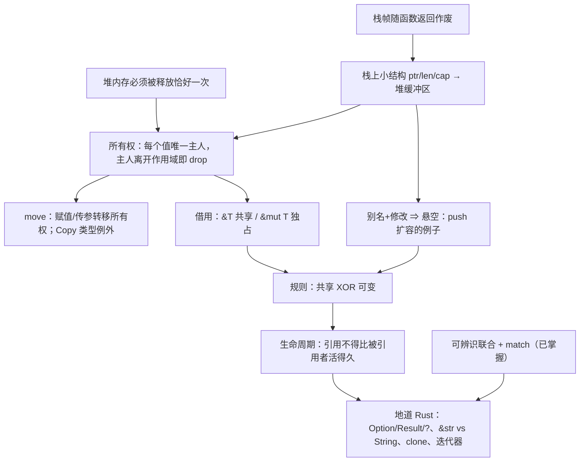

> [!quote] YOU

> [!note] SKILL loaded: teach

告诉我如何使用 rust 编程


> [!abstract] PI

先弄清楚你想用 Rust 做什么，再看你现有的基础，然后才开始讲。


> [!question] Question
> 你学 Rust 主要想做到什么？
>
> 1. 理解 Rust 的核心思想（所有权、借用、生命周期），能读懂和写出地道的 Rust 代码
> 2. 尽快上手做一个具体的东西（命令行工具、Web 后端等）
> 3. 系统编程或性能敏感的场景（替代 C/C++）
> 4. 先大致了解 Rust 是什么、好在哪里，判断值不值得学


> [!example] Answer
> 1. 理解 Rust 的核心思想（所有权、借用、生命周期），能读懂和写出地道的 Rust 代码


> [!question] Question
> 你目前最熟的编程语言是哪些？
>
> 1. Python / JavaScript / TypeScript
> 2. Java / C# / Go
> 3. C / C++
> 4. Haskell / OCaml / Scala 这类函数式语言
> 5. 基本没写过代码


> [!example] Answer
> 1. Python / JavaScript / TypeScript
> 2. Java / C# / Go


> [!abstract] PI

好，你写过带垃圾回收的语言。下面几道题帮我找到你的基础到哪里为止，不会也没关系。


> [!question] Quiz
> 在 Python 里执行 `a = [1, 2, 3]; b = a; b.append(4)` 之后，`a` 是什么？
>
> 1. [1, 2, 3, 4]
> 2. [1, 2, 3]
> 3. 报错，因为 a 已经被移交给 b


> [!success] Quiz — correct ✓
> Your answer: 1. [1, 2, 3, 4]
> Correct answer: 1
>
> `b = a` 不会复制列表，只是让 b 指向和 a 同一个堆上的对象。两个名字指向同一份数据，所以通过 b 改，a 也能看到。这种“多个名字同时指向、同时修改同一份数据”的情况叫别名（aliasing），后面讲 Rust 时它是核心问题。


> [!abstract] PI

Floor established. Jump up sharply.


> [!question] Quiz
> 在 Java / Go 这类有 GC 的语言里，一个堆上的对象什么时候可以被回收？
>
> 1. 当最后一个使用它的线程结束时
> 2. 当它的引用变量被重新赋值时
> 3. 当程序中不再有任何可达的引用指向它时
> 4. 当创建它的那个函数返回时


> [!success] Quiz — correct ✓
> Your answer: 3. 当程序中不再有任何可达的引用指向它时
> Correct answer: 3
>
> GC 判断的是可达性：从根（栈上的变量、全局变量等）出发顺着引用走，走不到的对象才算垃圾。函数返回不算，因为对象可能已经被返回出去或者存进了别处；变量被重新赋值也不一定算，因为可能还有其他引用指着它。这件事要等到运行时才能判断，所以 GC 必须在程序运行时去扫描。


> [!question] Quiz
> 在 C 这种没有 GC、需要手动 `free` 的语言里，下面哪个 bug 是“对同一块内存 free 两次”？
>
> 1. use-after-free
> 2. memory leak
> 3. double free
> 4. data race


> [!success] Quiz — correct ✓
> Your answer: 3. double free
> Correct answer: 3
>
> double free：同一块内存释放了两次。use-after-free：释放之后又去读写它。memory leak：一直没释放。data race：多个线程同时访问同一数据，且至少一个在写、又没有同步。前两个都是“谁负责释放、什么时候释放”没讲清楚导致的，Rust 的所有权就是为了解决这个问题。


> [!question] Quiz
> 在 C++ 里，`int* p = &v[0];` 拿到 vector 第一个元素的指针，然后执行 `v.push_back(42);`。这时 `p` 最可能怎么样？
>
> 1. 编译器会报错，禁止在持有指针时修改 v
> 2. p 会自动更新，指向元素在新内存里的位置
> 3. p 可能变成悬空指针，因为扩容时元素可能被搬到新的内存
> 4. p 仍然有效，因为 v 这个对象本身没有被释放


> [!failure] Quiz — incorrect ✗
> Your answer: 4. p 仍然有效，因为 v 这个对象本身没有被释放
> Correct answer: 3
>
> vector 的元素存放在堆上的一块连续缓冲区里。容量不够时，push_back 会申请一块更大的缓冲区，把元素复制过去，再释放旧的缓冲区。p 仍然指向旧地址，于是变成悬空指针，之后使用它就是 use-after-free。C++ 编译器不会拦你。这里同时发生了两件事：一个名字（p）在读，另一个名字（v）在改，这就是别名加修改。Rust 的借用规则恰好在编译期禁止这种组合。


> [!abstract] PI

找到一个边界了。再问一题，确认问题出在哪一层：


> [!question] Quiz
> 一个动态数组（C++ 的 `vector`、Go 的 slice、Rust 的 `Vec`）在内存里通常是什么样子？
>
> 1. 一个链表，每个元素各自分配在堆上、互相链接
> 2. 一个小结构（指针 + 长度 + 容量），指针指向堆上存元素的缓冲区
> 3. 所有元素直接存在变量所在的位置，扩容时就地变大


> [!failure] Quiz — incorrect ✗
> Your answer: 1. 一个链表，每个元素各自分配在堆上、互相链接
> Correct answer: 2
>
> 变量 v 本身只是一个固定大小的小结构，包含指向堆缓冲区的指针、长度和容量。元素放在堆上那块连续的缓冲区里。扩容时，v 的地址不变，但它内部的指针会改指一块新的缓冲区，旧缓冲区被释放。上一题的关键就在这里：v 还活着，不代表它的元素还在原来的地址。


> [!question] Quiz
> 函数里的局部变量（比如 `let x: i32 = 5`）一般存在哪里？函数返回后它会怎样？
>
> 1. 存在堆上，函数返回时由编译器插入 free 释放
> 2. 存在堆上，函数返回后等垃圾回收器来清理
> 3. 存在栈上，函数返回后仍然保留到程序结束
> 4. 存在栈上，函数返回时连同整个栈帧自动作废


> [!success] Quiz — correct ✓
> Your answer: 4. 存在栈上，函数返回时连同整个栈帧自动作废
> Correct answer: 4
>
> 每次调用函数，都会在栈上压入一个栈帧，局部变量就放在里面。函数返回时，整个栈帧直接作废，不需要任何回收逻辑，所以很快。代价是生命期固定：数据活不过创建它的那个函数调用。大小在运行时才确定、或者需要比函数活得更久的数据就放到堆上，堆上的数据得有人负责释放。


> [!abstract] PI

栈的概念你掌握了，没掌握的是“栈上的变量指向堆上的数据”这种结构。最后再探两条后面写地道 Rust 要用到的基础：


> [!question] Quiz
> TypeScript 里有 `type Shape = {kind: "circle", r: number} | {kind: "rect", w: number, h: number}`。对 `kind` 做 `switch` 时，在 `case "circle"` 分支里能访问 `shape.r`，原因是？
>
> 1. 编译器根据 kind 的值把类型收窄到了 circle 那个变体
> 2. 运行时会检查 r 是否存在，不存在就返回 undefined
> 3. 联合类型把所有变体的字段合并了，哪个分支都能访问 r


> [!success] Quiz — correct ✓
> Your answer: 1. 编译器根据 kind 的值把类型收窄到了 circle 那个变体
> Correct answer: 1
>
> 这叫可辨识联合（discriminated union）。编译器看到 `kind === "circle"`，就知道在这个分支里 shape 只可能是 circle 变体，所以允许访问 r。Rust 的 `enum` 加 `match` 是同一个思路，而且更严格：match 必须覆盖所有变体，漏掉一个就编译不过。Rust 用 `Option` 代替 null、用 `Result` 代替异常，靠的都是这个机制。


> [!abstract] PI

subagent 用不了（需要 tmux），只能我自己核对。下面用到的事实（Rust Book 第 4、8、10 章的所有权三规则、借用规则、`v.push` 报错 E0502、NLL）都是 Rust 最核心、最稳定的内容，我有把握。如果哪里需要逐字核对原文，你在 tmux 里启动 pi 后我再派 researcher 去查。

## 教学计划

**思路。** Rust 的所有规则都在回答同一个问题：**不用 GC，怎么在编译期就保证堆内存被释放且只被释放一次，并且释放之后没人再去用它？** 你熟悉 GC 的做法（运行时看可达性），所以我们从你缺的那一块开始：栈上的小结构指向堆上的缓冲区。再让你自己推出来：既然没有 GC，每块堆内存就得有唯一一个负责释放的主人（**所有权**）；主人可以交接（**move**）；想用但不想接手，就只能借（**借用**）；借的时候不能有人同时在改（**共享 XOR 可变**，正好防住你刚才错的那题）；编译器要能证明借来的东西没有活得比主人久（**生命周期**）。最后讲地道写法：`Option`/`Result` + `match` + `?`、`&str` 和 `String` 怎么选、什么时候用 `clone`、迭代器。这部分可以直接借用你已经懂的可辨识联合。

每一步尽量用提问的方式让你自己推出来。你给出推导之后，我再给对应的 Rust 代码和编译器报错来印证。



**根节点：**
- A 你已经确认过。
- B 是这节课的出发点：堆内存只释放 0 次是泄漏，释放 2 次是 double free，你也认得这些 bug。
- C 是你缺的那一块，所以第一课就从 C 讲起。

计划这样可以吗？想调整范围或顺序的话现在说，确认后我就从 C 开始讲。


> [!quote] YOU

好的从C开始


> [!abstract] PI

## 节点 C：栈上的小结构 → 堆上的缓冲区

**为什么需要它？** 后面的所有权、借用、生命周期，管的都是**堆上的那块内存**，以及**谁手里拿着指向它的指针**。这个画面不清楚，后面的规则看起来就会很随意。所以我们先把它推出来。

**你已经知道的：** 局部变量放在栈帧里，函数返回时整个栈帧一起作废。

现在考虑一个问题。你写：

```rust
let mut v = Vec::new();   // 空的动态数组
v.push(1);
v.push(2);
// ……可能 push 3 个，也可能 300 万个，取决于运行时的输入
```

最直接的想法是把元素就放在 `v` 所在的栈帧里。先想一下这样做有什么问题：


> [!question] Quiz
> 为什么动态数组的元素不能直接放在栈帧里？
>
> 1. 栈上的内存只能读不能写，元素却需要被修改
> 2. 栈上的数据只有当前线程能看到，元素却需要共享
> 3. 栈帧大小在编译期就固定了，元素个数却到运行时才知道
> 4. 栈上只能存整数和指针，元素却可能是任意类型


> [!success] Quiz — correct ✓
> Your answer: 3. 栈帧大小在编译期就固定了，元素个数却到运行时才知道
> Correct answer: 3
>
> 编译器生成函数代码时，就已经算好了栈帧多大、每个局部变量在帧里的哪个偏移位置。v 在帧里只能占一块固定大小的格子，而元素数量要到运行时才知道，可能是 3 个，也可能是 300 万个。所以元素只能放到一个大小可以在运行时决定的地方，也就是堆。栈本身是可读写的，什么类型都能放，所以另外两个理由不对；线程共享那条和这个问题无关。


> [!question] Quiz
> 要支持上面三个操作，v 那个固定大小的格子里至少需要存哪些字段？（多选）
>
> 1. 每个元素各自的堆地址列表
> 2. 当前缓冲区最多能容纳的元素个数
> 3. 指向上一块旧缓冲区的指针
> 4. 当前已存放的元素个数
> 5. 指向堆上缓冲区起始位置的指针


> [!success] Quiz — correct ✓
> Your answer: 2. 当前缓冲区最多能容纳的元素个数, 4. 当前已存放的元素个数, 5. 指向堆上缓冲区起始位置的指针
> Correct answer: 2, 4, 5
>
> ptr：元素在一块连续缓冲区里，所以第 i 个元素的地址是 ptr + i × 元素大小，有起始地址就够了，不用为每个元素单独存地址（单独存地址的那种结构其实就是你上次选的链表）。len：告诉你现在有几个元素、哪些下标合法、push 应该写到哪个位置。cap：告诉你缓冲区什么时候满了、需要换更大的。这三个字段都是固定大小，在 64 位机器上各占 8 字节，一共 24 字节，无论元素有多少个。旧缓冲区的指针不用留：扩容时把元素复制到新缓冲区，旧的立刻释放掉。


> [!question] Quiz
> v 当前 len = 2、cap = 2。有人保存了 p = &v[1]，然后执行 v.push(9)。下面哪个说法正确？
>
> 1. v 的栈地址不变，v.ptr 改指新缓冲区，p 被自动更新到新位置
> 2. v 的栈地址不变，v.ptr 也不变，缓冲区就地变大，p 仍有效
> 3. v 整个被搬到新的栈地址，v.ptr 不变，p 指向的元素仍有效
> 4. v 的栈地址不变，v.ptr 改指新缓冲区，p 指向已释放的内存


> [!failure] Quiz — incorrect ✗
> Your answer: 1. v 的栈地址不变，v.ptr 改指新缓冲区，p 被自动更新到新位置
> Correct answer: 4
>
> len == cap，所以这次 push 会扩容：申请新缓冲区、复制元素、释放旧缓冲区、更新 v.ptr 和 cap。v 在栈帧里的格子位置是编译期定好的，不会移动。p 只是一个裸地址，没有任何东西会去通知它或更新它，所以它现在指向已经释放的内存。（就地变大在某些分配器里确实可能发生，但不能依赖，一般默认会搬走。）这正是 Rust 要在编译期禁止的情况：手里有 p 的时候，不允许通过 v 修改。


> [!question] Quiz
> 在没有 GC 的程序里，`v.push` 扩容后为什么不能把旧指针 p 更新到新地址？
>
> 1. 新缓冲区里元素的排列顺序和旧缓冲区不同
> 2. 运行时没有任何东西记录哪些指针指向了这块缓冲区
> 3. 堆内存一旦分配就不允许再写入新的地址值
> 4. 指针是只读变量，创建之后就不能再修改


> [!success] Quiz — correct ✓
> Your answer: 2. 运行时没有任何东西记录哪些指针指向了这块缓冲区
> Correct answer: 2
>
> 要更新 p，得先知道 p 在哪儿。没有 GC 时，运行时不会记录“谁指向了这块内存”，push 的代码只看得到 v 自己的字段。Java 的 GC 能更新引用，正是因为它追踪了所有引用，这是它的运行时成本。Rust 不想付这个成本，所以改成在编译期禁止“有人借着 v 的元素时修改 v”。元素顺序在扩容时不变，指针变量本身也可以修改，所以另外两个理由都不对。


> [!abstract] PI

节点 C 讲完了。用两句话概括：

1. **`Vec`/`String` = 栈上固定 24 字节（ptr, len, cap）+ 堆上的缓冲区。** 两者的地址各变各的。
2. **没有 GC，就没人追踪指针。** 缓冲区一换，旧指针就悬空了，也没人会去修正它。

两个根节点现在都有了：
- **B**：堆内存必须恰好释放一次
- **C**：栈上的那个小结构是通往堆内存的唯一入口

下一个节点 **D：所有权**，就是从这两点推出来的。我会先问你一个问题：*函数返回、`v` 那 24 字节随栈帧作废的时候，堆上的缓冲区该由谁来释放？如果 `let w = v;` 复制出了第二份 ptr，又会出什么问题？*

现在继续讲 D 吗？


> [!quote] YOU

继续讲 D


> [!abstract] PI

## 节点 D：所有权

**为什么需要它？** 根节点 B 要求堆缓冲区恰好释放一次，0 次是泄漏，2 次是 double free。Rust 没有 GC，所以必须**有一段确定的代码，在一个确定的时刻**去释放它。我们来找这个时刻。

```rust
fn f() {
    let v = vec![1, 2, 3];   // 栈上 24 字节 + 堆上缓冲区
    // ……用 v ……
}   // ← 函数返回，栈帧作废
```

函数返回时，栈上那 24 字节会自动作废，但堆上的缓冲区**不会**。栈帧作废只是“这块栈空间不要了”，没有任何代码会顺着 ptr 去释放堆。


> [!question] Quiz
> 在没有 GC 的前提下，释放 v 的堆缓冲区最自然、开销最小的时机是什么？
>
> 1. 当 v 离开作用域、它的栈格子即将作废时，顺着 ptr 释放
> 2. 程序结束时，由操作系统一次性回收所有堆内存
> 3. 当 v 最后一次被修改之后，立刻顺着 ptr 释放
> 4. 定期扫描堆，释放那些已经没有变量指向的缓冲区


> [!success] Quiz — correct ✓
> Your answer: 1. 当 v 离开作用域、它的栈格子即将作废时，顺着 ptr 释放
> Correct answer: 1
>
> v 的栈格子是通往缓冲区的唯一入口。格子作废以后，就再也没人知道缓冲区在哪儿了，所以必须在格子作废之前释放，也就是离开作用域的时候。这个时刻编译器在编译期就知道（在 `}` 处），所以它可以直接在那里插入一行释放代码，运行时零额外开销。Rust 把这一步叫 drop。“等到程序结束”就是内存泄漏；“定期扫描”就是 GC；“最后一次修改之后”是错的，因为修改完以后可能还要读。


> [!question] Quiz
> 按“离开作用域就顺着 ptr 释放”这条规则，函数在 } 处会发生什么？
>
> 1. w 释放缓冲区，v 发现已被释放于是跳过，一切正常
> 2. w 释放缓冲区，v 再释放同一块缓冲区，造成 double free
> 3. 只有先声明的 v 释放缓冲区，w 作为副本什么都不做
> 4. 两个变量都不释放，因为缓冲区还被对方引用着，造成泄漏


> [!failure] Quiz — incorrect ✗
> Your answer: 3. 只有先声明的 v 释放缓冲区，w 作为副本什么都不做
> Correct answer: 2
>
> 规则很机械：每个变量离开作用域时都顺着自己的 ptr 去释放。v 和 w 的 ptr 是同一个地址，所以同一块缓冲区会被释放两次，这就是 double free。“发现已被释放于是跳过”需要运行时记录状态；“还被对方引用所以不释放”需要知道有几个引用指着它，其实就是引用计数。这两种都要额外的运行时机制。“副本什么都不做”的问题在于，两份 24 字节完全一样，凭什么区分哪个是副本？必须有一条规则来区分。


> [!question] Quiz
> 如果规定“先声明的 v 负责释放，w 只是不负责的副本”，main 里使用 x 时会怎样？
>
> 1. x 指向的缓冲区会被释放两次，分别由 v 和 x 释放
> 2. x 指向的缓冲区已在 make 返回时被 v 释放，x 悬空
> 3. x 指向的缓冲区仍然有效，因为 w 已经把它返回出去了


> [!success] Quiz — correct ✓
> Your answer: 2. x 指向的缓冲区已在 make 返回时被 v 释放，x 悬空
> Correct answer: 2
>
> v 是负责人，它在 make 的 } 处离开作用域，于是释放缓冲区。w 和 x 只是副本，不负责释放，但它们的 ptr 仍指着那块已经被释放的内存。所以 main 里的 x 是悬空的，再使用就是 use-after-free。问题在于：数据流向了 w，负责人却还是 v，责任没有跟着数据走。


> [!question] Quiz
> 责任转交给 w 之后，要在不增加任何运行时开销的前提下杜绝上面的 bug，对 v 最合理的处理是？
>
> 1. 赋值时把堆缓冲区也复制一份，让 v 和 w 各自拥有独立的缓冲区
> 2. 给缓冲区加一个计数器，记录有几个变量指向它，归零时才释放
> 3. 编译器把 v 标记为已失效，之后任何对 v 的使用都报编译错误
> 4. 运行时把 v 的 ptr 置为 null，之后使用 v 时先检查是否为 null


> [!success] Quiz — correct ✓
> Your answer: 3. 编译器把 v 标记为已失效，之后任何对 v 的使用都报编译错误
> Correct answer: 3
>
> 编译器在编译期就知道 `let w = v` 这一行在哪儿，所以它可以禁止这之后对 v 的任何使用，同时也不在 v 离开作用域时插入释放代码。这一切都在编译期完成，运行时零开销。这就是 move（移动）。另外三个方案都要付运行时代价：置 null 加检查，每次访问都要多一次判断；深拷贝要复制整个堆缓冲区；引用计数要维护计数器。Rust 里其实这三种都能用，分别对应 Option、.clone()、Rc，但都必须你显式写出来，默认行为是零开销的 move。


> [!question] Quiz
> 这段代码的结果是什么？
>
> 1. 正常打印 3 和 3：传参时自动深拷贝了一份缓冲区给 s
> 2. 正常打印 3 和 3：传参只是临时借给函数，返回后 v 仍可用
> 3. 编译错误：v 在传给 consume 时已被 move，之后不能再用
> 4. 运行时崩溃：consume 返回时 s 释放了缓冲区，v 悬空


> [!warning] Quiz — cancelled
> (user skipped)


> [!abstract] PI

这道题先放下。节点 D 的核心已经推出来了：

- **所有权三规则**：每个值有一个所有者；同一时刻只能有一个；所有者离开作用域就 drop。
- **move**：赋值、传参、返回都会转移所有权。转移之后旧变量失效，编译期就会拦截，运行时零开销。

刚才那道题考的是：`consume(v)` 之后再用 `v` 会编译报错（E0382），因为传参和 `let s = v` 一样会发生 move。想“临时借给函数”，要写 `consume(&v)`，这就是下一个节点 **F：借用**。

你想现在继续讲 E/F，还是先停在这里？


> [!quote] YOU

完整的代码是什么


> [!abstract] PI

下面两段代码我都用本机的 `rustc` 实际编译、运行过。

## 1. 刚才那道题的代码（编译不过）

`bad.rs`：
```rust
fn consume(s: Vec<i32>) {
    println!("{}", s.len());
}

fn main() {
    let v = vec![1, 2, 3];
    consume(v);              // 所有权从 v 移到了 s
    println!("{}", v.len()); // ← v 已失效
}
```

`rustc bad.rs` 的真实输出：
```
error[E0382]: borrow of moved value: `v`
 --> bad.rs:8:20
  |
6 |     let v = vec![1, 2, 3];
  |         - move occurs because `v` has type `Vec<i32>`, which does not implement the `Copy` trait
7 |     consume(v);
  |             - value moved here
8 |     println!("{}", v.len());
  |                    ^ value borrowed here after move
  |
note: consider changing this parameter type in function `consume` to borrow instead if owning the value isn't necessary
 --> bad.rs:1:15
  |
1 | fn consume(s: Vec<i32>) {
  |    -------    ^^^^^^^^ this parameter takes ownership of the value
help: consider cloning the value if the performance cost is acceptable
  |
7 |     consume(v.clone());
```

编译器给了两种修法：**借用**，或者 **clone**。它们就对应节点 D 那道题里被排除掉的几种方案。

## 2. 能编译的几种写法

`good.rs`：
```rust
// 写法 1：借用（不转移所有权）
fn inspect(s: &Vec<i32>) {
    println!("inspect: {}", s.len());
}

// 写法 2：拿走所有权，用完再还回来
fn take_and_give_back(s: Vec<i32>) -> Vec<i32> {
    println!("take: {}", s.len());
    s
}

// 原来的函数：拿走所有权，函数结束时 drop
fn consume(s: Vec<i32>) {
    println!("consume: {}", s.len());
}

fn main() {
    let v = vec![1, 2, 3];

    inspect(&v);                     // 借出去，v 仍是所有者
    println!("after inspect: {}", v.len());

    let v = take_and_give_back(v);   // 所有权出去又回来
    println!("after give back: {}", v.len());

    consume(v.clone());              // 深拷贝一份交出去，v 不受影响
    println!("after clone: {}", v.len());

    consume(v);                      // 真正交出所有权
    // println!("{}", v.len());      // 取消注释 → error[E0382]
}
```

运行输出：
```
inspect: 3
after inspect: 3
take: 3
after give back: 3
consume: 3
after clone: 3
consume: 3
```

要自己跑的话，把代码存成 `good.rs`，然后执行 `rustc good.rs && ./good`。

**三种写法对比：**
- **写法 2**（拿走再还回来）能用，但每个函数都得把值传回来，很啰嗦。
- **clone** 要复制整个堆缓冲区，有开销。
- **`&v` 借用**最常用，但它也有自己的规则：借出去的时候，别人能不能同时修改 `v`？这就回到了节点 C 里 `push` 让指针悬空的那个问题。这是下一个节点 **F**。

要继续讲 F 吗？


> [!quote] YOU

继续 F


> [!abstract] PI

## 节点 F：借用

**为什么需要它？** 上一段代码说明了：只想“用一下” `v`，却不得不交出所有权，要么还回来、要么 clone，都很笨。我们需要一种方式，**能访问值，但不承担释放责任**。

**`&v` 是什么？** 它是一个**指向 `v` 那 24 字节栈格子的指针**，叫作**引用**。注意它指向的是 `v` 本身，不是堆缓冲区。

```
  inspect 的栈帧            main 的栈帧                 堆
  ┌────────────┐          ┌──────────────┐          ┌───┬───┬───┐
  │ s ─────────┼────────▶ │ v: ptr ──────┼────────▶ │ 1 │ 2 │ 3 │
  └────────────┘          │    len=3     │          └───┴───┴───┘
                          │    cap=3     │
                          └──────────────┘
```

`s.len()` 的执行过程是：顺着 `s` 找到 `v`，读出 `v` 的 len。


> [!question] Quiz
> inspect(&v) 返回时，形参 s 离开作用域。按所有权规则，会发生什么？
>
> 1. 释放 v 的栈格子：s 离开作用域，把它指向的 24 字节作废
> 2. 什么都不释放：s 不是所有者，缓冲区仍由 v 负责
> 3. 把 v 标记为失效：借用结束后所有权归还给了 inspect
> 4. 释放堆缓冲区：s 离开作用域，顺着指针把数据 drop 掉
