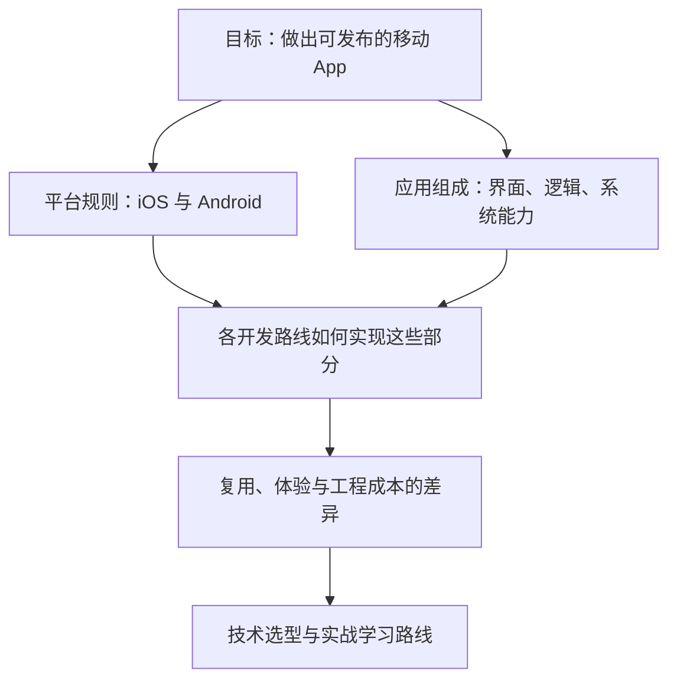

> [!quote] YOU

我现在想全面地了解移动端开发的相关技术，包括：

1. iOS和安卓。
2. 可选择的开发方式和技术栈。
3. 它们的异同。


> [!quote] YOU

我现在想全面地了解移动端开发的相关技术，包括：

1. iOS和安卓。
2. 可选择的开发方式和技术栈。
3. 它们的异同。


> [!abstract] PI

可以。我们把它整理成一张**“平台 → 开发方式 → 技术栈 → 选型取舍”**的地图，而不是只罗列 Swift、Kotlin、Flutter 等名词。

先用一道小题确认你的起点；不熟悉可以直接选“不知道”，我会据此调整讲解深度。


> [!question] Quiz
> 假设要让同一款产品同时支持 iOS 和 Android，下面哪种说法正确？
>
> 1. 跨平台框架可以复用代码，但仍需分别构建两个平台的应用。
> 2. 只要两端使用同一种编程语言，就能直接运行同一份应用。
> 3. 跨平台框架可以生成一个安装包，供两个平台直接安装。


> [!success] Quiz — correct ✓
> Your answer: 1. 跨平台框架可以复用代码，但仍需分别构建两个平台的应用。
> Correct answer: 1
>
> 复用源代码，不等于复用安装包。iOS 和 Android 的应用格式、系统接口和运行环境不同；跨平台框架帮助共享代码，但面向这两个平台发布应用时，仍需分别构建。


> [!question] Question
> 这次全面了解移动端开发，你最想达到什么目的？
>
> 1. 建立技术全景
> 2. 给自己的产品选技术栈
> 3. 规划学习与实战路线


> [!example] Answer
> 3. 规划学习与实战路线


> [!question] Quiz
> 再看一个决定学习路线的区别：React Native 和 Flutter 都能开发双端 App，关于它们如何显示界面，哪项正确？
>
> 1. 两者通常都把 HTML 和 CSS 放进内嵌浏览器，由网页引擎显示界面。
> 2. React Native 通常使用平台原生视图；Flutter 通常由自己的渲染体系绘制组件。
> 3. 两者通常都把界面代码转换成 SwiftUI 和 Jetpack Compose 组件。


> [!failure] Quiz — incorrect ✗
> Your answer: 1. 两者通常都把 HTML 和 CSS 放进内嵌浏览器，由网页引擎显示界面。
> Correct answer: 2
>
> React Native 的常规组件映射到平台原生视图；Flutter 的常规组件由 Flutter 自己的渲染体系绘制。内嵌浏览器是另一类方案，不能把所有跨平台技术都理解成“App 里套网页”。


> [!abstract] PI

这个回答帮我们找到了一个值得重点讲清的地方：**“跨平台”不是一种实现方式**，不同框架可能用完全不同的方式显示界面。这会直接影响你要学什么、哪些知识能复用，以及以后如何排查问题。

后面的学习路线会重点拆开这一层，而不只比较语言。


> [!question] Question
> 你目前有哪些实际编程经验？
>
> 可多选；也可以选 Other，补充你用过的技术和做过的项目。
>
> 1. 暂时没有编程经验
> 2. Web 前端：HTML、CSS、JavaScript / TypeScript、React 等
> 3. 后端或脚本：Python、Java、Go、Node.js 等
> 4. 原生客户端：Swift、Kotlin、Java、Objective-C 等
> 5. 其他客户端：Flutter、C# / .NET、Unity、桌面开发等


> [!example] Answer
> 2. Web 前端：HTML、CSS、JavaScript / TypeScript、React 等
> 3. 后端或脚本：Python、Java、Go、Node.js 等


> [!question] Quiz
> 结合你的 Web 经验：一个界面完全由 WebView 中的 HTML、CSS、JavaScript 实现的 App，如果要调用系统相机，哪种说法准确？
>
> 1. 只要打包成 App，网页脚本就自动拥有全部系统权限。
> 2. 必须先把整个界面改写成平台原生组件才能调用。
> 3. 可以通过宿主提供的原生插件或桥接接口调用。


> [!success] Quiz — correct ✓
> Your answer: 3. 可以通过宿主提供的原生插件或桥接接口调用。
> Correct answer: 3
>
> 界面怎么渲染，与系统能力怎么接入，是两个不同的问题。WebView 界面可以通过宿主的原生插件或桥接调用相机等能力，但仍要满足系统权限等要求；并不需要先重写整个界面。


> [!abstract] PI

你的起点已经比较清楚：**有 Web 前后端经验，理解代码复用和原生能力桥接，但还需要建立不同移动框架的实现模型。** 所以我们不从编程基础讲起，也不急着推荐某个框架。

建议按下面的顺序展开：

### 1. 先认识平台：iOS 和 Android
弄清操作系统给 App 提供什么、限制什么，再比较：
- 开发语言、工具和 UI 框架。
- 生命周期、权限、后台运行。
- 构建、真机调试、签名、安装与上架。

### 2. 再认识开发路线：到底共享哪一层
围绕三个问题比较，而不是背框架名称：
- **业务逻辑由谁执行？**
- **界面由谁显示？**
- **相机、定位、推送等系统能力如何接入？**

覆盖原生开发、React Native、Flutter、WebView 混合开发、Kotlin Multiplatform，以及移动 Web / PWA；补充小程序、游戏开发与普通 App 的边界。

### 3. 用同一个项目横向比较
以一个“登录＋列表＋拍照上传＋本地缓存”的 App 为例，比较各路线的代码复用、体验、性能、调试和维护成本。重点解释：**为什么有这些差异，而不是简单排个优劣榜。**

### 4. 最后落到你的学习路线
结合已有 Web 技能，确定主学路线、需要补的原生基础，以及从第一个页面到双端发布的实践步骤。



这个范围和顺序符合你的预期吗？


> [!quote] YOU

符合


> [!abstract] PI

## 第一讲：先分清“平台”和“开发框架”

先回答一个决定后面所有选型的问题：

**为什么已经有了 Flutter、React Native，还需要懂 iOS 和 Android？**

从你熟悉的 Web 开发出发，就能推出来。

### 1. 框架帮助你写程序，但不是程序运行环境的主人

你用 React 开发网页时：

- React 帮你组织组件、管理状态。
- 浏览器提供 DOM、网络请求、存储等接口。
- 网页最终能做什么，仍受浏览器规则约束。

例如：React 不能让一个没有摄像头授权的网页，凭空获得摄像头权限。

移动开发里也存在类似的关系：

| 角色 | Web 中的例子 | 移动 App 中的例子 |
|---|---|---|
| 帮你组织和实现应用的工具 | React、Vue | SwiftUI、Compose、React Native、Flutter |
| 提供运行规则和系统接口的平台 | 浏览器及其所在系统 | iOS、Android |
| 应用希望使用的能力 | 网络、存储、摄像头 | 网络、存储、摄像头、定位、通知等 |

这张表是在**对应角色，不是在说这些框架内部原理相同**。

由此得到第一块基础：

> **开发框架不能取消目标操作系统施加的限制。**

所以，“用跨平台框架”不等于“不再需要了解平台”。

### 2. 为什么移动操作系统要管 App？

设想你自己设计一部手机，里面同时装着聊天、地图、银行和游戏。

如果每个 App 都可以随便读取其他 App 的文件、打开相机、长期占用处理器，会怎样？

会出现三个直接问题：

- **数据安全**：游戏不该随便读取银行 App 的私有文件。
- **隐私**：App 不该未经允许就使用敏感资源。
- **资源竞争**：多个 App 不可能都无限制地占用内存、电量和后台执行时间。

因此，学习移动平台，不只是学“按钮怎么画”，还要理解**系统如何管理应用**。

后面我们会逐步拆开三个概念，现在先认识它们解决的问题：

| 概念 | 要解决的问题 |
|---|---|
| **沙箱** | 哪些数据属于这个 App，它能访问哪些范围？ |
| **权限** | 这个 App 是否可以使用某项受保护的能力？ |
| **生命周期与后台规则** | App 什么时候运行、暂停，以及如何应对被系统终止？ |

iOS 和 Android 都需要处理这些问题，**但具体接口和规则并不相同**。这就是两者“目标相似，实现不同”的一个根源。

### 3. 用“拍照上传”连接到技术选型

把这个功能拆成两件事：

**拍照：与设备和平台交互。**

需要接入相机能力，处理权限、用户取消、设备不可用等情况。

**上传：与服务器交互。**

照片拿到之后，通过网络接口发送给后端。这部分可以沿用大量你已有的 HTTP、认证和错误处理知识。

于是你就能看出：

> **一个产品功能，可能同时包含容易共享的业务逻辑，以及需要适配平台的系统交互。**

跨平台框架的工作之一，是帮你封装这些差异。但封装不等于差异消失：例如用户拒绝相机权限，无论界面用什么框架写，应用都必须处理。

这也为下一讲准备了关键问题：**各条技术路线，究竟共享了哪些部分，又把哪些差异留给开发者？**

参考：[Android 应用基础](https://developer.android.com/guide/components/fundamentals)、[Apple 用户隐私保护](https://developer.apple.com/documentation/uikit/protecting-the-user-s-privacy)。


> [!question] Quiz
> 一个 Flutter App 在 iOS 上无法后台持续执行某项任务。已确认原因是 iOS 对这类任务的执行规则，而不是框架缺少接口。下面哪项判断正确？
>
> 1. 换成 Swift 重写，就能摆脱这项系统规则。
> 2. 需要按 iOS 允许的机制重新设计这项任务。
> 3. 换成 React Native，就能摆脱这项系统规则。


> [!success] Quiz — correct ✓
> Your answer: 2. 需要按 iOS 允许的机制重新设计这项任务。
> Correct answer: 2
>
> 题目已经确认限制来自操作系统，而不是框架封装不足。Swift、React Native 和 Flutter 开发的 App 都受到目标系统规则约束。换语言或框架不等于换掉系统规则；需要寻找平台允许的执行方式，必要时调整产品行为。


> [!abstract] PI

对，你抓住了第一条主线：

**语言和框架决定“怎么实现”，操作系统决定“允许怎么运行”。**

以后遇到问题，先区分：
- **框架没有封装某个能力**：可能通过原生代码补上。
- **系统本身限制某个行为**：需要遵循平台机制，或调整产品设计。

接下来比较 iOS 和 Android 的原生技术栈，再看跨平台方案究竟替你共享了什么。


> [!quote] YOU

好的继续


> [!abstract] PI

## 第二讲：iOS 和 Android 的原生技术栈

上一讲我们确定了：**框架之下，还有平台自己的接口和规则。**

那么最直接的开发方式就是：分别使用两个平台的 SDK、UI 框架和构建工具来做 App。这就是我们现在讨论的**原生开发路线**。

先把“原生”理解为一条开发路线，**不要把它当成“性能好”的同义词**。具体性能仍取决于实现。

### 1. 一张表，先把名词放对位置

你熟悉 JavaScript、React 和开发工具的区别。移动开发也要区分这些角色：

| 角色 | iOS | Android |
|---|---|---|
| **编程语言**：表达程序逻辑 | Swift；已有项目中也会遇到 Objective-C | Kotlin；已有项目中也会遇到 Java |
| **现代 UI 框架**：构建界面 | SwiftUI | Jetpack Compose |
| **另一套仍需认识的 UI 体系** | UIKit | Android Views，常搭配 XML 布局 |
| **主要开发工具** | Xcode | Android Studio |
| **平台 SDK** | 提供相机、定位、通知等 Apple 平台接口 | 提供相机、定位、通知等 Android 平台接口 |

因此：

- **Swift 对应的是 Kotlin 这一层，不是 Flutter 这一层。**
- **SwiftUI 对应的是 Jetpack Compose 这一层，不是 Android 这一层。**
- Xcode、Android Studio 是工具，不是语言或 UI 框架。

这些角色分清了，后面就不会把不同层次的技术拿来直接比较。

### 2. 为什么学会语言，还不能直接做出完整 App？

以“拍照上传”为例：

- 你用 **Swift / Kotlin** 表达“拍照成功之后再上传”的逻辑。
- 你用 **UI 框架**显示拍照按钮、预览和上传进度。
- 你通过**平台接口**接入相机。
- 你用**构建工具链**把代码、资源和配置信息处理成可以运行的应用。

所以，“学习 iOS”不等于只学 Swift 语法；“学习 Android”也不等于只学 Kotlin 语法。

这与你已有的经验一样：**会 JavaScript，不等于已经掌握浏览器 API、React、构建和部署。**

### 3. 为什么两边都不止一套 UI 技术？

这不是要求你同时学完两套，而是因为平台在演进，已有应用又不会全部推倒重写。

- iOS：SwiftUI 可以和 UIKit 混用。
- Android：Compose 可以和已有的 Views 界面互操作。

例如，一个已有 UIKit 应用，可以保留旧页面，用 SwiftUI 开发新页面。

因此，学习时要区分两个目标：

| 目标 | 合理起点 |
|---|---|
| 做自己的全新 iOS 项目 | Swift ＋ SwiftUI |
| 做自己的全新 Android 项目 | Kotlin ＋ Jetpack Compose |
| 维护已有产品、读懂更多工程 | 再按项目需要补 UIKit / Views，以及旧语言 |

**“先学现代路线”不等于“旧体系已经没有价值”。**

### 4. 双端原生开发，究竟重复在哪里？

假设后端提供了一个“获取订单列表”的 HTTP 接口。

两个客户端可以共用：

- 同一个后端服务。
- 同一套接口约定。
- 同一套产品需求和业务规则。

但如果你分别写两套原生客户端，就通常需要分别实现：

- iOS 的订单页面和 Android 的订单页面。
- 两边的网络调用、状态处理与本地缓存。
- 两边的权限、导航和生命周期适配。

注意这个区别：

> **共用后端接口，是共享服务；并不意味着客户端实现代码也共享了。**

这正是跨平台方案要解决的主要问题之一：**能否让两端不必把相同的客户端工作重复实现？**

下一讲，我们就以这两套原生技术栈为参照，拆解跨平台究竟共享了哪一层。

参考：[Apple SwiftUI](https://developer.apple.com/swiftui/)、[Android Jetpack Compose](https://developer.android.com/compose)。


> [!question] Quiz
> 一个团队用 Swift＋SwiftUI 开发 iOS 客户端，用 Kotlin＋Compose 开发 Android 客户端，两端调用同一个后端 API。目前可以确定共享的是什么？
>
> 1. 客户端业务逻辑代码，不代表客户端界面代码共享。
> 2. 客户端界面组件代码，不代表平台能力接入代码共享。
> 3. 后端服务和接口约定，不代表客户端实现代码共享。


> [!success] Quiz — correct ✓
> Your answer: 3. 后端服务和接口约定，不代表客户端实现代码共享。
> Correct answer: 3
>
> 两个客户端访问同一个服务，只说明它们共用后端和接口约定。它们可以分别用 Swift 和 Kotlin 实现同样的业务规则；规则相同，不等于源代码共享。客户端代码共享需要额外的技术方案，不能从“共用后端”直接推出来。


> [!abstract] PI

对。这里要牢牢记住：

**业务规则相同 ≠ 客户端代码共享。**

两套原生客户端可以使用同一个后端，但仍各自实现页面和业务逻辑。接下来比较跨平台方案时，我们就追问：**它共享的是逻辑、界面，还是两者？共享后又留下了哪些平台差异？**


> [!quote] YOU

共享的应该是逻辑。

然后界面的话，应该是通过编译来实现在不同平台上的效果。


> [!abstract] PI

你抓到了一个重要方向：**相同的逻辑，不应该在两端重复写。** 但还要补两点：

1. 跨平台可以共享逻辑，**也可以共享界面代码**。
2. “通过编译适配平台”还不足以解释界面，因为**代码如何执行**和**界面如何显示**是两个不同的问题。

我们顺着你的推测，把它拆开。

## 1. 共享界面，不等于共享最终的界面实现

假设我们希望两个平台都显示：

> 一个输入框、一个登录按钮；点击后发起登录请求。

这里能共享的不只是登录逻辑，也可以包括“页面上有什么、怎么排列、点击后做什么”的代码。

但这份界面描述，最终怎么变成屏幕上的东西？至少有三种路线：

| 路线 | 共享的界面代码描述什么 | 最终主要由谁呈现界面 |
|---|---|---|
| **React Native** | React 组件，例如 `View`、`Text`、`TextInput` | 对应的平台原生视图 |
| **Flutter** | Dart 编写的 Widget | Flutter 自己的布局与绘制体系 |
| **WebView 混合开发** | HTML、CSS 和 Web 组件 | 内嵌的浏览器引擎 |

这里说的是各自的**常规界面路径**；实际项目也可以混用其他方式。

所以它们都可以“写一份界面代码，支持两个平台”，但内部做法并不一样。

## 2. 用一个输入框，看清三者的区别

### React Native：让平台视图来实现

你写：

```jsx
<TextInput placeholder="请输入用户名" />
```

React Native 在运行时创建、更新对应的平台原生输入视图。

**它不是把这段 JSX 翻译成一份 SwiftUI 页面，再翻译成一份 Compose 页面。**

### Flutter：用自己的 UI 体系实现

你写：

```dart
TextField(
  decoration: InputDecoration(hintText: '请输入用户名'),
)
```

Flutter 用自己的布局、绘制体系呈现这个组件，并与系统的键盘、输入等能力协作。

**它通常不是换成一个 iOS 原生输入框或 Android 原生输入框。**

### WebView：由网页引擎实现

你写：

```html
<input placeholder="请输入用户名" />
```

由 App 内嵌的网页引擎处理 HTML、CSS、布局和显示。

这条路线最接近你已有的 Web 开发经验，但它不是 React Native 或 Flutter 的默认工作方式。

## 3. 那“编译”在其中负责什么？

可以用你熟悉的 Web 来区分：

- TypeScript 转成 JavaScript：解决**代码转换**问题。
- 浏览器把 DOM、CSS 变成屏幕上的内容：解决**布局和绘制**问题。

移动开发也要这样分开看：

| 问题 | 关注点 |
|---|---|
| **代码怎么执行？** | 编译成机器码，还是由某种运行时执行？ |
| **界面怎么显示？** | 使用平台视图、自有绘制体系，还是网页引擎？ |

例如，Flutter 的移动端发布构建会将 Dart 代码编译成机器码，**但这不意味着它的 Widget 被编译成 SwiftUI 或 Compose 组件**。执行后的代码，仍使用 Flutter 的 UI 体系来呈现界面。

因此，你的理解可以升级成：

> **跨平台框架可以共享逻辑和界面描述，再通过各自的运行、渲染和平台适配机制，做出不同平台上的应用。不是所有框架都通过“编译成平台原生界面”实现跨平台。**

参考：[React Native 原生组件](https://reactnative.dev/docs/intro-react-native-components)、[Flutter 架构概览](https://docs.flutter.dev/resources/architectural-overview)。


> [!question] Quiz
> 一个 Flutter 按钮看起来与 iOS 系统按钮非常相似。仅凭这一点，能否判断它使用了 iOS 原生按钮控件？
>
> 1. 不能，自有绘制体系也能呈现类似的 iOS 外观。
> 2. 能，编译成机器码就意味着使用了原生控件。
> 3. 能，外观符合 iOS 风格就意味着使用了原生控件。


> [!success] Quiz — correct ✓
> Your answer: 1. 不能，自有绘制体系也能呈现类似的 iOS 外观。
> Correct answer: 1
>
> 外观风格、代码执行方式、UI 实现方式是三个不同的维度。Flutter 可以用自己的绘制体系实现 iOS 风格的按钮；看起来像原生控件，不等于底层就是那个原生控件。编译成机器码也不能推出它使用平台原生控件。


> [!abstract] PI

对。现在你已经分清了三个独立维度：

- **共享什么**：业务逻辑、界面代码，或两者。
- **代码如何执行**：编译、运行时等机制。
- **界面如何呈现**：平台原生视图、框架自绘、网页引擎。

所以，**“一份代码支持双端”是目标，不是一种固定的实现原理。**


> [!quote] YOU

接下来我们应该熟悉对应的工具链


> [!abstract] PI

对。先熟悉工具链，就能把前面的技术地图变成“我怎么实际做出一个 App”。

不过，**工具链不是单独一个 IDE，而是把源代码变成可运行、可发布应用的一组工具**。我们按真实开发流程认识它：

| 环节 | 要回答的问题 |
|---|---|
| **创建项目、管理依赖** | 项目怎么初始化？第三方库怎么安装？ |
| **编辑与检查** | 在哪里写代码？如何发现语法、类型问题？ |
| **构建** | 代码、资源和配置怎样变成应用？ |
| **运行与调试** | 如何在模拟器和真机上运行、看日志、设断点？ |
| **测试与性能分析** | 功能是否正确？为什么卡顿、耗内存？ |
| **签名与分发** | 如何标识应用及其发布者，再交给测试者或用户？ |

**不同技术栈，主要是在这些位置使用不同工具，而不是拥有完全不同的开发目标。**

另外，要区分两个层次：
- **框架工具链**：例如 Flutter、React Native 提供的项目与开发工具。
- **目标平台工具链**：例如 iOS、Android 的 SDK、构建与调试工具。

跨平台框架会封装部分平台流程，但不会让目标平台这一层消失。


> [!question] Question
> 接下来，你希望怎样熟悉这些工具链？
>
> 1. 先横向认识各条路线的工具链 (Recommended)
> 2. 直接跑通 React Native 的开发流程
> 3. 直接跑通 Flutter 的开发流程
> 4. 先体验一个平台的原生开发
