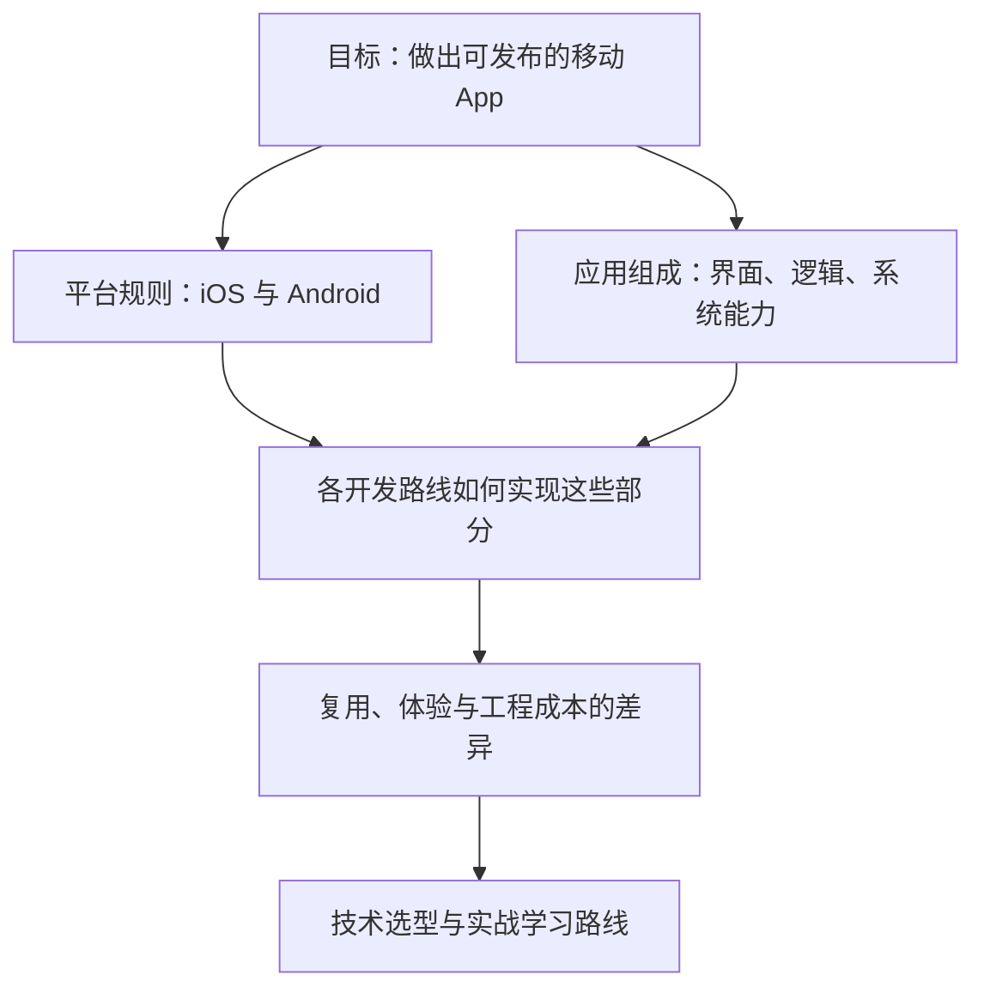

> [!quote] YOU

我现在想全面地了解移动端开发的相关技术，包括：

1. iOS和安卓。
2. 可选择的开发方式和技术栈。
3. 它们的异同。

> [!quote] YOU

我现在想全面地了解移动端开发的相关技术，包括：

1. iOS和安卓。
2. 可选择的开发方式和技术栈。
3. 它们的异同。

> [!abstract] PI

可以。我们把它整理成一张**“平台 → 开发方式 → 技术栈 → 选型取舍”**的地图，而不是只罗列 Swift、Kotlin、Flutter 等名词。

先用一道小题确认你的起点；不熟悉可以直接选“不知道”，我会据此调整讲解深度。

> [!question] Quiz
> 假设要让同一款产品同时支持 iOS 和 Android，下面哪种说法正确？
>
> 1. 跨平台框架可以复用代码，但仍需分别构建两个平台的应用。
> 2. 只要两端使用同一种编程语言，就能直接运行同一份应用。
> 3. 跨平台框架可以生成一个安装包，供两个平台直接安装。

> [!success] Quiz — correct ✓
> Your answer: 1. 跨平台框架可以复用代码，但仍需分别构建两个平台的应用。
> Correct answer: 1
>
> 复用源代码，不等于复用安装包。iOS 和 Android 的应用格式、系统接口和运行环境不同；跨平台框架帮助共享代码，但面向这两个平台发布应用时，仍需分别构建。

> [!question] Question
> 这次全面了解移动端开发，你最想达到什么目的？
>
> 1. 建立技术全景
> 2. 给自己的产品选技术栈
> 3. 规划学习与实战路线

> [!example] Answer
> 3. 规划学习与实战路线

> [!question] Quiz
> 再看一个决定学习路线的区别：React Native 和 Flutter 都能开发双端 App，关于它们如何显示界面，哪项正确？
>
> 1. 两者通常都把 HTML 和 CSS 放进内嵌浏览器，由网页引擎显示界面。
> 2. React Native 通常使用平台原生视图；Flutter 通常由自己的渲染体系绘制组件。
> 3. 两者通常都把界面代码转换成 SwiftUI 和 Jetpack Compose 组件。

> [!failure] Quiz — incorrect ✗
> Your answer: 1. 两者通常都把 HTML 和 CSS 放进内嵌浏览器，由网页引擎显示界面。
> Correct answer: 2
>
> React Native 的常规组件映射到平台原生视图；Flutter 的常规组件由 Flutter 自己的渲染体系绘制。内嵌浏览器是另一类方案，不能把所有跨平台技术都理解成“App 里套网页”。

> [!abstract] PI

这个回答帮我们找到了一个值得重点讲清的地方：**“跨平台”不是一种实现方式**，不同框架可能用完全不同的方式显示界面。这会直接影响你要学什么、哪些知识能复用，以及以后如何排查问题。

后面的学习路线会重点拆开这一层，而不只比较语言。

> [!question] Question
> 你目前有哪些实际编程经验？
>
> 可多选；也可以选 Other，补充你用过的技术和做过的项目。
>
> 1. 暂时没有编程经验
> 2. Web 前端：HTML、CSS、JavaScript / TypeScript、React 等
> 3. 后端或脚本：Python、Java、Go、Node.js 等
> 4. 原生客户端：Swift、Kotlin、Java、Objective-C 等
> 5. 其他客户端：Flutter、C# / .NET、Unity、桌面开发等

> [!example] Answer
> 2. Web 前端：HTML、CSS、JavaScript / TypeScript、React 等
> 3. 后端或脚本：Python、Java、Go、Node.js 等

> [!question] Quiz
> 结合你的 Web 经验：一个界面完全由 WebView 中的 HTML、CSS、JavaScript 实现的 App，如果要调用系统相机，哪种说法准确？
>
> 1. 只要打包成 App，网页脚本就自动拥有全部系统权限。
> 2. 必须先把整个界面改写成平台原生组件才能调用。
> 3. 可以通过宿主提供的原生插件或桥接接口调用。

> [!success] Quiz — correct ✓
> Your answer: 3. 可以通过宿主提供的原生插件或桥接接口调用。
> Correct answer: 3
>
> 界面怎么渲染，与系统能力怎么接入，是两个不同的问题。WebView 界面可以通过宿主的原生插件或桥接调用相机等能力，但仍要满足系统权限等要求；并不需要先重写整个界面。

> [!abstract] PI

你的起点已经比较清楚：**有 Web 前后端经验，理解代码复用和原生能力桥接，但还需要建立不同移动框架的实现模型。** 所以我们不从编程基础讲起，也不急着推荐某个框架。

建议按下面的顺序展开：

### 1. 先认识平台：iOS 和 Android
弄清操作系统给 App 提供什么、限制什么，再比较：
- 开发语言、工具和 UI 框架。
- 生命周期、权限、后台运行。
- 构建、真机调试、签名、安装与上架。

### 2. 再认识开发路线：到底共享哪一层
围绕三个问题比较，而不是背框架名称：
- **业务逻辑由谁执行？**
- **界面由谁显示？**
- **相机、定位、推送等系统能力如何接入？**

覆盖原生开发、React Native、Flutter、WebView 混合开发、Kotlin Multiplatform，以及移动 Web / PWA；补充小程序、游戏开发与普通 App 的边界。

### 3. 用同一个项目横向比较
以一个“登录＋列表＋拍照上传＋本地缓存”的 App 为例，比较各路线的代码复用、体验、性能、调试和维护成本。重点解释：**为什么有这些差异，而不是简单排个优劣榜。**

### 4. 最后落到你的学习路线
结合已有 Web 技能，确定主学路线、需要补的原生基础，以及从第一个页面到双端发布的实践步骤。

这个范围和顺序符合你的预期吗？
